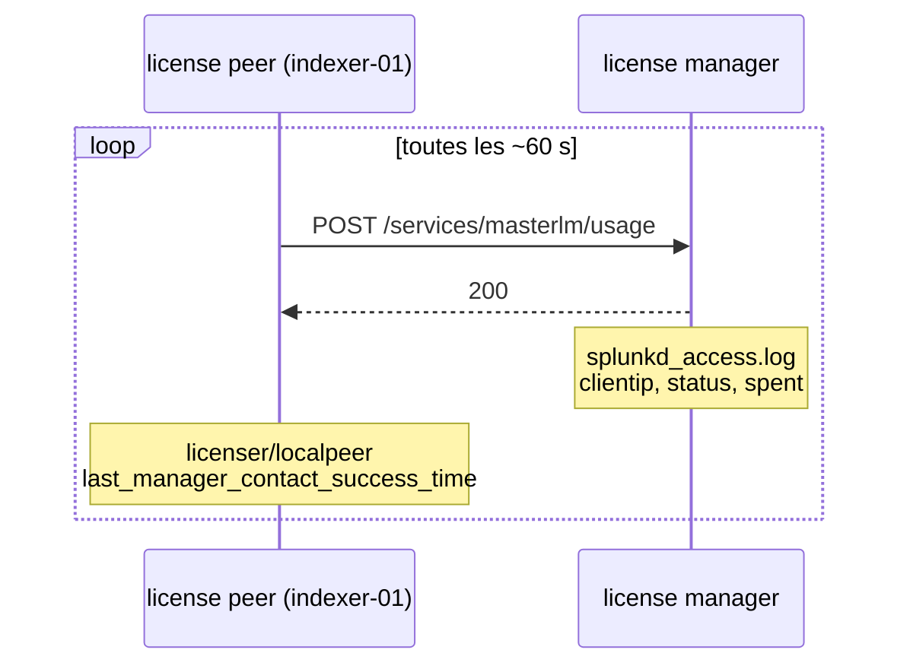

# Dernière synchro des license peers avec le License Manager

Repérer, pour chaque instance rattachée à un License Manager (LM), la date de son dernier
contact réussi, et donc le temps qui lui reste avant le seuil des 72 h.

## Pourquoi 72 h

Un license peer qui ne joint plus son LM pendant 72 h passe en violation : la recherche est
bloquée sur ce peer, l'indexation continue. Ce comportement est décrit dans l'Admin Manual de
Splunk Enterprise, au chapitre sur les violations de licence ; vérifier la formulation exacte
pour votre version.

## Le mécanisme observé

Chaque license peer poste son usage au LM environ toutes les 60 s. Le LM trace chaque requête
dans `splunkd_access.log` (indexé dans `_internal`) ; le peer garde de son côté l'horodatage
de son dernier contact réussi, exposé par REST.



Mesuré sur Splunk Enterprise 9.4.6 : intervalle de 60 à 61 s entre deux `POST`, champs
`clientip`, `method`, `uri_path`, `status`, `bytes` et `spent` extraits par défaut sur le
sourcetype `splunkd_access`. L'endpoint `/services/licenser/peers` du LM liste les peers
déclarés (GUID, `label`) mais **ne donne pas** leur dernier contact.

## Vue LM : dernière remontée reçue, par client

À lancer sur une recherche qui voit le `_internal` du LM. Période conseillée : 7 jours, pour
garder visibles les peers silencieux depuis plus de 72 h.

```spl
index=_internal host=<license-manager> sourcetype=splunkd_access
    TERM(/services/masterlm/usage) method=POST uri_path="/services/masterlm/usage" status=200
| stats latest(_time) AS derniere_synchro count AS remontees BY host clientip
| lookup dnslookup clientip OUTPUT clienthost
| eval age_h=round((now()-derniere_synchro)/3600,2), reste_h=round(72-age_h,2)
| eval etat=case(age_h>=72,"DEPASSE", age_h>=48,"CRITIQUE", age_h>=24,"ALERTE",
                 age_h>=1/6,"RETARD", true(),"OK")
| eval derniere_synchro=strftime(derniere_synchro,"%F %T %z")
| rename host AS license_manager
| table license_manager clientip clienthost derniere_synchro age_h reste_h etat remontees
| sort - age_h
```

- `TERM(/services/masterlm/usage)` filtre par l'index lexical avant l'extraction des champs :
  même résultat que le seul filtre `uri_path`, sans relire tout le journal d'accès.
- `RETARD` dès 10 min : une remontée est attendue chaque minute.
- Le LM lui-même n'apparaît pas : il est son propre peer (`manager_uri = self`) et ne passe
  pas par HTTP.

Limites :

- Le client est identifié par son **IP** ; `dnslookup` dépend d'une résolution inverse.
  Sans PTR, rapprocher l'IP du nom par les connexions de forwarding
  (`index=_internal sourcetype=splunkd group=tcpin_connections`, champs `sourceIp` et
  `hostname`) : rapprochement non mesuré ici.
- Un peer muet depuis plus longtemps que la période de recherche disparaît du tableau.
  Comparer le nombre de lignes au nombre de peers déclarés :
  `| rest splunk_server=local /services/licenser/peers | stats count` sur le LM.
- Plusieurs IP pour une même instance (NAT, interfaces multiples) donnent plusieurs lignes.

## Vue peers : dernier contact réussi, côté peer

À lancer depuis la Monitoring Console, où toutes les instances sont des search peers.

```spl
| rest splunk_server=* /services/licenser/localpeer
| eval succes='last_manager_contact_success_time', essai='last_manager_contact_attempt_time'
| eval age_h=round((now()-succes)/3600,2), reste_h=round(72-age_h,2),
       echec_en_cours=if(essai-succes>120,"oui","non")
| eval etat=case(age_h>=72,"DEPASSE", age_h>=48,"CRITIQUE", age_h>=24,"ALERTE",
                 age_h>=1/6,"RETARD", true(),"OK")
| eval derniere_synchro=strftime(succes,"%F %T %z"), dernier_essai=strftime(essai,"%F %T %z")
| table splunk_server peer_label manager_uri derniere_synchro dernier_essai
        age_h reste_h echec_en_cours etat
| sort - age_h
```

- Donne le **nom** de l'instance (`peer_label`) et l'URI du LM visé (`manager_uri`).
- `echec_en_cours` : le peer essaie encore (dernier essai récent) sans réussir. Le seuil de
  120 s absorbe le décalage normal entre les deux horodatages.
- Ne voit que les instances joignables en REST depuis la console : un peer injoignable
  n'apparaît pas. La vue LM couvre ce cas.

## En faire une alerte

Planifier la vue LM toutes les heures, sur 7 jours glissants, et déclencher si le résultat
filtré n'est pas vide :

```spl
... | where reste_h < 24
```

## Choisir

| Besoin | Vue |
|---|---|
| Tous les clients du LM, même hors Monitoring Console | Vue LM |
| Nom exact de l'instance, LM visé, échec en cours | Vue peers |
| Détection préventive | Vue LM planifiée, `reste_h < 24` |
