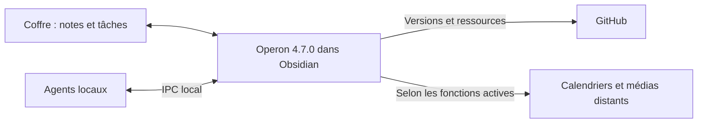

# Operon pour Obsidian : assessment de code malveillant, version 4.7.0

## Verdict et portée

**Aucun indice de code intentionnellement malveillant n’a été identifié dans les familles examinées de la release 4.7.0. L’absence de code malveillant n’est pas démontrée.** Il s’agit d’un audit statique ciblé, pas d’une certification de sécurité ni d’un test en fonctionnement.

**Décision conseillée : essai uniquement sur un coffre sauvegardé et non critique**, avec des modèles de confiance et des médias distants maîtrisés. Pas de motif établi pour classer cette release comme malveillante, mais **pas de feu vert pour un coffre sensible** sur la seule base de cette revue. Deux points demandent une attention particulière : une suppression de compensation sans vérification du contenu et un aperçu PDF distant non sandboxé, détaillés plus bas. Le niveau de confiance dans la recherche d’intention hostile reste **modéré**, compte tenu du volume du bundle, de la lecture non exhaustive et de l’absence de reconstruction indépendante.

Ce verdict porte sur les fichiers publics et leurs empreintes ci-dessous. **Aucun poste, coffre, réglage utilisateur ou exemplaire installé n’a été examiné.** Il ne vaut ni pour une installation locale non comparée, ni pour une autre version.

## Identité et version figées

- **Date de vérification : 15 novembre 2026.**
- Plugin : **Operon**, identifiant `operon`, auteur **Hasan Yılmaz**. Fonction annoncée : gestion des tâches et projets, calendriers, tableaux, Kanban et suivi du temps.[1][3]
- Dépôt public : `hasanyilmaz/operon`. Le catalogue communautaire référence ce dépôt et indique que le plugin n’a pas fait l’objet d’une revue manuelle par l’équipe Obsidian.[3]
- Version : **4.7.0**, dernière release stable renvoyée par l’API `releases/latest` lors de l’acquisition. Publication : **12 novembre 2026 à 13:33:25 UTC**. Tag : `4.7.0`.[1]
- Commit pointé par le tag au moment de l’audit : `27f9072532403d6f673e5d1bc8ee88081bfb1629`.[2]
- Manifeste livré : `minAppVersion: 1.13.7`, `isDesktopOnly: false`. Cette déclaration de compatibilité n’est pas un test Android, iOS ou desktop.[1][5]
- Licence déclarée dans le code : `GPL-3.0-or-later`.[11]

Le catalogue n’est pas un certificat de sûreté. La documentation officielle d’Obsidian indique désormais une analyse automatique de chaque version, avec des revues manuelles ciblées. Les résultats de sa fiche d’évaluation n’ont pas été vérifiés dans cet audit.[4]

## Artefacts effectivement examinés

Les trois pièces jointes de la release ont été téléchargées par HTTPS, sans authentification, sans installation et sans exécution. Les tailles et SHA-256 calculés sur disque correspondent aux valeurs publiées dans les métadonnées GitHub.[1]

- **`main.js`**, **6 840 117 octets** :
  `73d4ba44b35ce9dfeb555f0b5689caa4e6ae2988546d4215c6907c7eab0034d0`
- **`manifest.json`**, **400 octets** :
  `66a66db564a5f02bb7a9cfa6911e33d0efb0f6a7047a4d033033da82766fae75`
- **`styles.css`**, **1 127 450 octets** :
  `c817fd5eeb6a89704f4642ad2b9a3a2d982fb3cfd92192cb6c372f37bd022009`

Ces valeurs sont des **empreintes d’artefacts publics**, pas des secrets ou empreintes d’identifiants.

L’archive source du tag a également été acquise. Les **2 015 fichiers** extraits correspondent individuellement aux identifiants de blobs de l’arbre Git récupéré. Le manifeste et la feuille de style du tag sont identiques, octet pour octet, aux fichiers de la release. Ces mesures établissent une cohérence de provenance, **pas la bienveillance du mainteneur**.[2][5]

**La correspondance complète entre les sources et `main.js` n’a pas été prouvée par reconstruction.** Les contrôles de taille et d’empreinte valident l’acquisition de l’artefact publié, pas sa reproductibilité. Le workflow source prévoit des attestations de build ; leurs signatures n’ont pas été vérifiées ici.[12]

## Méthode réellement appliquée

1. Acquisition de la release, du tag, de l’arbre Git, du catalogue et de l’archive source.
2. Inventaire et empreintes, puis triage automatique sur **1 598 fichiers** : les trois artefacts livrés et **1 595 fichiers source JS/TS/JSON/CSS/YAML**, y compris des scripts et fixtures de tests. Les occurrences dans ces fixtures ne sont pas assimilées à du comportement de production.
3. Mise en forme du bundle minifié avec **Prettier 3.10.0 déjà installé**, sans configuration du dépôt. L’original reste inchangé. Le résultat compte **330 740 lignes** ; ce nombre ne signifie pas qu’elles ont toutes été lues.
4. Analyse syntaxique de l’intégralité de `main.js`, puis lecture dirigée des chemins sensibles dans le bundle et les sources : réseau, chargement de modules, fichiers, données du coffre, encodage, persistance et démarrage.
5. Recherche de littéraux encodés et décodage statique de candidats base64, sans évaluation du résultat ; examen de la feuille de style pour les chargements externes.
6. Deux contre-lectures par agents distincts, sur les axes réseau/exécution et données/intégrité, avec références au code. Chacun a criblé le même périmètre principal de **844 fichiers TypeScript** : il ne s’agit pas de 1 688 fichiers uniques, ni de deux certifications externes. Les constats sensibles retenus ont ensuite été relus dans les sources et, pour les aperçus PDF et le retour arrière, confirmés dans le bundle livré.

**Aucun `npm install`, `npm ci`, build, test du dépôt, chargement du plugin dans Obsidian ou appel à une fonction d’Operon n’a été exécuté.** Les outils d’audit lisent le code tiers comme des données. Aucun échantillon du coffre n’a été envoyé à un scanner public.

La lecture est **ciblée et non exhaustive**. Un motif détecté déclenche une investigation ; son absence ne prouve pas que toutes les variantes ou indirections possibles sont absentes.

## Résultats techniques

### Exécution et code dynamique

Dans le bundle livré, l’analyse n’a retrouvé aucun appel direct à `eval` ou `Function`, ni référence à `child_process`, `fetch`, `XMLHttpRequest` ou `WebSocket`. Les **246 appels directs à `require()`** ont des arguments littéraux : `obsidian` et les modules CodeMirror fournis par l’hôte.

Ce comptage ne suffit pas : le bundle accède aussi à **`window.require` par alias** pour charger les modules Node nécessaires au transport local, notamment `node:fs`, `node:crypto`, `node:process` et `node:net`. Ces chemins ont été examinés séparément. Ils ne sont pas traités comme des téléchargements ou une exécution de JavaScript distant.[6][10]

Les usages de `atob` et `String.fromCharCode` examinés correspondent à l’encodage des curseurs de pagination du runtime et au décodage de données calendaires. Aucun domaine de collecte caché n’a été identifié par le triage appliqué. Cela ne constitue pas une preuve d’absence de toute obfuscation possible.

**Délégation à Templater :** Operon appelle réellement le moteur du plugin `templater-obsidian` pour certains modèles choisis. L’absence d’`eval` dans son propre bundle ne signifie donc pas absence de traitement de modèles exécutables. Utiliser uniquement des modèles de confiance ; aucun modèle utilisateur n’a été inspecté ou exécuté. Référence : `main.ts:29794-29845`.[6]

### Réseau : des accès existent, ils ne sont pas tous désactivés par défaut

Le schéma résume les capacités identifiées dans le code. Il ne représente pas une capture réseau et n’établit pas une exfiltration.[5]

Le bundle contient **cinq sites d’appel à `requestUrl`**. Le rapprochement avec les sources les rattache aux fonctions suivantes :

- **Vérification des mises à jour** : lecture du manifeste de release sur GitHub, puis éventuellement de `versions.json` sur `raw.githubusercontent.com`. **`checkForUpdatesOnStartup` vaut `true` par défaut.** Le chemin examiné affiche une notification et renvoie vers le gestionnaire de plugins ; il ne réécrit pas lui-même `main.js`. Références : `main.ts:2532-2572`, `src/systems/release-check.ts:151-170` et `src/types/settings.ts:2372`.[6][7][8]
- **Documentation** : téléchargement de fichiers Markdown depuis le dépôt, puis écriture de documentation gérée dans le coffre. Les URL visent la branche mouvante `main`, pas uniquement le tag audité. **`operonDocsAutoUpdateEnabled` vaut `false` par défaut.** Références : `src/systems/operon-docs-sync.ts:4-8,175-267` et `main.ts:3958-3972`.[7][9]
- **Langues** : téléchargement de packs JSON, avec vérifications de taille, SHA-256 et structure avant stockage et lecture. Le catalogue embarqué pointe sur des fichiers du tag `4.7.0`. Références : `src/core/locale-pack-manager.ts:228-278,398-404` et `src/generated/locale-pack-catalog.json`.[5]
- **Sons de rappel** : téléchargement de fichiers audio avec contrôles de taille et d’empreinte ; les URL du catalogue visent `main`. Références : `src/core/reminder-sound-pack-manager.ts` et `src/generated/reminder-sound-pack-catalog.json`.[5]
- **Calendriers externes** : lecture des URL configurées pour les flux ICS. Les en-têtes conditionnels servent au cache ; aucun téléversement du contenu du coffre n’a été identifié dans ce chemin. Référence : `src/systems/external-calendar-ics.ts:36-75`.[5]

Les requêtes de ressources intégrées ne se limitent pas à `requestUrl` : le code construit des URL de **miniatures YouTube**, d’**iframes `youtube-nocookie.com`** et de **fond de carte OpenFreeMap**. La cartographie dépend de l’intégration Maps/Bases ; la présence de ces URL n’établit pas une requête systématique au démarrage. Des médias distants renseignés dans les tâches peuvent également provoquer des accès réseau. Références : `src/core/youtube-url.ts:47-58` et `src/core/location-base-map.ts`.[5]

**Confidentialité des médias :** une URL contenue dans une tâche peut devenir un attribut `src` d’image ou d’aperçu au simple affichage ou survol. Une note non fiable peut ainsi contenir une balise de suivi. Le `no-referrer` utilisé sur plusieurs images n’empêche ni la connexion ni la transmission d’un jeton déjà inclus dans l’URL. Aucun envoi automatique des autres notes par ce chemin n’est démontré. Références : `src/ui/kanban/kanban-view.ts:2946-2978` et `src/ui/compact-chip-link-preview.ts:132-173,234-306`.[5]

**Conclusion réseau :** les sorties identifiées ont une justification fonctionnelle. Aucun chemin de collecte clandestine du coffre vers un serveur de l’auteur n’a été établi dans les chemins examinés. En revanche, une utilisation « zéro réseau » n’est pas acquise : les accès effectifs, les redirections et les médias tiers n’ont pas été mesurés en fonctionnement.

### Transport local pour les agents

Le code démarre, sur les plateformes desktop prises en charge, un transport persistant local après le chargement du plugin. L’option de compilation de production correspondante est activée. Il utilise un **socket Unix** ou un **tube nommé Windows**, pas un port TCP dans le chemin examiné. Références : `operon-build-config.mjs:8` et `main.ts:15776-15814`.[5][6][10]

Le serveur comporte un secret de session aléatoire, des contrôles d’authentification et de rejeu ainsi que des vérifications de propriétaire et de permissions pour les fichiers et sockets Unix. Ces protections ont été lues, **pas éprouvées sur un système réel**. Le nom du canal Windows ne suffit pas, à lui seul, à prouver sa politique d’accès ; les garanties Windows restent non validées par cet audit.[10]

Le serveur persistant examiné est orienté lecture, mais **l’ensemble de l’API Agent Runtime n’est pas en lecture seule** : les handlers du CLI natif déclarent aussi des mutations. Le protocole complet d’autorisation de ces mutations n’a pas été audité. Références : `src/agent-runtime/transport/native-cli.ts:80-103` et `src/agent-runtime/transport/persistent-read-server.ts:31-44`.[5][10]

Ce mécanisme est cohérent avec la fonction publique de runtime pour agents, mais représente une **surface d’accès supplémentaire** à prendre en compte. Un processus malveillant déjà exécuté sous la même identité utilisateur n’est pas une frontière de confiance résolue par cet audit.

### Coffre, fichiers et persistance

Operon indexe et modifie des notes et tâches, conserve des réglages et caches et enregistre des événements. Ces capacités sont attendues pour un gestionnaire de tâches ; elles peuvent néanmoins modifier un grand nombre de fichiers. La présente revue n’est pas une garantie d’absence de perte de données.[5][6]

Aucun mécanisme d’exfiltration de secrets d’autres plugins, de lancement de commande système ou de réécriture clandestine du bundle n’a été établi dans les chemins examinés. L’accès aux données d’autres plugins pour une intégration déclarée ne doit pas être confondu avec du vol de secrets.

Les temporisateurs et écouteurs observés servent notamment aux rappels, au suivi du temps, à l’indexation et à l’interface. **Aucun `@import` ou `url(...)` n’a été détecté dans le CSS livré**, lors du contrôle textuel appliqué.

Obsidian précise que ses plugins héritent des accès de l’application et ne peuvent pas être restreints de manière fiable par un système de permissions propre à chaque plugin. Il ne faut donc pas interpréter les constats ci-dessus comme une isolation du coffre ou du système de fichiers.[4]

### Dépendances et chaîne de livraison

`package.json` déclare CodeMirror et `ical.js`. Le lockfile examiné fixe notamment `ical.js` à **2.2.1**, `@codemirror/state` à **6.5.0**, `@codemirror/view` à **6.38.6** et `@codemirror/language` à **6.12.3**.[5][11]

Un script **`postinstall` existe** : `scripts/fix-ical-declaration.mjs`. Sa lecture montre une correction locale d’une déclaration TypeScript d’`ical.js`, et non un téléchargement de charge utile. Cela confirme néanmoins pourquoi il ne faut pas lancer une installation de dépendances simplement pour « lire le code ». Aucun script d’installation n’a été exécuté.[5][11]

Le workflow de release déclare des contrôles préalables, une compilation et des attestations. Leur présence dans le YAML n’est pas la preuve de leur exécution correcte sur cette release. **Aucun bilan exhaustif de vulnérabilités ou de compromission des dépendances n’a été réalisé.**[12]

## Constats de sécurité distincts de la malveillance

### D1. Retour arrière : suppression sans revalidation du fichier

**Fait statique confirmé dans le bundle :** `rollbackCreatedFileTask()` vérifie l’existence d’un chemin puis appelle directement `adapter.remove()`, sans comparaison de contenu ou d’identité de l’objet créé, et sans appel à la corbeille dans ce code. Cette compensation est appelée si le remplacement de la source par un lien échoue après la création du fichier. Références : `main.ts:30328-30338,30550-30589`.[6]

**Chemin d’accès identifié :** le parcours de création depuis une sélection fournit `sourceReplacement` sans l’option `prepared` qui utiliserait une autre implémentation (`main.ts:32705-32712`). **Scénario déduit, non reproduit :** si le fichier nouvellement créé est modifié ou remplacé concurremment et que le remplacement du lien échoue, la compensation peut supprimer ces données sans vérifier qu’elles lui appartiennent encore. La fréquence et la gravité en pratique n’ont pas été mesurées. Ce n’est pas une suppression arbitraire hors coffre ni une intention de sabotage établie.[6]

**Mesure proposée :** comparer le contenu et l’identité juste avant compensation, préserver le fichier s’il a changé et préférer une mise à la corbeille. Aucun correctif du plugin n’a été appliqué.

### N1. Aperçu PDF distant : contenu actif possible dans une iframe

**Fait statique confirmé dans le bundle :** une URL HTTP(S) est classée PDF d’après son extension, puis chargée dans une iframe sans attribut `sandbox` ajouté par Operon. Le chemin examiné n’impose pas un type de réponse PDF. Références : `src/core/task-media-preview-kind.ts:31-47` et `src/ui/task-media-lightbox.ts:67-79`.[13][14]

**Scénario déduit, non reproduit :** un tiers contrôlant l’URL d’un média affiché peut servir une page active derrière un chemin se terminant en `.pdf`. Le chargement dépend encore des politiques de l’hôte et des en-têtes de réponse. **Aucune lecture du coffre, exécution Node, XSS dans le contexte du plugin ou évasion Chromium n’est démontrée.**[13][14]

**Mesure proposée :** limiter les aperçus aux médias de confiance et durcir le lecteur PDF ou son isolation. Ne pas survoler des médias non fiables en supposant qu’un aperçu ne fait aucune connexion.

### C1. Exports : les URL privées de calendriers sont incluses

Le code d’export des réglages déclare explicitement `externalCalendarUrls: 'included'`. Une URL ICS contenant un jeton peut donc se retrouver dans un export pourtant qualifié de portable. Il s’agit d’un risque de divulgation lors du partage de ce fichier, pas d’un téléversement clandestin identifié. Référence : `src/core/settings-backup-export.ts:109-128`.[15]

## Réserves et conditions d’utilisation

Les constats ci-dessus et les réserves suivantes **ne constituent pas des accusations de malveillance** :

1. Sauvegarder et pouvoir restaurer le coffre avant tout usage : le plugin a une large capacité de modification.
2. Désactiver la vérification des mises à jour si les connexions automatiques ne sont pas souhaitées. Conserver la documentation automatique désactivée lorsque sa mise à jour n’est pas nécessaire.[7]
3. Activer les calendriers, médias distants, langues et sons en connaissance des destinations et de la confidentialité des URL. Ne pas partager un export de réglages sans vérifier ses URL de calendrier ; ne pas confier de modèle non fiable à l’intégration Templater.[6][15]
4. Qualifier le transport local d’agents si cette surface ne fait pas partie de l’usage attendu. **Aucun réglage de désactivation de ce transport n’est affirmé ici sans vérification.**
5. Comparer les trois fichiers réellement installés aux empreintes ci-dessus. Cette opération n’a pas été effectuée sur une installation utilisateur.
6. Réévaluer une nouvelle version et tout changement d’empreinte. Les contenus servis depuis `main` peuvent changer sans modification de la version du plugin. Pour les sons, le SHA-256 attendu reste épinglé dans le catalogue embarqué et un changement d’octets doit être refusé ; pour les docs, le manifeste et les fichiers proviennent tous du même upstream mutable. Ne pas assimiler leurs garanties.[5][9]
7. Pour un coffre sensible, compléter par un essai dans un environnement jetable avec données leurres, observation du réseau et des écritures. **Cet essai n’a pas été réalisé.**

## Ce que ce rapport ne permet pas d’affirmer

- Que « le plugin est sûr » ou qu’il est dépourvu de toute charge utile conditionnelle.
- Que toutes les lignes et dépendances ont fait l’objet d’une lecture manuelle.
- Que l’exemplaire installé correspond à la release ou que le build est reproductible.
- Que les garanties Windows, mobile, réseau ou de restauration ont été testées.
- Que les fonctions légitimes ne contiennent aucune vulnérabilité exploitable.
- Que les futures versions ou ressources distantes seront identiques à celles examinées.

## Réexamen

Conserver cette page comme **point de référence pour la version et les empreintes indiquées**, et non comme une approbation permanente du nom Operon. Pour un nouvel examen, commencer par l’identité des artefacts, puis analyser le différentiel et les changements de destinations, de chargement de code et de transport local.

Méthode complémentaire : [Revue de code tiers à la recherche d’intention hostile](../skills/revue-code-malveillant.md). Cette référence est méthodologique ; la présente revue a maintenu le principe de **non-exécution**, y compris pour la reconstruction du bundle.

## Sources

[1] https://api.github.com/repos/hasanyilmaz/operon/releases/442991722
[2] https://api.github.com/repos/hasanyilmaz/operon/git/ref/tags/4.7.0
[3] https://raw.githubusercontent.com/obsidianmd/obsidian-releases/master/community-plugins.json
[4] https://raw.githubusercontent.com/obsidianmd/obsidian-help/master/en/Extending%20Obsidian/Plugin%20security.md
[5] https://codeload.github.com/hasanyilmaz/operon/tar.gz/refs/tags/4.7.0
[6] https://github.com/hasanyilmaz/operon/blob/27f9072532403d6f673e5d1bc8ee88081bfb1629/main.ts
[7] https://github.com/hasanyilmaz/operon/blob/27f9072532403d6f673e5d1bc8ee88081bfb1629/src/types/settings.ts
[8] https://github.com/hasanyilmaz/operon/blob/27f9072532403d6f673e5d1bc8ee88081bfb1629/src/systems/release-check.ts
[9] https://github.com/hasanyilmaz/operon/blob/27f9072532403d6f673e5d1bc8ee88081bfb1629/src/systems/operon-docs-sync.ts
[10] https://github.com/hasanyilmaz/operon/blob/27f9072532403d6f673e5d1bc8ee88081bfb1629/src/agent-runtime/transport/persistent-read-server.ts
[11] https://github.com/hasanyilmaz/operon/blob/27f9072532403d6f673e5d1bc8ee88081bfb1629/package.json
[12] https://github.com/hasanyilmaz/operon/blob/27f9072532403d6f673e5d1bc8ee88081bfb1629/.github/workflows/release.yml
[13] https://github.com/hasanyilmaz/operon/blob/27f9072532403d6f673e5d1bc8ee88081bfb1629/src/ui/task-media-lightbox.ts
[14] https://github.com/hasanyilmaz/operon/blob/27f9072532403d6f673e5d1bc8ee88081bfb1629/src/core/task-media-preview-kind.ts
[15] https://github.com/hasanyilmaz/operon/blob/27f9072532403d6f673e5d1bc8ee88081bfb1629/src/core/settings-backup-export.ts
