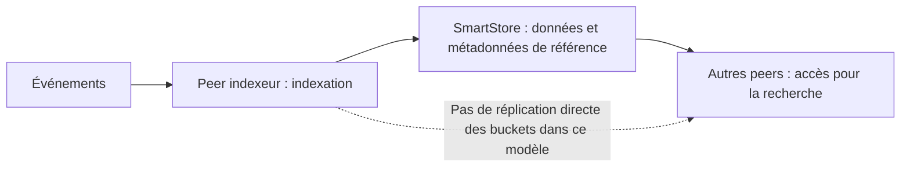

# Splunk Enterprise 9.4.6 vers 10.4 : évolutions techniques

> Synthèse documentaire au 9 novembre 2026 pour Splunk Enterprise on-premise. Pas de validation en laboratoire ni de matrice de compatibilité des apps. Les fonctionnalités décrites ne sont pas nécessairement activées par la seule mise à niveau.

## 10.0 : droits sur les recherches enregistrées

Les nouveaux droits fins portent sur les **recherches enregistrées**, pas indistinctement sur tous les objets de connaissance. La [spécification authorize.conf 10.0](https://help.splunk.com/en/splunk-enterprise/administer/admin-manual/10.0/configuration-file-reference/10.0.0-configuration-file-reference/authorize.conf) définit :

- `edit_saved_search` : modifier requête, description et bornes temporelles sans droit d'écriture explicite sur l'objet ;
- `edit_saved_search_owner` : changer son propriétaire, avec `list_all_users` en supplément dans Splunk Web ;
- `list_saved_searches` : découvrir toutes les recherches enregistrées, indépendamment de leurs ACL.

Pour agir sur **toute** recherche malgré son ACL, combiner `list_saved_searches` avec la capacité d'édition voulue. Il s'agit de déléguer une tâche d'administration sans `admin_all_objects`, **pas** d'un droit anodin : les recherches privées deviennent visibles. Le propriétaire reste déterminant pour la suppression. Source : [notes 10.0](https://help.splunk.com/en/splunk-enterprise/release-notes-and-updates/release-notes/10.0/whats-new/welcome-to-splunk-enterprise-10.0), [authorize.conf 10.0](https://help.splunk.com/en/splunk-enterprise/administer/admin-manual/10.0/configuration-file-reference/10.0.0-configuration-file-reference/authorize.conf).

## 10.0 puis 10.4 : Bulk Data Move

Cette fonction **déplace définitivement des événements entre index** en retravaillant les buckets ; elle ne déplace pas un cluster. Le filtre est limité à `host`, `source` et `sourcetype`, pas une recherche SPL arbitraire.

- **Instance autonome dès 10.0** : `splunk split-buckets`, `splunkd` arrêté et `bucketMerging = true` dans la section globale de `indexes.conf`. Options de préparation : `--dryrun`, `--backup-to`, `--json-out`. Pas d'index de métriques, ni de bucket déjà scindé ou fusionné.
- **Cluster d'indexeurs** : pilotage depuis le cluster manager, par CLI ou REST. Avec SmartStore, prise en charge annoncée en **10.4** : rapatriement temporaire des buckets, création et vérification des nouveaux buckets dans le stockage distant. Pas de déplacement entre clusters ou entre modes de stockage différents ; buckets chauds exclus. La documentation avertit que les résultats de recherche peuvent être inexacts pendant l'opération.

Exemple de **simulation** à adapter, non une commande à exécuter sur une production :

```bash
splunk split-buckets --source-index-name=source_idx --dest-index-name=dest_idx --search-filter="sourcetype=example_type" --dryrun
```

Source : [gestion des index, 10.4](https://help.splunk.com/en/splunk-enterprise/administer/manage-indexers-and-indexer-clusters/10.4/manage-indexes/remove-indexes-and-indexed-data), [notes 10.0](https://help.splunk.com/en/splunk-enterprise/release-notes-and-updates/release-notes/10.0/whats-new/welcome-to-splunk-enterprise-10.0). Prévoir la fenêtre d'indisponibilité ou de dégradation et une vérification des données source/destination.

## 10.0 : Dashboard Studio

- Jusqu'à **10 recherches chaînées** par recherche de base, contre 2 ; modifier une recherche chaînée ne relance plus la base.
- Export CSV des données de toute visualisation, définition JSON lisible sur plusieurs lignes, disposition `Auto`.
- Champs de saisie directement sur le canevas, visibilité conditionnelle des panneaux en disposition absolue, cartes choroplèthes et vue d'événements.
- La liste des **domaines de confiance** est appliquée : les contenus externes hors liste sont bloqués. Vérifier les tableaux de bord qui incorporent des ressources externes après mise à niveau.

Source : [notes 10.0, Dashboard Studio et domaines de confiance](https://help.splunk.com/en/splunk-enterprise/release-notes-and-updates/release-notes/10.0/whats-new/welcome-to-splunk-enterprise-10.0).

## 10.0 : anciens endpoints de Search API

Les endpoints **v1 dépréciés** de Search API sont désactivés par défaut ; la voie cible est **Search API v2**. Les endpoints originels v1 peuvent être adressés sans numéro ou avec `v1` dans l'URI ; un endpoint v2 exige `v2` dans l'URI. Une réactivation transitoire existe, sans remplacer la migration. Exemple d'impact : un client qui crée un job, lit ses résultats ou exporte des données au moyen d'un endpoint v1 peut échouer après l'upgrade alors que la même recherche fonctionne dans Splunk Web. **On ne doit pas remplacer mécaniquement un préfixe** : la référence ne permet pas ici d'établir un tableau fiable d'équivalences URI v1/v2 et méthodes. Inventorier les appels HTTP réels des scripts et SDK, notamment `results_preview`, `events`, `results`, `jobs/export` et `parser`, puis les confronter à la [référence des endpoints Search 10.4](https://help.splunk.com/en/splunk-enterprise/leverage-rest-apis/rest-api-reference/10.4/search-endpoints/search-endpoint-descriptions). Source : [notes 10.0, Search API](https://help.splunk.com/en/splunk-enterprise/release-notes-and-updates/release-notes/10.0/whats-new/welcome-to-splunk-enterprise-10.0), [référence Search 10.4](https://help.splunk.com/en/splunk-enterprise/leverage-rest-apis/rest-api-reference/10.4/search-endpoints/search-endpoint-descriptions).

## 10.2 : SPL2 dans Dashboard Studio

Deux usages documentés : **créer une requête SPL2 dans le dashboard**, ou **référencer une vue existante d'un module SPL2**. Le second permet la réutilisation d'une définition au lieu de recopier la requête dans chaque panneau. Activation, compatibilité précise des visualisations et comportement d'un dashboard SPL existant restent à vérifier sur la version cible. Source : [notes 10.2](https://help.splunk.com/en/splunk-enterprise/release-notes-and-updates/release-notes/10.2/whats-new/welcome-to-splunk-enterprise-10.2).

## 10.2 : quotas des recherches ad hoc en file d'attente

Il s'agit de la **file d'attente**, pas des recherches déjà en cours. Une nouvelle recherche qui devrait entrer dans une file saturée est **rejetée**.

- Par utilisateur détenteur du rôle : `queuedSearchQuota` dans `authorize.conf`, défaut **0 = pas de limite**.
- Par search head : `hostwide_queued_search_limit` dans `limits.conf [search]`, défaut **0 = pas de limite**.

Dimensionner en observant files et rejets : un quota trop faible casse les usages, un quota trop haut conserve la pression mémoire. Source : [authorize.conf 10.2](https://help.splunk.com/en/splunk-enterprise/administer/admin-manual/10.2/configuration-file-reference/10.2.0-configuration-file-reference/authorize.conf), [notes 10.2](https://help.splunk.com/en/splunk-enterprise/release-notes-and-updates/release-notes/10.2/whats-new/welcome-to-splunk-enterprise-10.2).

## 10.2 : Audit Trail Log v2

Format structuré **JSON** aligné sur le CIM, avec notamment `roles`, `session_id` et `correlation_id`. Activation documentée dans l'app **Audit Trail**, onglet **Setup**, option **Enable Audit Trail Log v2**. Les événements v2 se retrouvent ainsi :

```spl
index=_audit sourcetype=audittrailv2
```

L'ancien sourcetype est `audittrail`. Les deux formats peuvent coexister : revoir les recherches, alertes et extractions qui filtrent exclusivement l'ancien sourcetype ou analysent son texte. L'équivalent en fichier de configuration n'a pas été vérifié. Source : [notes 10.2](https://help.splunk.com/en/splunk-enterprise/release-notes-and-updates/release-notes/10.2/whats-new/welcome-to-splunk-enterprise-10.2).

## 10.2 puis 10.4 : KV Store sur MongoDB 8.0

KV Store 8.0 devient disponible en 10.2 ; les notes 10.4 annoncent la mise à niveau du backend vers **MongoDB 8.0**. Les [notes 10.4](https://help.splunk.com/en/splunk-enterprise/release-notes-and-updates/release-notes/10.4/whats-new/welcome-to-splunk-enterprise-10.4) demandent aux instances 9.x de passer d'abord par **10.0 ou 10.2**, en invoquant l'impossibilité de passer directement de MongoDB 4.x/6.x à 8. Mais la [page des prérequis 10.4](https://help.splunk.com/en/splunk-enterprise/get-started/install-and-upgrade/10.4/upgrade-or-migrate-splunk-enterprise/about-upgrading-to-10.4-read-this-first) exige seulement un moteur MongoDB **7 ou supérieur** avant l'upgrade ; une instance 9.4.6 peut déjà être en 7.0. **Ne pas inférer une route directe prise en charge** de ce seul prérequis : relever la version effective du KV Store, puis consulter le tableau officiel des chemins de mise à niveau de la version cible. Vérifier également la santé des collections sur tous les membres, la compatibilité CPU/OS et une sauvegarde utilisable. Les prérequis documentés incluent **AVX activé**, `glibc` au moins **2.27** sous Linux et **plus de 50 % d'espace libre**. Tester les apps qui utilisent KV Store et les SHC ; redescendre le binaire Splunk ne suffit pas à restaurer le magasin. Sources : [notes 10.2](https://help.splunk.com/en/splunk-enterprise/release-notes-and-updates/release-notes/10.2/whats-new/welcome-to-splunk-enterprise-10.2), [prérequis 10.4](https://help.splunk.com/en/splunk-enterprise/get-started/install-and-upgrade/10.4/upgrade-or-migrate-splunk-enterprise/about-upgrading-to-10.4-read-this-first), [upgrade KV Store 10.4](https://help.splunk.com/en/splunk-enterprise/administer/admin-manual/10.4/administer-the-app-key-value-store/upgrade-the-kv-store-server-version).

## 10.4 : validation de configuration

Les notes annoncent la vérification de modifications de fichiers `.conf` avant leur arrivée en production : schémas Splunk, compatibilité de version et contraintes de déploiement. **Ne pas confondre** cette annonce Enterprise avec l'API `POST /services/properties/<config_file>?validate=true` documentée pour **Splunk Cloud** comme alternative à la CLI `btool` : l'identité des deux fonctions n'a pas été établie. Une validation statique ne démontre pas qu'un réglage est déjà effectif au runtime. Source : [notes 10.4](https://help.splunk.com/en/splunk-enterprise/release-notes-and-updates/release-notes/10.4/whats-new/welcome-to-splunk-enterprise-10.4), [btool REST pour Cloud](https://help.splunk.com/en/data-management/splunk-cloud-platform-admin-manual/10.4.2604/configure-your-splunk-cloud-platform-deployment/validating-configurations-using-the-btool-rest-api).

## 10.4 : API de topologie

API REST annoncée pour accéder à la topologie du déploiement et aux informations d'introspection, via le **Splunk Topology sidecar**. Les cas cités incluent installations d'apps et mises à niveau. Les chemins d'endpoint, le schéma des réponses et les capacités RBAC n'ont pas été vérifiés : ne pas concevoir un client sur la seule annonce. Source : [notes 10.4](https://help.splunk.com/en/splunk-enterprise/release-notes-and-updates/release-notes/10.4/whats-new/welcome-to-splunk-enterprise-10.4).

## 10.4 : visualisations personnalisées Dashboard Studio

Un **nouveau cadre de développement** de visualisations personnalisées est annoncé, distinct de la simple configuration des graphiques intégrés. Il fournit une API d'extension, un contexte React et des hooks. Le CLI `@splunk/create --mode=dashboard-studio-extension` génère le projet puis l'empaquette en app `.spl`. Il propose les modèles JavaScript, TypeScript, React + JavaScript et React + TypeScript. Ce cadre accepte un framework JavaScript, mais ne sert pas à créer des visualisations Simple XML. Vérifier l'API de rendu, la compatibilité et les exigences de déploiement avant de porter une app. Source : [notes 10.4](https://help.splunk.com/en/splunk-enterprise/release-notes-and-updates/release-notes/10.4/whats-new/welcome-to-splunk-enterprise-10.4), [vue d'ensemble](https://help.splunk.com/en/splunk-enterprise/developing-views-and-apps-for-splunk-web/10.4/custom-visualizations-for-dashboard-studio), [CLI d'extension](https://help.splunk.com/en/splunk-enterprise/developing-views-and-apps-for-splunk-web/10.4/custom-visualizations-for-dashboard-studio/create-custom-visualizations-for-dashboard-studio-with-the-splunk-dashboard-extension-cli), [API](https://help.splunk.com/en/splunk-enterprise/developing-views-and-apps-for-splunk-web/10.4/custom-visualizations-for-dashboard-studio/dashboard-extension-api-reference).

## 10.4 : recherche fédérée

Les changements dépendent du **mode transparent ou standard**.

- **Transparent, ciblage par index** : ne solliciter que les fournisseurs associés aux index. Les notes nomment `allowIndexBasedProviderFiltering` sur `data/federated/settings/general` et `fedSrchIndexesAllowed` sur `data/federated/provider/{federated_provider_name}`.
- **Transparent, routage par fournisseur** : fournisseur explicitement ciblé dans la recherche ou liste par défaut ; restriction par rôle dans l'onglet **Providers**. Paramètres de rôle `srchFederatedProvidersAllowed` et `srchFederatedProvidersDefault` sur `authorization/roles/{name}`. Tester les recherches sans cible explicite lors du changement de politique.
- **Standard** : `useAppContextFromSearch` reprend le contexte d'app de la recherche locale.
- **Transparent et SHC** : la propagation des bundles vers un membre distant sans contact direct obligatoire avec son captain facilite les topologies IPv6.

Source : [notes 10.4, Federated Search for Splunk](https://help.splunk.com/en/splunk-enterprise/release-notes-and-updates/release-notes/10.4/whats-new/welcome-to-splunk-enterprise-10.4). Ces noms sont documentaires, pas validés par un test dans cette fiche.

## 10.4 : séparer indexation et réplication sur SmartStore

Une **nouvelle architecture** de cluster d'indexeurs prend SmartStore pour référence des **données et métadonnées**, plutôt que répliquer chaque bucket directement entre peers. Cela découple le rôle d'indexation des copies nécessaires à la recherche. **Ce n'est pas une transformation automatique à supposer sur tout cluster mis à niveau.** Cette architecture est à activer et valider séparément. Les prérequis documentés incluent SmartStore sur chaque index ciblé et un Ingest-Tier Scaling déjà activé et stable. Ses contraintes s'ajoutent à celles de SmartStore : ce dernier convient surtout aux volumes importants et aux recherches sur données récentes, moins aux petits déploiements ou aux recherches fréquentes sur de longues périodes. Source complémentaire : [bonnes pratiques et limites](https://help.splunk.com/en/splunk-enterprise/administer/manage-indexers-and-indexer-clusters/10.4/indexing-replication-separation/best-practices-and-limitations-for-indexing-and-replication-separation), [SmartStore](https://help.splunk.com/en/data-management/manage-splunk-enterprise-indexers/10.4/implement-smartstore-to-reduce-local-storage-requirements/about-smartstore).



Schéma conceptuel, sans prétendre supprimer le cache local ou tous les échanges entre peers. Source : [notes 10.4, Indexing/Replication Separation](https://help.splunk.com/en/splunk-enterprise/release-notes-and-updates/release-notes/10.4/whats-new/welcome-to-splunk-enterprise-10.4).

## Priorités pour la migration

1. Auditer les rôles, les recherches privées et les appels Search API des clients.
2. Vérifier les dashboards avec contenu externe, recherches chaînées ou composants personnalisés.
3. Valider CPU, OS, stockage, sauvegarde et apps consommatrices de KV Store.
4. Traiter Bulk Data Move et l'architecture SmartStore comme **projets distincts** de l'upgrade binaire.

Sources générales : [10.0](https://help.splunk.com/en/splunk-enterprise/release-notes-and-updates/release-notes/10.0/whats-new/welcome-to-splunk-enterprise-10.0), [10.2](https://help.splunk.com/en/splunk-enterprise/release-notes-and-updates/release-notes/10.2/whats-new/welcome-to-splunk-enterprise-10.2), [10.4](https://help.splunk.com/en/splunk-enterprise/release-notes-and-updates/release-notes/10.4/whats-new/welcome-to-splunk-enterprise-10.4).
