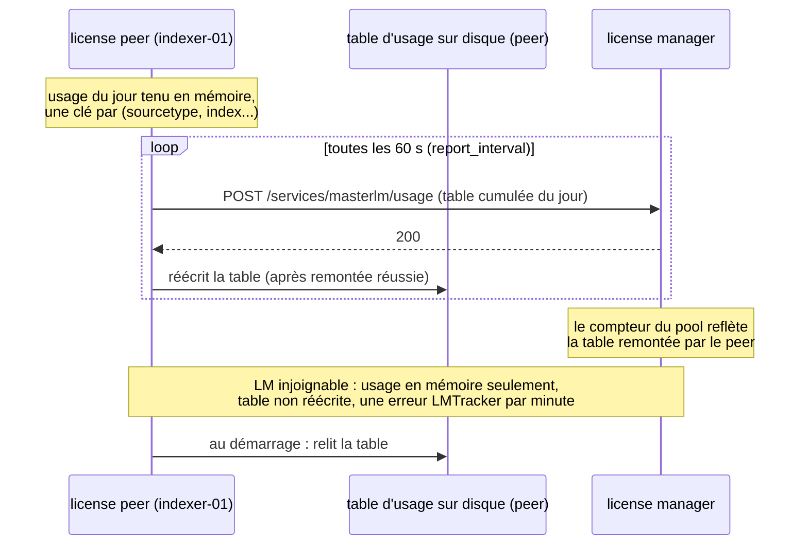

# Réintégrer un license peer sans pic de charge sur le License Manager

Quand un license peer (typiquement un indexeur) reste coupé de son License Manager (LM),
il continue d'indexer et accumule son usage en attente. À la reconnexion, il remonte cet
usage d'un coup. Avec une forte cardinalité de sourcetypes, cette remontée coûte cher au LM :
plusieurs peers qui reviennent ensemble peuvent le saturer jusqu'à l'OOM.

Cette fiche mesure ce qui se passe réellement, et ce qui permet de réintégrer un peer
**sans que le LM traite l'usage accumulé**.

> Mesures sur **Splunk Enterprise 9.4.6**, lab d'un LM (2 vCPU, 4 Go) et d'un indexeur
> (2 vCPU, 8 Go), licence Developer de 10 Gio par jour, novembre 2026. Un seul peer : la
> charge cumulée de plusieurs peers n'est pas reproduite.

Voir aussi : [dernière synchro des license peers avec le LM](../cheat-sheets/splunk-license-peers-derniere-synchro.md).

---

## 1. Le mécanisme observé



- **Le coût suit la cardinalité, pas le volume.** À 1 M de sourcetypes, la première remontée
  coûte 9 à 15 s de traitement au LM. Ensuite, chaque remontée minute coûte encore environ
  2,6 s tant que la table du jour contient ces 1 M de clés, même sans nouvelle donnée. Multiplier
  le volume par 39 (10 Go au lieu de 256 Mo) n'aggrave pas ce coût de fond.
- **LM injoignable :** le peer garde l'usage en mémoire et journalise chaque minute
  `ERROR LMTracker - failed to send rows, reason='Unable to connect to license manager=...'`.
  Au retour du LM, il envoie **une seule** remontée agrégée : il ne rejoue pas les minutes
  d'absence.
- **Table d'usage sur disque :** un fichier CSV sous
  `$SPLUNK_HOME/var/lib/splunk/fishbucket/rawdata/`, d'en-tête
  `slaveId,slaveLabel,serializedTime,pool_suggestion,UsageKey,Bytes`, une ligne par clé
  (`"sourcetype::<st>",<octets>`), avec une copie `.old`. 33 Mo pour 1 M de sourcetypes. Il
  n'est réécrit qu'après une remontée réussie.
- **Délai côté peer :** au-delà de 30 s de traitement (`receive_timeout` par défaut), le peer
  compte la remontée comme échouée. Un peer seul n'a pas atteint ce seuil au lab (17 s au pire).

## 2. Protocole

- Fixture : événements de 256 octets `st=st_NNNNNNN seq=NNNNNNNN xxx...`, le sourcetype est
  attribué au parsing par `TRANSFORMS` (`DEST_KEY = MetaData:Sourcetype`). Lot de référence :
  1 M d'événements, 1 M de sourcetypes, 256 Mo.
- Chaque essai part du même instantané des deux VM.
- Relevés : durée de chaque `POST /services/masterlm/usage` (dernier champ, en ms, de
  `splunkd_access.log` du LM), CPU et RSS des splunkd toutes les 2 s, octets du pool
  (`/services/licenser/pools`), état côté peer (`/services/server/info`,
  `/services/licenser/localpeer`, `/services/licenser/messages`), recherche de contrôle
  `| tstats count where index=<index>`.
- Piège de fixture : deux fichiers dont les 256 premiers octets sont identiques ont le même CRC
  pour le monitor, qui prend le second pour un fichier déjà lu. Le second lot décale donc son
  champ `seq=`.

## 3. Résultats

| Essai | Séquence | Remontée la plus lourde au retour | Coût de fond ensuite | Octets comptés par le LM |
|---|---|---|---|---|
| 1. Témoin | LM éteint, lot de référence, LM rallumé | **14,8 s** | 2,5 à 2,9 s par minute | 255 Mo |
| 2. Restart du peer | LM éteint, lot de référence, restart du peer, LM rallumé | 1 ms | 0 à 1 ms | **0** |
| 3. 10 Go puis restart | LM éteint, 39 M d'événements (1 M de sourcetypes, 9,98 Go), restart du peer, lot de référence, LM rallumé | 14,5 s | 3,0 s | 255 Mo (le second lot seul) |
| 4a. Restart, table conservée | LM allumé, lot de référence, restart du peer | pas de pic | 2,6 s par minute | 255 Mo |
| 4b. Restart, table retirée | LM allumé, lot de référence, table déplacée pendant l'arrêt, restart du peer | pas de pic | 0 ms | **0** : l'usage déjà compté est effacé |

Les octets comptés valent 255 par événement : le saut de ligne n'est pas compté.

### Essai 1 : témoin


Au retour du LM : une remontée de 525 ms, puis une seule remontée lourde de 14,8 s, puis le coût
de fond. Tout l'usage de la coupure est compté.

### Essai 2 : restart du peer pendant la coupure


Le splunkd du peer redémarre alors que le LM est toujours injoignable. Au retour du LM : 16
remontées à 0 ou 1 ms en 15 min, 0 octet compté, table d'usage vide. L'usage en attente, tenu en
mémoire, a disparu avec le processus.

### Essai 3 : 10 Go accumulés, restart, puis nouvelle ingestion


Tout ce qui a été ingéré **avant** le restart (9,98 Go) est purgé. Ce qui est ingéré **après**
(256 Mo, 1 M de sourcetypes) est remonté et compté normalement, avec son propre coût : 14,5 s,
comme au témoin. Le pic au retour ne dépend donc que de ce que le peer a ingéré depuis son
dernier démarrage.

### Essai 4a : restart avec la table conservée


Au démarrage, le peer relit sa table de 33 Mo et la remonte aussitôt. Il n'y a pas de pic, et
le compteur ne double pas, mais le coût de fond reprend à 2,6 s par minute. **Redémarrer un peer
ne fait pas disparaître le coût de fond** d'une journée déjà synchronisée.

### Essai 4b : restart avec la table retirée


Le peer repart avec une table vide et le coût de fond tombe à 0 ms. Mais le pool du LM passe
de 255 Mo à **0 octet** dans la même minute : le LM remplace l'usage du peer par la table que
celui-ci remonte. Ce n'est pas une optimisation, c'est **une altération du comptage de licence**
(usage du jour effacé). À exclure.

## 4. État de licence du peer pendant la coupure

Relevé après le restart du peer, LM toujours injoignable (essais 2 et 3) :

- `licenseState=OK`, et `licenser/messages` vide ;
- `last_manager_contact_success_time` **conservé** à travers le restart : il n'est ni remis à
  zéro ni avancé. Le décompte des 72 h repart donc probablement de ce point, et non du
  redémarrage (déduction, non vérifiée sur une coupure longue) ;
- `last_manager_contact_attempt_time` avance : le peer retente dès son démarrage ;
- la recherche fonctionne, et une ingestion faite après le restart est indexée et cherchable ;
- `activeLicenseGroup` est vide et le peer expose un jeu de fonctions par défaut (33 entrées,
  toutes `ENABLED`, contre 39 avec le LM). Le jeu normal revient à la reconnexion.

```bash
# Sur le peer : contact avec le LM et état de licence
curl -sk -u admin "https://localhost:8089/services/licenser/localpeer?output_mode=json" \
  | jq '.entry[0].content | {manager_uri, last_manager_contact_success_time, last_manager_contact_attempt_time}'
curl -sk -u admin "https://localhost:8089/services/server/info?output_mode=json" \
  | jq '.entry[0].content | {licenseState, activeLicenseGroup}'
curl -sk -u admin "https://localhost:8089/services/licenser/messages?output_mode=json" | jq '.entry | length'
```

## 5. Ce qu'on en retient

- **Redémarrer le splunkd du peer juste avant sa reconnexion au LM** purge l'usage accumulé
  pendant la coupure, quel qu'en soit le volume (testé jusqu'à 39 M d'événements). Le LM ne
  voit pas de pic au retour.
- **Redémarrer au plus près de la reconnexion :** tout ce qui est ingéré entre le restart et le
  retour du LM est remonté normalement.
- **Contrepartie :** l'usage de la coupure n'est jamais compté. À faire valider au regard des
  obligations de licence avant tout usage en production.
- **En cluster d'indexeurs,** ce restart suit la procédure habituelle d'un peer (maintenance
  mode). Non testé ici.
- **Ne pas toucher à la table d'usage sur disque :** la retirer efface l'usage du jour déjà
  compté (essai 4b).
- **Le coût de fond n'est pas traité par un restart :** il dépend de la cardinalité du jour. Les
  leviers restent la réduction du nombre de sourcetypes dès le parsing et, côté peers,
  `[license] report_interval` (de 1 min à 1 h, prévu par `server.conf.spec` pour les grands
  déploiements) pour espacer les remontées.
- Pour surveiller les remontées par peer sur le LM :

```spl
index=_internal sourcetype=splunkd_access TERM(/services/masterlm/usage)
| rex "(?<spent_ms>\d+)ms$"
| timechart span=1m max(spent_ms) AS remontee_ms BY clientip
```

Une valeur qui approche 30 000 signale un peer proche du `receive_timeout` par défaut.

## 6. Limites

- Un seul peer. La concurrence entre peers, cause probable de l'OOM sur un grand parc, n'est
  pas reproduite.
- La grâce de 72 h n'est pas mesurée (coupures de 6 à 14 min).
- Journée compressée : 1 M de sourcetypes actifs à chaque minute, ce qu'un trafic étalé sur
  24 h ne produit pas forcément.
- À cette cardinalité, `license_usage.log` du LM tourne plus vite qu'il n'est lu (6 fichiers de
  25 Mo) : 663 683 lignes `Usage` lisibles pour 1 M attendues. Les rapports d'usage
  construits sur `license_usage.log` sont alors incomplets.
- Le remplacement du compteur par la table remontée est observé, pas documenté. La remise à
  zéro de la table au changement de jour n'est pas mesurée.
