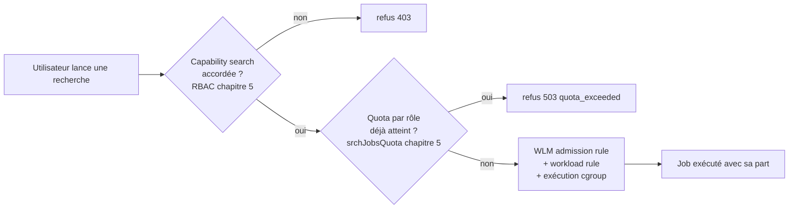
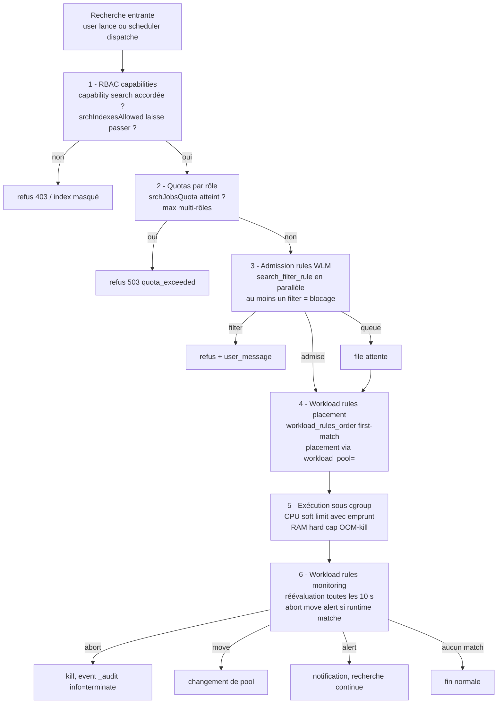

# Chapitre 6 — Guide Workload Management : search heads

> Ce chapitre est le guide opérationnel complet de Workload Management
> côté Search Head. Il couvre les concepts WLM, l'audit de l'existant,
> la conception des pools, l'implémentation progressive avec ses gates,
> et la surveillance permanente.
>
> Le volet **indexers / mode distribué** est traité au chapitre 7. Une
> recommandation tranche le pilotage : **activer les pools côté indexers
> en premier, avec des plafonds larges et sans autre effet que la
> mesure**, avant de poser des règles sur le search head (justifié au
> chapitre 7 §5).
>
> Les invariants WLM (sémantique CPU/mémoire, contenu des catégories,
> mode distribué, pièges de prédicats) sont posés une fois pour toutes
> au [chapitre 9 — principes clés](./09-wlm-principes-cles.md). Ce
> chapitre en est l'application à l'archétype du guide.
>
> **Révision du 2026-11-18.** Chapitre confronté à la documentation
> Splunk 9.4 / 10.0. Corrections : sémantique de `mem_weight` et
> dimensionnement mémoire (§2.1, §4), contenu de la catégorie `ingest`
> (§2.2), visibilité de l'action `alert` (§2.4), syntaxe de plusieurs
> règles types (§5), avertissement sur les recherches de surveillance
> (§7), pièges complémentaires (§9).

## 1. Modèle mental — pourquoi WLM existe

Un Search Head Splunk exécute des **recherches** : des processus
splunkd qui scannent des index, agrègent des événements, restituent
un résultat. Chaque recherche consomme du CPU, de la mémoire, du
disque (dispatch dir), de la bande passante I/O.

Sur un SHC qui sert mille utilisateurs, ces ressources sont
**partagées**. Sans arbitre, la première recherche qui démarre prend
ce qu'elle veut ; la suivante prend ce qui reste ; au bout d'un
moment plus rien n'est garanti.

WLM réserve des **parts** de ces ressources pour des **familles de
recherches** et les **arbitre** quand la demande dépasse l'offre.

### Trois choses

1. Une **géographie** : les recherches sont rangées dans des **pools**
   qui ont chacun une part de CPU et de mémoire.
2. Des **règles de placement** : chaque recherche entrante est routée
   vers un pool selon ce qu'elle est (RT vs historique, ad-hoc vs
   scheduled, lancée par tel rôle, sur tel index).
3. Une **exécution sous cgroup** : Linux applique réellement les parts
   via les **cgroups** (control groups).

### Articulation avec le RBAC



WLM ne remplace **pas** les capabilities (qui décident *qui a le droit
de faire quoi*) ni les quotas par rôle (qui décident *combien de jobs
un user peut lancer*). Il s'ajoute par-dessus : **combien de ressources
un job en cours peut consommer**, et **avec quelle priorité face à la
pression instantanée**.

## 2. Les cinq briques

### 2.1 Le pool

Un **pool** (`[workload_pool:<name>]`) est une enveloppe partagée par
un ensemble de recherches. Trois paramètres principaux.

- **`category`** : à quelle catégorie WLM le pool appartient
  (`search`, `ingest`, `misc`).
- **`cpu_weight`** : la part de CPU **relative** que le pool peut
  prétendre dans sa catégorie. **Soft limit** — si le pool n'utilise
  pas sa part, les autres pools peuvent l'emprunter (« CPU is
  compressible »).
- **`mem_weight`** : un **plafond** mémoire, exprimé en pourcentage
  **absolu** de la mémoire de la catégorie (hard cap). Un pool ne peut
  pas emprunter la mémoire inutilisée des autres ; au dépassement, le
  noyau tue un processus du pool selon son score OOM. La mémoire n'est
  pas compressible. Ce n'est **pas une réservation** : rien n'impose que
  les `mem_weight` d'une catégorie somment à 100, et des poids qui
  somment à 100 créent une **partition stricte** — un pool se fait tuer
  des recherches alors que la catégorie a encore de la mémoire libre
  ([chapitre 9 §5](./09-wlm-principes-cles.md#5-mémoire--un-plafond-dur-sans-garantie-ni-emprunt)).

Le paramètre **`default_category_pool=1`** désigne le pool par défaut
de sa catégorie. **Chaque catégorie WLM exige au moins un pool
`default_category_pool=1`** sinon splunkd refuse d'activer WLM
(F-WLM-01).

### 2.2 La catégorie

Une **catégorie** (`[workload_category:<name>]`) regroupe des pools par
usage technique. Les trois catégories sont fixes en Splunk 9.4 :
`search`, `ingest`, `misc`. Chaque catégorie a son propre `cpu_weight`
et `mem_weight` — c'est la première étape de partage.

Le `cpu_allocated_percent` effectif d'un pool s'obtient par :

```
cpu_weight_pool / somme(cpu_weight des pools de la catégorie) × cpu_weight_categorie
```

Les poids CPU sont **relatifs** : la formule simplifiée
`cpu_weight_pool × cpu_weight_categorie / 100` n'est juste que si les
poids des pools somment à 100. Exemple : `ad_hoc` à 35 sur une somme de
100, dans une catégorie `search` à 70 % = 24,5 % du CPU total du SH,
**garanti en cas de contention** et dépassable sinon (emprunt aux pools
inactifs de la même catégorie).

Pour un SH, la catégorie qui porte les **règles métier** est `search`.
Les deux autres doivent exister (avec un `default_category_pool=1`)
pour que WLM s'active, et ne reçoivent pas de règles — mais elles ne
sont **pas** des catégories « pour mémoire » :

- `ingest` héberge **splunkd, le process runner, le KV store, l'app
  server (Splunk Web) et l'introspection**, y compris sur un search
  head ;
- `misc` héberge les **inputs scriptés et modulaires** (add-ons de
  collecte présents sur le SH).

Source : [How workload management works 10.0](https://help.splunk.com/en/splunk-enterprise/administer/manage-workloads/10.0/workload-management-overview/how-workload-management-works).
Sous-dimensionner `ingest` sur un search head expose splunkd et le KV
store à l'OOM du cgroup.

### 2.3 L'admission rule

Une **admission rule** (`[search_filter_rule:<name>]`) s'évalue
**avant** que la recherche démarre.

- **`action = filter`** : bloque la recherche. Un message
  `user_message` est renvoyé au client (≤ 140 chars selon la spec ;
  le lab 9.4.6 a en outre rejeté les parenthèses — F-WLM-06). Pour une
  recherche planifiée, le message n'apparaît que dans `scheduler.log`.
- **`action = queue`** : met en file d'attente. **Réservée** aux règles
  `adhoc_search_percentage`, qui n'acceptent que `search_type=adhoc`
  comme autre prédicat.

Toutes les admission rules sont **évaluées en parallèle** — il suffit
qu'une seule matche `filter` pour bloquer ; une recherche qui correspond
à la fois à `filter` et `queue` est filtrée. Elles ne s'appliquent
qu'une fois activées globalement dans `workload_policy.conf`
(`[search_admission_control] admission_rules_enabled = 1`). Pièges de
prédicats (`index=*` littéral, recherches « all time », héritage de
rôles, `nobody`) : [chapitre 9 §9](./09-wlm-principes-cles.md#9-les-pièges-des-prédicats).

### 2.4 La workload rule

Une **workload rule** (`[workload_rule:<name>]`) s'évalue à
l'admission pour le placement, puis toutes les dix secondes pour le
monitoring.

- **Placement** : présence de la clé `workload_pool = <pool>`
  **sans** clef `action=` (F-WLM-02).
- **`action = abort`** : tue la recherche en cours (exige `runtime>`
  dans le prédicat — F-WLM-03).
- **`action = move`** : déplace un job d'un pool à un autre (`move`
  + `workload_pool = <pool_alt>` ; exige `runtime>`).
- **`action = alert`** : signale sans contraindre — la recherche
  continue et une notification est émise. C'est l'équivalent natif
  d'un **mode monitor-only par règle**. Splunk Web nomme cette action
  *Display a Message* ; dans `workload_rules.conf`, la valeur est
  `alert` (`display_message` est rejetée — F-WLM-04, conforme à la
  [spec 10.0](https://help.splunk.com/en/splunk-enterprise/administer/admin-manual/10.0/configuration-file-reference/10.0.0-configuration-file-reference/workload_rules.conf)).
  **Visibilité limitée** : le message n'apparaît dans le job inspector
  que pour les utilisateurs qui détiennent les quatre capabilities
  `list_workload_pools`, `edit_workload_pools`, `list_workload_rules`
  et `select_workload_rules`
  ([Configure workload rules 10.0](https://help.splunk.com/en/splunk-enterprise/administer/manage-workloads/10.0/configure-workload-management/configure-workload-rules)).
  Ce n'est donc **pas** un canal de sensibilisation de l'utilisateur
  final ; les déclenchements se comptent dans le tableau de bord
  *Workload Management Monitoring* de la Monitoring Console
  ([Monitor WLM 10.0](https://help.splunk.com/en/splunk-enterprise/administer/manage-workloads/10.0/monitor-workload-management)).

L'ordre d'évaluation est strict, défini par `[workload_rules_order]` —
**first-match wins**, à l'admission puis à chaque réévaluation (toutes
les dix secondes). Conséquence : une règle `move` placée au-dessus
d'une règle `abort` de même prédicat empêche définitivement l'abort ;
une règle de placement sans `runtime` placée au-dessus d'une règle de
surveillance la rend inatteignable pour les recherches qu'elle couvre.
Cet ordre n'accepte **que** les `[workload_rule:*]` ; y inscrire une
`[search_filter_rule:*]` provoque un HTTP 404 (F-WLM-05).

### 2.5 Le cgroup

Sous Linux, un **cgroup** (control group) est un mécanisme noyau qui
regroupe des processus et leur applique des limites de CPU, mémoire,
I/O. Splunk en 9.4.6 utilise cgroups v2, sous
`/sys/fs/cgroup/system.slice/Splunkd.service/`.

Au démarrage de splunkd avec WLM activé, splunkd **attache** ses
processus aux cgroups configurés. Quand une nouvelle recherche
démarre, splunkd attache le processus search au cgroup correspondant
au pool décidé par les workload rules. À partir de ce moment, c'est
le **noyau Linux** qui applique la limite.

**Note opérationnelle.** Sur le lab 9.4.6, un `systemctl restart
Splunkd` a été nécessaire au **premier** déploiement de WLM pour que
splunkd attache ses processus aux cgroups (F-WLM-08). La documentation
décrit, elle, une activation par rechargement, et la spec de
`workload_pools.conf` prévient qu'un redémarrage *peut* être nécessaire
([chapitre 9 §10](./09-wlm-principes-cles.md#10-déployer-sans-se-piéger)).
Règle pratique : prévoir un restart à la première activation ; ensuite,
un reload via `/services/workloads/config/_reload` suffit (les
modifications de `workload_rules.conf` prennent effet sans
redémarrage). Le restart **doit** être en root direct, pas via `runuser
-u splunk` qui échoue silencieusement sur les services systemd-managed
(F-WLM-08).

## 3. Chaîne d'évaluation complète



Trois remarques :

- Une recherche refusée à l'étape 2 (quota) **n'apparaît jamais** dans
  les traces WLM — c'est une cause fréquente de confusion en lecture
  de `_audit`.
- L'étape 4 est **implicite** (pas d'`action=` pour le placement —
  F-WLM-02). Le seul fait d'avoir une clef `workload_pool = X` dans
  une `[workload_rule:*]` qui match suffit à router.
- L'étape 6 ne s'évalue **que sur les règles qui ont un prédicat
  `runtime>`** (F-WLM-03). Les autres règles ne sont évaluées qu'à
  l'étape 4 (placement).
- Admission (étape 3) et règles de workload (étapes 4 et 6) ne
  s'appliquent qu'à la **recherche de base**, jamais aux sous-recherches.
  Les règles d'admission des recherches **planifiées** sont évaluées de
  façon asynchrone, toutes les 600 s par défaut.

## 4. Pattern recommandé — sept pools

| Pool | Catégorie | `cpu_weight` | `mem_weight` (plafond) | `default_category_pool` | Vocation |
| --- | --- | --- | --- | --- | --- |
| `admin` | search | 15 | 100 | 0 | Réservé aux rôles admin |
| `scheduled` | search | 30 | 100 | 0 | Recherches planifiées |
| `ad_hoc` | search | 35 | 100 | **1** | Recherches interactives (défaut) |
| `bulk` | search | 10 | 50 | 0 | Recherches longues, exports — plafond volontaire |
| `accel` | search | 10 | 100 | 0 | Accélérations, summary indexing |
| `ingest_default` | ingest | 100 | 100 | **1** | splunkd, KV store, Splunk Web, introspection |
| `misc_default` | misc | 100 | 100 | **1** | Inputs scriptés et modulaires |

Catégories au point de départ documenté par Splunk : `search` à 70 %,
`ingest` à 20 %, `misc` à 10 % (exemple de la
[spec `workload_pools.conf`](https://help.splunk.com/en/splunk-enterprise/administer/admin-manual/10.0/configuration-file-reference/10.0.4-configuration-file-reference/workload_pools.conf)).

Lecture de la table :

- **CPU** — les poids des pools `search` (somme 100) fixent les parts
  **garanties en cas de contention** ; hors contention, chaque pool peut
  emprunter le CPU inactif des autres.
- **Mémoire** — chaque `mem_weight` est un **plafond** en pourcentage de
  la mémoire de la catégorie, pas une part. Les pools à 100 peuvent
  chacun utiliser toute la mémoire `search` ; seul `bulk` est plafonné
  délibérément, pour qu'un export massif ne puisse pas prendre plus de la
  moitié de la mémoire de recherche. Pour **garantir** de la mémoire au
  pool `admin`, on plafonne les autres pools (par exemple `ad_hoc` et
  `scheduled` à 80) plutôt que de le doter d'une part
  ([chapitre 9 §5](./09-wlm-principes-cles.md#5-mémoire--un-plafond-dur-sans-garantie-ni-emprunt)).
- **Pools à pool unique** (`ingest`, `misc`) — leur `cpu_weight` est
  sans effet (le pool reçoit tout le CPU de sa catégorie), mais leur
  `mem_weight` **plafonne la mémoire de splunkd et du KV store** : le
  laisser à 100.
- **Catégories** — ne réduire `ingest` sur un search head qu'après
  avoir mesuré la consommation du pool `ingest` par processus (tableau
  de bord *Workload Management Activity* de la Monitoring Console) ;
  relever `misc` si des add-ons de collecte tournent sur le SH.

> **Révision 2026-11-18.** La version précédente de ce tableau donnait
> des `mem_weight` égaux aux `cpu_weight` (15/30/35/10/10, somme 100),
> `ingest`/`misc` à 1/1 et des catégories 80/15/5. Avec la sémantique
> documentée de la mémoire (plafond absolu, sans emprunt), cela
> plafonnait par exemple `ad_hoc` à 35 % de la mémoire de recherche et
> splunkd à une fraction de pourcent de la mémoire totale.

> Les pourcentages CPU sont l'état de l'art pour un SHC d'un millier
> d'utilisateurs. **À adapter au contexte** sur la baseline d'usage
> réelle.

### Exemple `workload_pools.conf`

```ini
[general]
enabled = 1

[workload_category:search]
cpu_weight = 70
mem_weight = 70

[workload_category:ingest]
cpu_weight = 20
mem_weight = 20

[workload_category:misc]
cpu_weight = 10
mem_weight = 10

[workload_pool:admin]
category = search
cpu_weight = 15
mem_weight = 100

[workload_pool:scheduled]
category = search
cpu_weight = 30
mem_weight = 100

[workload_pool:ad_hoc]
category = search
cpu_weight = 35
mem_weight = 100
default_category_pool = 1

[workload_pool:bulk]
category = search
cpu_weight = 10
mem_weight = 50

[workload_pool:accel]
category = search
cpu_weight = 10
mem_weight = 100

[workload_pool:ingest_default]
category = ingest
cpu_weight = 100
mem_weight = 100
default_category_pool = 1

[workload_pool:misc_default]
category = misc
cpu_weight = 100
mem_weight = 100
default_category_pool = 1
```

## 5. Pattern recommandé — règles WLM

Sept règles forment un set cohérent (la R-W07 de la version initiale
est retirée, voir plus bas). Toutes les règles d'**action monitoring**
(`abort`, `move`, `alert`) portent un terme `runtime>` **dans leur
prédicat** — `runtime` est un type de prédicat, pas une clé de
configuration. Toutes les règles de **placement** ne portent que des
prédicats de contexte (rôle, `search_type`, etc.).

Rappels de syntaxe ([spec `workload_rules.conf` 10.0](https://help.splunk.com/en/splunk-enterprise/administer/admin-manual/10.0/configuration-file-reference/10.0.0-configuration-file-reference/workload_rules.conf)) :

- prédicat `<type>=<value>` combiné par `AND`, `OR`, `NOT` en
  majuscules et parenthèses ; pas d'opérateur `IN` ;
- `schedule` vaut `always_on`, `time_range`, `every_day`,
  `every_week` ou `every_month` ; absent = toujours actif ;
- `user_message` : 140 caractères maximum.

### R-W01 — Abort des real-time non autorisées

```ini
[workload_rule:abort_unauthorized_rt]
predicate = search_mode=realtime AND (NOT role=rt_authorized_*) AND runtime>1s
action = abort
user_message = Recherche temps reel non autorisee pour votre profil.
```

Arrête toute recherche real-time lancée par un utilisateur qui ne
détient aucun rôle `rt_authorized_*`. Le finding F-RBAC-01 rappelle
que `rtsearch` héritée ne se révoque pas — c'est WLM qui rattrape.
Comme les règles sont réévaluées toutes les dix secondes, l'arrêt
intervient en pratique dans les dix premières secondes. Le prédicat
`role` s'évalue sur **tous** les rôles effectifs de l'utilisateur,
rôles hérités compris.

### R-W02 — Move des recherches sans borne vers `bulk`

```ini
[workload_rule:move_alltime_to_bulk]
predicate = search_time_range=alltime AND runtime>1m
action = move
workload_pool = bulk
```

Déplace les recherches « all time » vers le pool `bulk` après une
minute d'exécution, sans les tuer. Une recherche « all time » ne
correspond **qu'aux** règles `search_time_range=alltime`, jamais à un
seuil numérique. Pour viser aussi les très longues plages explicites
(`search_time_range>1825d`), il faut activer `numeric_search_time_range
= true` dans la stanza `[general]` de `workload_rules.conf` — réglage
global, avec un coût de performance signalé par la spec — et ajouter
une seconde règle.

> **Révision 2026-11-18.** La version initiale écrivait
> `numeric_search_time_range=true AND search_time_range>1825d` dans le
> prédicat et une clé `runtime = 1m` : le premier est un réglage
> `[general]`, pas un prédicat, et le seuil numérique ne capte pas les
> recherches « all time ».

### R-W03 — Placement des scheduled

```ini
[workload_rule:place_scheduled]
predicate = search_type=scheduled
workload_pool = scheduled
```

Placement implicite par présence de `workload_pool=` (F-WLM-02). Pas
d'`action=`.

### R-W04 — Placement des accélérations

```ini
[workload_rule:place_acceleration]
predicate = search_type=datamodel_acceleration OR search_type=report_acceleration OR search_type=summary_index
workload_pool = accel
```

### R-W05 — Placement des admin

```ini
[workload_rule:place_admin]
predicate = role=admin_*
workload_pool = admin
```

Protège le pool admin pour qu'un incident de saturation n'empêche
pas le diagnostic. Attention à l'héritage : si un rôle métier importe
un rôle `admin_*`, ses utilisateurs atterrissent aussi dans `admin`.
Pour un compte précis, préférer `user=<nom>`.

### R-W06 — Alert sur les recherches longues

```ini
[workload_rule:alert_long_searches]
predicate = (NOT search_type=scheduled) AND runtime>10m
action = alert
user_message = Recherche de plus de 10 minutes, voir le guide des bonnes pratiques.
```

Mode monitor-only par règle (F-WLM-04). La recherche continue ; le
déclenchement se lit dans la Monitoring Console et, dans le job
inspector, **seulement** pour les détenteurs des capabilities WLM
(§2.4). Pour la boucle pédagogique, l'extraction des recherches
concernées passe donc par un tableau de bord d'administration, pas par
le message lui-même.

### R-W07 — retirée

La version initiale déplaçait vers `admin` les recherches admin lancées
en ad hoc après 30 s (`role=admin_* AND runtime>30s`). Avec l'ordre
first-match, `place_admin` (R-W05), placée au-dessus, correspond déjà à
toutes ces recherches dès leur lancement : la règle n'était jamais
atteinte. Elle est retirée.

### R-W08 — Admission rule : file d'attente sur saturation ad hoc

```ini
[search_filter_rule:queue_on_adhoc_saturation]
predicate = search_type=adhoc AND adhoc_search_percentage>85
action = queue
user_message = Plateforme saturee, votre recherche est en file d attente.
```

`adhoc_search_percentage` exige `search_type=adhoc` comme **seul**
autre prédicat : toute autre condition (par exemple `NOT role=admin_*`)
fait rejeter la règle. La valeur s'applique **par membre** de SHC, en
pourcentage de la limite de concurrence de recherche
([Admission rules 10.2](https://help.splunk.com/en/splunk-enterprise/administer/manage-workloads/10.2/configure-workload-management/configure-admission-rules-to-prefilter-searches)).
Les admins ne peuvent donc pas être exemptés de cette règle.

**Note F-WLM-06** : `user_message` ≤ 140 caractères ; le lab 9.4.6 a
en outre rejeté les parenthèses (contrainte non documentée par la
spec).

### Ordre d'évaluation

```ini
[workload_rules_order]
rules = abort_unauthorized_rt, move_alltime_to_bulk, place_admin, place_scheduled, place_acceleration, alert_long_searches
```

L'ordre **n'accepte que les `[workload_rule:*]`** (F-WLM-05). Les
admission rules (`[search_filter_rule:*]`) sont évaluées toutes à la
fois, hors de cet ordre, et doivent être **activées globalement** dans
`workload_policy.conf` (`[search_admission_control]
admission_rules_enabled = 1`) — fichier à embarquer dans l'app de
déploiement.

Logique d'ordre :

1. Tuer les comportements interdits (`abort_unauthorized_rt`).
2. Déplacer les comportements non interdits mais coûteux
   (`move_alltime_to_bulk`).
3. Protéger les admin (`place_admin`).
4. Placer les types techniques (`place_scheduled`,
   `place_acceleration`).
5. Alerter sur les anomalies de durée (`alert_long_searches`) — règle
   atteinte uniquement par les recherches qu'aucune règle précédente
   n'a captées.

Règle générale : les actions les plus sévères en haut. Une règle
`move` placée au-dessus d'une règle `abort` de même prédicat se
redéclenche à chaque réévaluation et l'abort ne se produit jamais
([exemples Splunk](https://docs.splunk.com/Documentation/Splunk/latest/Workloads/Workloadmanagementexamples)).

## 6. Implémentation progressive — six phases

### Phase 0 — Baseline (2 à 4 semaines)

Mesurer pendant deux à quatre semaines sans WLM activé : la
concurrence ad-hoc, la concurrence scheduled, la durée moyenne d'une
recherche, le pic de mémoire d'un Search Head, la distribution des
`search_type`.

Calibrer les pourcentages de pool (table §4) sur ces mesures. Pour la
mémoire, raisonner sur les **pics** et non sur les moyennes : un
plafond franchi tue une recherche. Les données d'introspection
(`_introspection`, consommation par processus) sont disponibles avant
toute activation de WLM.

Critère de gate : la baseline est connue, les pourcentages sont
ajustés pour le contexte.

### Phase 1 — Activation des pools sans règles (1 semaine)

Déployer `workload_pools.conf` (7 pools), activer WLM via
`workload-management-status enabled=1`. Aucune règle pour le moment —
toutes les recherches tombent dans `ad_hoc` (default category pool).

Restart Splunkd via `systemctl restart Splunkd` (F-WLM-08).

Prérequis vérifiés avant cette phase : preflight checks au vert sur
chaque membre (statut global, pas seulement « supporté »), délégation
systemd des cgroups, limite mémoire éventuelle de l'unité systemd
connue ([chapitre 9 §10](./09-wlm-principes-cles.md#10-déployer-sans-se-piéger)).
Sur un SHC, choisir **un seul** canal de déploiement : deployer **ou**
réplication de configuration, jamais les deux.

Critère de gate : `| rest /services/workloads/status` retourne
`enabled=1`. Les recherches tournent. Aucun impact utilisateur
observable. Les tableaux de bord WLM de la Monitoring Console affichent
la consommation par pool.

### Phase 2 — Monitor-only (`alert`) — 2 à 4 semaines

Déployer toutes les workload rules **en `action = alert`** (jamais
`abort` ni `move` en cette phase). Toutes les règles ont leur
prédicat de placement remplacé par un prédicat monitor-only.

Exemple : la règle R-W01 devient

```ini
[workload_rule:monitor_unauthorized_rt]
predicate = search_mode=realtime AND (NOT role=rt_authorized_*) AND runtime>1s
action = alert
user_message = Recherche temps reel hors profil autorise.
```

Cela permet d'observer **ce que la règle ferait** sans rien casser. Le
volume de déclenchements par règle se lit dans le tableau de bord
*Workload Management Monitoring: Distributed* de la Monitoring Console
(recherches ayant déclenché une alerte, par règle et dans le temps,
recherches planifiées concernées)
([Monitor WLM 10.0](https://help.splunk.com/en/splunk-enterprise/administer/manage-workloads/10.0/monitor-workload-management)).
Le message lui-même n'est visible que des détenteurs des capabilities
WLM (§2.4) : les utilisateurs concernés ne sont pas prévenus par ce
biais.

Les règles d'admission n'ont pas de mode `alert` : leur équivalent
monitor-only consiste à mesurer d'abord, par une recherche d'audit, ce
qu'elles filtreraient (B.1.06 pour les recherches sans borne), puis à
les activer **une à une**, chacune observée au moins 24 h
([blog Splunk, admission rules](https://www.splunk.com/en_us/blog/tips-and-tricks/admission-rules-use-cases-and-best-practices1.html)).

Critère de gate : pour chaque règle, on connaît le nombre de matchs
par jour, on a contacté les utilisateurs qui auraient été impactés
pour comprendre leur intention.

### Phase 3 — Bascule en enforce, règle par règle (4 à 8 semaines)

Basculer les règles **une par une** en enforce, dans cet ordre :

1. Placement implicite (`place_scheduled`, `place_acceleration`,
   `place_admin`) — bénin, aucun risque utilisateur.
2. Move (`move_alltime_to_bulk`) — perturbe les recherches longues
   mais ne les tue pas.
3. Abort (`abort_unauthorized_rt`) — perturbe les utilisateurs
   directement, attendre la dernière phase. Avant toute règle d'abort
   élargie, exclure explicitement les accélérations
   (`search_type=datamodel_acceleration`) et les recherches de
   détection : un abort y crée un trou de couverture silencieux.
4. Admission queue (`queue_on_adhoc_saturation`) — déploiement final.

Avant toute règle d'admission `alltime` ou `index=*`, recenser les
recherches planifiées des apps techniques et premium qui les utilisent
(monitoring, télémétrie, apps de sécurité ou d'ITSM) et les exclure par
`app=` : `user=nobody` n'est pas un prédicat valide. Un retour client
documente le blocage de recherches internes par la règle d'exemple
officielle ([Splunk Community](https://community.splunk.com/t5/Splunk-Cloud-Platform/Workload-Management-Rule-No-AllTime-searches/m-p/623661)).

Entre chaque bascule, **deux semaines d'observation** des KPI (§7).

Critère de gate par règle : aucun incident d'accès non résolu en
moins d'une heure, KPI inchangés ou améliorés.

### Phase 4 — Cycles correctifs (continu)

Pour chaque règle activée, mesurer en continu les KPI. Une règle
qui devient trop bruyante (matchs > seuil prévu) est rebasculée en
`alert` pour analyse.

### Phase 5 — Industrialisation multi-SHC (4 à 6 semaines)

Une fois la conception stable sur le SHC pilote, propager aux autres
SHC en respectant la cohérence inter-SHC (les noms de rôles ciblés
par les règles doivent être identiques d'un SHC à l'autre).

Critère de gate : tous les SHC du périmètre ont la même set de règles,
les pourcentages de pool sont ajustés à la charge propre de chaque
SHC.

## 7. Surveillance permanente

> **Avertissement (révision 2026-11-18).** Les recherches B.3 ci-dessous
> s'appuient sur des noms de champs et de valeurs (`workload_pool` dans
> `_audit`, `action=workload_abort|workload_move|workload_alert|workload_queue`,
> composants `WorkloadPool` et `SearchAdmission`) que la documentation
> Splunk 9.4 / 10.0 ne décrit pas. Les valider sur la version déployée
> avant d'en faire des KPI. La référence documentée est la Monitoring
> Console : *Workload Management Overview*, *Activity*, *Monitoring:
> Distributed* et *Admission Control*
> ([Monitor WLM 10.0](https://help.splunk.com/en/splunk-enterprise/administer/manage-workloads/10.0/monitor-workload-management)),
> dont les recherches sous-jacentes peuvent servir de modèle.

### B.3.01 — Distribution des recherches par pool, dernière heure

```spl
search index=_audit action=search earliest=-1h
| eval pool = coalesce(workload_pool, "unmatched")
| stats count by pool
| sort -count
```

**Cible** : `ad_hoc` > 50 %, `scheduled` 20-40 %, `admin` < 5 %,
`bulk` < 10 %, `accel` < 10 %, `unmatched` proche de 0.

### B.3.02 — Pression sur le pool ad-hoc

```spl
search index=_internal sourcetype=splunkd component=WorkloadPool
| where pool_name="ad_hoc"
| stats avg(cpu_pct) as cpu_avg max(cpu_pct) as cpu_max
        avg(mem_pct) as mem_avg max(mem_pct) as mem_max by host
| where cpu_max>80 OR mem_max>85
```

**Interprétation.** Pression soutenue > 80 % CPU ou > 85 % mémoire
sur le pool ad-hoc = candidat à augmentation du `cpu_weight` ou à
serrage des admission rules.

### B.3.03 — Aborts WLM par règle, dernière semaine

```spl
search index=_audit action=workload_abort earliest=-7d
| stats count values(user) as users dc(user) as nb_users by rule_name
| sort -count
```

**Interprétation.** Une règle qui abort plus de N fois par jour est
soit mal calibrée, soit révèle un comportement à corriger côté
utilisateur (formation, communication).

### B.3.04 — Files d'attente sur saturation

```spl
search index=_audit action=workload_queue earliest=-7d
| timechart span=1h count
```

**Interprétation.** Pics de queue concentrés sur certaines plages
horaires = signal de planification à mieux étaler les scheduled.

### B.3.05 — Latence d'admission

```spl
search index=_internal sourcetype=splunkd component=SearchAdmission
| eval admit_ms = wait_ms
| stats p50(admit_ms) as p50 p90(admit_ms) as p90 p99(admit_ms) as p99 by host
```

**Cible** : `p50 < 100 ms`, `p99 < 1000 ms`. Dégradation = WLM ou
quotas surchargés.

### B.3.06 — Recherches alertées par durée

```spl
search index=_audit action=workload_alert earliest=-7d
| stats count values(rule_name) as rules dc(user) as nb_users by behavior
| sort -count
```

Alimente la boucle pédagogique.

### B.3.07 — Top utilisateurs par pression sur le pool

```spl
search index=_audit action=search earliest=-24h workload_pool=*
| eval cost = total_run_time
| stats sum(cost) as total_cost count by user workload_pool
| sort -total_cost
| head 20
```

**Interprétation.** Top 20 des utilisateurs en termes de coût agrégé.
Cibles évidentes pour la sensibilisation pédagogique (chapitre 3 §4).

### B.3.08 — Distribution des `search_type` par pool

```spl
search index=_audit action=search earliest=-24h
| eval pool = coalesce(workload_pool, "unmatched")
| eval stype = if(isnull(search_type), "adhoc_default", search_type)
| stats count by pool stype
| sort -count
```

Vérifie que les règles de placement font ce qu'on attend (scheduled
dans `scheduled`, accel dans `accel`).

### B.3.09 — Move events

```spl
search index=_audit action=workload_move earliest=-7d
| stats count by source_pool target_pool rule_name
| sort -count
```

**Interprétation.** Une recherche `ad_hoc → bulk` est attendue
(R-W02). Toute autre transition mérite analyse.

### B.3.10 — Recherches sans `workload_pool` (unmatched)

```spl
search index=_audit action=search earliest=-24h
| eval matched = if(isnull(workload_pool) OR workload_pool="", "no", "yes")
| stats count by matched
```

**Cible** : `no` < 5 %. Toute recherche `no` est partie dans le
default `ad_hoc`, ce qui n'est pas forcément faux — mais une
proportion croissante de `no` indique une couverture incomplète des
règles de placement.

## 8. Audit pré-WLM

Avant de concevoir les pools, dix recherches de cartographie. Elles
servent à calibrer les pourcentages de pool sur la réalité de
l'usage.

### B.1.01 — Concurrence ad-hoc historique

```spl
search index=_audit action=search search_type=adhoc earliest=-30d
| bucket _time span=10m
| stats dc(eval(coalesce(search_id, sid))) as nb_jobs by _time
| stats avg(nb_jobs) as avg_concurrent max(nb_jobs) as max_concurrent
```

Mesure la concurrence ad-hoc moyenne et pic sur 30 jours. Calibre la
part du pool `ad_hoc`.

### B.1.02 — Concurrence scheduled

```spl
search index=_audit action=search search_type=scheduled earliest=-30d
| bucket _time span=1m
| stats dc(eval(coalesce(search_id, sid))) as nb_jobs by _time
| stats avg(nb_jobs) as avg_per_min max(nb_jobs) as max_per_min
```

Calibre la part du pool `scheduled`. Pics > 50 / minute = problème
de répartition à corriger côté planification.

### B.1.03 — Durée moyenne et p99

```spl
search index=_audit action=search earliest=-7d
| stats avg(total_run_time) as avg_dur p99(total_run_time) as p99_dur
        by search_type
```

Une recherche ad-hoc qui dure > 60 s en p99 est candidate à
optimisation.

### B.1.04 — Top utilisateurs en volume de recherches

```spl
search index=_audit action=search earliest=-7d
| stats count by user
| sort -count
| head 20
```

### B.1.05 — Recherches real-time réelles

```spl
search index=_audit action=search search_mode=realtime earliest=-7d
| stats count values(user) as users dc(user) as nb_users by index
| sort -count
```

Mesure l'usage réel des RT — alimente la décision sur `feature_rt` et
sur la règle R-W01.

### B.1.06 — Recherches sans borne temporelle

```spl
search index=_audit action=search earliest=-7d
| where time_range="alltime" OR isnull(time_range)
| stats count values(user) as users by index
```

Cible directe de R-W02.

### B.1.07 — Recherches par index (top 20 indexes)

```spl
search index=_audit action=search earliest=-7d
| rex max_match=5 "search_index_list=\"(?<idx>[^\"]+)\""
| mvexpand idx
| stats count by idx
| sort -count
| head 20
```

### B.1.08 — Distribution des durées par tranche

```spl
search index=_audit action=search earliest=-7d
| eval bucket = case(
    total_run_time < 1, "<1s",
    total_run_time < 10, "1-10s",
    total_run_time < 60, "10-60s",
    total_run_time < 600, "1-10min",
    true(), ">10min")
| stats count by bucket
```

Calibre le seuil de R-W06 (`alert_long_searches`).

### B.1.09 — Saved searches en quotas non déclarés

```spl
| rest /servicesNS/-/-/saved/searches splunk_server=local
| rename "eai:acl.app" as app "eai:acl.owner" as owner
| where disabled=0 AND is_scheduled=1
| stats count by app cron_schedule
| sort -count
```

Identifie les saved searches dont la planification (cron) doit être
revue avant activation WLM stricte.

### B.1.10 — Accélérations actives

```spl
| rest /servicesNS/-/-/data/models splunk_server=local
| where acceleration=true
| table title acceleration.cron_schedule eai:acl.app
```

Calibre la part du pool `accel`.

## 9. Pièges — récapitulatif

| # | Piège | Conséquence | Référence |
| --- | --- | --- | --- |
| W1 | Oublier `default_category_pool=1` sur `ingest` et `misc` | activation WLM échoue silencieusement | F-WLM-01 |
| W2 | Utiliser `action=workload_pool` pour le placement | règle rejetée par splunkd | F-WLM-02 |
| W3 | Oublier `runtime>` dans le **prédicat** d'une règle `abort/move/alert` (une clé `runtime =` séparée n'existe pas) | règle rejetée à l'activation | F-WLM-03, spec |
| W4 | Utiliser `action=display_message` | rejetée ; la valeur conf est `alert` (libellé UI *Display a Message*) | F-WLM-04, spec |
| W5 | Mettre une `search_filter_rule` dans `[workload_rules_order]` | HTTP 404 | F-WLM-05 |
| W6 | `user_message` > 140 caractères (ou avec parenthèses, observé en 9.4.6) | règle rejetée | F-WLM-06, spec |
| W7 | Éditer la conf WLM directement sur un peer d'indexer | écrasée au prochain bundle | ch. 7 |
| W8 | Restart Splunkd via `runuser -u splunk` | échec silencieux | F-WLM-08 |
| W9 | Concevoir les pools sans baseline | pourcentages déconnectés de l'usage | calibration |
| W10 | Basculer en enforce sans phase monitor-only | incidents utilisateurs non anticipés | méthode |
| W11 | Donner des `mem_weight` qui somment à 100 | partition stricte : OOM d'un pool alors que la catégorie a de la mémoire libre | ch. 9 §5 |
| W12 | Sous-dimensionner `ingest` sur un SH | splunkd, KV store et Splunk Web exposés à l'OOM | ch. 9 §3 |
| W13 | Écrire `index=*` en croyant viser « tous les index » | correspondance littérale seulement | ch. 9 §9 |
| W14 | Viser les recherches sans borne avec un seuil numérique | les recherches « all time » ne correspondent qu'à `alltime` | ch. 9 §9 |
| W15 | Exclure un compte technique par `user=nobody` | prédicat invalide ; exclure par `app=` | ch. 9 §9 |
| W16 | Cibler `role=` sans tenir compte de l'héritage | un admin correspond aussi à `user` et `power` | ch. 9 §9 |
| W17 | Placer un `move` au-dessus d'un `abort` de même prédicat | l'abort ne se déclenche jamais | ch. 9 §7 |
| W18 | Déployer les règles d'admission sans `workload_policy.conf` | règles présentes mais inactives | ch. 9 §8 |
| W19 | Mélanger deployer et réplication de configuration sur un SHC | WLM peut échouer | ch. 9 §10 |
| W20 | Compter sur `alert` pour prévenir l'utilisateur final | message visible des seuls admins WLM | §2.4 |

## Sources

- [Principes clés WLM — chapitre 9 de ce guide](./09-wlm-principes-cles.md) (sources détaillées)
- [How workload management works 10.0](https://help.splunk.com/en/splunk-enterprise/administer/manage-workloads/10.0/workload-management-overview/how-workload-management-works)
- [Configure workload rules 10.0](https://help.splunk.com/en/splunk-enterprise/administer/manage-workloads/10.0/configure-workload-management/configure-workload-rules)
- [Configure admission rules to prefilter searches 10.2](https://help.splunk.com/en/splunk-enterprise/administer/manage-workloads/10.2/configure-workload-management/configure-admission-rules-to-prefilter-searches)
- [Monitor workload management using the monitoring console 10.0](https://help.splunk.com/en/splunk-enterprise/administer/manage-workloads/10.0/monitor-workload-management)
- [workload_pools.conf 10.0.4](https://help.splunk.com/en/splunk-enterprise/administer/admin-manual/10.0/configuration-file-reference/10.0.4-configuration-file-reference/workload_pools.conf)
- [workload_rules.conf 10.0.0](https://help.splunk.com/en/splunk-enterprise/administer/admin-manual/10.0/configuration-file-reference/10.0.0-configuration-file-reference/workload_rules.conf)
- [workload_policy.conf 10.0.1](https://help.splunk.com/en/splunk-enterprise/administer/admin-manual/10.0/configuration-file-reference/10.0.1-configuration-file-reference/workload_policy.conf)
- [Workload management examples](https://docs.splunk.com/Documentation/Splunk/latest/Workloads/Workloadmanagementexamples)
- [Splunk Workload Management 9.4 — Overview](https://help.splunk.com/en/splunk-enterprise/administer/manage-workloads/9.4/workload-management-overview)
- [Configure workload pools 9.4](https://help.splunk.com/en/splunk-enterprise/administer/manage-workloads/9.4/configure-workload-management/configure-workload-pools)
- [Configure workload rules 9.4](https://help.splunk.com/en/splunk-enterprise/administer/manage-workloads/9.4/configure-workload-management/configure-workload-rules)
- [Configure admission rules 9.4](https://help.splunk.com/en/splunk-enterprise/administer/manage-workloads/9.4/configure-workload-management/configure-admission-rules-to-prefilter-searches)
- [Splunk Blog — Best Practices for Using Splunk Workload Management](https://www.splunk.com/en_us/blog/platform/best-practices-for-using-splunk-workload-management.html)
- [Splunk Blog — Admission Rules: Use Cases and Best Practices](https://www.splunk.com/en_us/blog/tips-and-tricks/admission-rules-use-cases-and-best-practices1.html)
- [Splunk Community — Workload Management Rule: No AllTime searches](https://community.splunk.com/t5/Splunk-Cloud-Platform/Workload-Management-Rule-No-AllTime-searches/m-p/623661)
