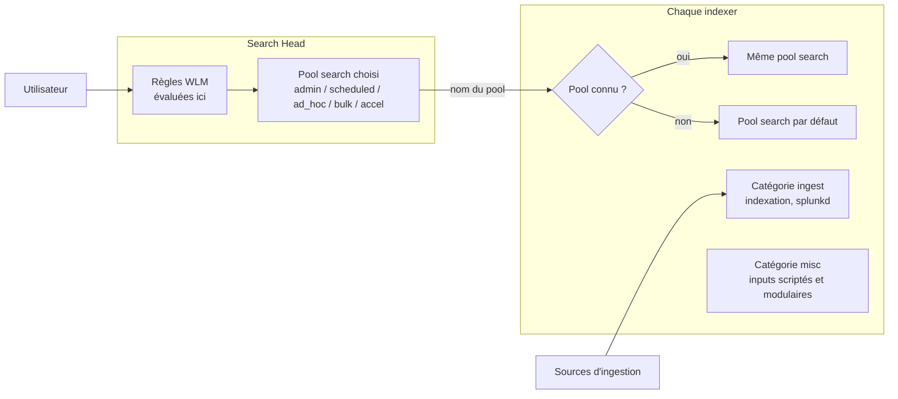

# Chapitre 7 — Guide Workload Management : indexers et mode distribué

> **Document historique du guide Splunk 9.4.6.** Les éventuelles corrections documentaires de novembre 2026 restent identifiées dans le corps ; elles ne qualifient pas les builds ultérieurs.
> Gouvernance : [synthèse 2.0](./synthese/README.md) ; [correspondance sujet/version](./README.md#table-des-matières).
> Mise en place WLM : [chapitre configuration du handbook autonome](../splunk-wlm-configuration/02-configurer-wlm.md), dans son périmètre 10.4.5 ; exécution 10.2 non qualifiée. Ne pas combiner les anciennes étapes avec cette procédure.
> **Attention :** activer les pools applique déjà des plafonds ; « observation » ne signifie pas absence d'effet. L'ancien ordre « indexeurs d'abord » ne remplace pas la séquence du handbook autonome.

> Ce chapitre traite WLM **côté indexers**, en complément du chapitre 6
> qui traite WLM côté Search Head. Il couvre ce que les indexers font
> (et ne font pas) en mode distribué, la conception des pools indexer,
> la propagation via le cluster manager, l'ordre d'implémentation et la
> surveillance.
>
> Les invariants WLM sont posés au
> [chapitre 9 — principes clés](./09-wlm-principes-cles.md), en
> particulier le [mode distribué (§6)](./09-wlm-principes-cles.md#6-mode-distribué--qui-décide-qui-applique).
>
> **Révision du 2026-11-18 — chapitre réécrit.** La version initiale
> décrivait une catégorie `search_peer`, des pools `ingest` multiples
> alimentés par des règles par index ou sourcetype, des règles de
> workload évaluées sur les indexers et une absence de correspondance
> entre pools SH et pools indexer. Confrontés à la documentation Splunk
> 9.4 / 10.0, ces points sont faux : il n'existe que trois catégories,
> `ingest` et `misc` n'ont qu'un pool, les règles ne s'évaluent que sur
> les search heads, et une recherche s'exécute sur les indexers **dans
> le pool de même nom** que sur le search head. Le chapitre est réécrit
> sur ces bases.

## 1. Pourquoi un volet indexers

### 1.1 La régulation côté SH ne suffit pas

Une recherche distribuée a **deux représentations** :

- côté SH, le **processus de recherche principal**, régulé par les
  pools du SH (chapitre 6) ;
- côté chaque indexer participant, le **processus de recherche
  distante**, qui scanne les buckets et applique les filtres, avec le
  CPU et la mémoire **de l'indexer**.

Le search head joint à la recherche le **nom de son pool** `search`.
L'indexer l'exécute dans le pool de même nom s'il le connaît, sinon
dans **son** pool `search` par défaut
([How workload management works 10.0](https://help.splunk.com/en/splunk-enterprise/administer/manage-workloads/10.0/workload-management-overview/how-workload-management-works)).
Sans WLM activé sur les indexers, rien n'y borne la partie distante
des recherches.

S'y ajoute la pression **d'ingestion** : sur un indexer, la catégorie
`ingest` porte l'indexation et le cœur de splunkd. C'est elle que WLM
côté indexer doit protéger avant tout.

### 1.2 Ce que le volet indexers apporte

Activer WLM côté indexers apporte deux leviers, et deux seulement.

1. **Protéger l'ingestion** en bornant la catégorie `search` des
   indexers : plafonner les catégories `search` et `misc` laisse à
   `ingest` une part de mémoire que les recherches ne peuvent pas
   prendre. Splunk illustre ce cas avec des catégories `search` et `misc`
   plafonnées à 70 % cumulés, qui garantissent 30 % à l'ingestion
   ([blog Splunk, partie 1](https://www.splunk.com/en_us/blog/platform/get-in-command-of-splunk-resources-with-workload-management-part-1.html)).
2. **Prolonger la priorisation du SH** jusqu'aux indexers, en déclarant
   sur les indexers les mêmes noms de pools `search` que sur les search
   heads, avec leurs propres poids. C'est le moyen de donner, par
   exemple, la priorité au SHC sécurité sur les indexers partagés
   ([blog Splunk, partie 2](https://splunk.com/en_us/blog/platform/get-in-command-of-splunk-resources-with-workload-management-part-2.html)).

Ce que WLM **ne fait pas** côté indexer : prioriser l'ingestion d'un
sourcetype ou d'un index sur un autre (la catégorie `ingest` n'a qu'un
pool, et aucune règle ne s'y applique), ni choisir sur quels indexers
ou sites une recherche s'exécute (c'est la *search affinity*).

### 1.3 Articulation côté SH / côté indexer



## 2. Concepts spécifiques

### 2.1 Fichiers et emplacement

Côté indexers, **seul `workload_pools.conf` est utile** :
`workload_rules.conf` n'a pas à être poussé, ses règles s'appliquant
aux seuls search heads
([Distributed deployments 10.0](https://help.splunk.com/en/splunk-enterprise/administer/manage-workloads/10.0/configure-workload-management/configure-workload-management-on-distributed-deployments)).

| Périmètre | Fichiers | Emplacement de l'app | Propagation |
| --- | --- | --- | --- |
| **Search Head Cluster** | `workload_pools.conf`, `workload_rules.conf`, `workload_policy.conf` | `etc/shcluster/apps/<app>/local/` sur le **deployer** — ou réplication de configuration, jamais les deux | `splunk apply shcluster-bundle` |
| **Cluster d'indexers** | `workload_pools.conf` | `etc/manager-apps/<app>/local/` sur le **cluster manager** | `splunk apply cluster-bundle` |

Côté peer, le bundle propagé arrive dans `etc/peer-apps/<app>/`
(`slave-apps` sur les versions anciennes). **Toute édition manuelle
sur un peer est écrasée au prochain bundle.**

### 2.2 Les trois catégories côté indexer

Il n'existe que trois catégories, sur toute instance
([workload_pools.conf 10.0](https://help.splunk.com/en/splunk-enterprise/administer/admin-manual/10.0/configuration-file-reference/10.0.4-configuration-file-reference/workload_pools.conf)).

| Catégorie | Contenu sur un indexer | Pools | Rôle de conception |
| --- | --- | --- | --- |
| `search` | Partie distante de **toutes** les recherches reçues des search heads | Un par nom de pool utilisé côté SH, plus un défaut | Borner la recherche pour protéger l'ingestion ; prolonger la priorité des SH |
| `ingest` | Indexation et cœur de splunkd : process runner, KV store, app server, introspection | **Un seul** (le défaut) | Ne jamais l'affamer ; c'est ce qu'on protège |
| `misc` | Inputs scriptés et modulaires | **Un seul** (le défaut) | Quasi vide sur un indexer pur |

Source du contenu des catégories :
[How workload management works 10.0](https://help.splunk.com/en/splunk-enterprise/administer/manage-workloads/10.0/workload-management-overview/how-workload-management-works).

La réplication de buckets et la summarization ne sont **pas** dans
`misc` : la documentation range splunkd et ses processus cœur dans
`ingest`, les accélérations et le summary indexing dans `search`.

### 2.3 Correspondance des pools SH ↔ indexer : par le nom

Contrairement à ce qu'affirmait la version initiale de ce chapitre,
les pools `search` côté SH et côté indexer **se correspondent par leur
nom** : c'est le seul lien entre les deux tiers. Les **allocations**,
en revanche, peuvent différer d'un tier à l'autre
([Distributed deployments 10.0](https://help.splunk.com/en/splunk-enterprise/administer/manage-workloads/10.0/configure-workload-management/configure-workload-management-on-distributed-deployments)).

Avec plusieurs SHC sur les mêmes indexers, chaque SHC applique ses
règles indépendamment et sans visibilité sur les autres
([blog Splunk, bonnes pratiques](https://www.splunk.com/en_us/blog/platform/best-practices-for-using-splunk-workload-management.html)),
tandis que les indexers n'ont qu'une `workload_pools.conf`. D'où quatre
règles de conception :

1. **Préfixer les pools par SHC** (`es_ad_hoc`, `ops_ad_hoc`…) et
   déclarer sur les indexers **tous** les pools de **tous** les SHC.
2. **Créer un pool sur les indexers avant de le référencer sur un
   SHC** : sinon ses recherches tombent dans le pool par défaut le temps
   du décalage.
3. **Nommer explicitement le pool `search` par défaut des indexers**
   (par exemple `idx_default_unmapped`), distinct de tout pool de SH :
   tout ce qui y atterrit révèle un pool inconnu. Il n'y a qu'**un**
   pool par défaut par indexer : pas de repli par SHC d'origine.
4. **Déclarer sur les indexers le pool par défaut de chaque SHC**, sans
   quoi les recherches non catégorisées des SHC remplissent le pool
   témoin et masquent les vrais décalages.

### 2.4 Chaîne complète RBAC → quotas → WLM SH → WLM indexer

```
RBAC (capabilities)
  v
Quotas par rôle (srchJobsQuota, srchDiskQuota, rtSrchJobsQuota)
  v
Admission rules SH (search_filter_rule) — sur le SH
  v
Workload rules SH (workload_rule, first-match) — sur le SH
  v
Exécution sur le SH sous le cgroup du pool choisi
  v (le nom du pool accompagne la recherche vers les N indexers)
Exécution distante sur chaque indexer, dans le pool search de même nom
  ou, à défaut, dans le pool search par défaut de l'indexer
```

Un `abort` décidé par une règle du SH arrête la recherche, y compris
sa partie distante. En parallèle, côté indexer, l'ingestion s'exécute
dans la catégorie `ingest`, indépendamment de toute recherche.

### 2.5 Ce qui ne s'applique pas côté indexer

- **Règles de workload et d'admission** : évaluées sur le search head
  ([How workload management works 10.0](https://help.splunk.com/en/splunk-enterprise/administer/manage-workloads/10.0/workload-management-overview/how-workload-management-works)).
  Les règles de routage d'ingestion par index ou par sourcetype de la
  version initiale (`R-IDX-01`, `R-IDX-02`) n'ont pas d'équivalent :
  les prédicats WLM décrivent des **recherches** (`app`, `role`,
  `user`, `index`, `search_type`, `search_mode`, `search_time_range`,
  `runtime`), pas des flux d'ingestion
  ([workload_rules.conf 10.0](https://help.splunk.com/en/splunk-enterprise/administer/admin-manual/10.0/configuration-file-reference/10.0.0-configuration-file-reference/workload_rules.conf)).
- **Mode monitor-only côté indexer** : sans règles, il n'y a pas
  d'`alert` sur un indexer. L'observation passe par les tableaux de bord
  WLM de la Monitoring Console (consommation par pool et par instance).

## 3. Conception des pools indexer

### 3.1 Audit pré-déploiement

Avant de poser une conf WLM côté indexers, cartographier :

1. **Liste des peers** : `| rest /services/cluster/master/peers`
   depuis le cluster manager. Tous en `Up`, bundle à jour.
2. **Prérequis par peer** : preflight checks au vert (statut global),
   délégation systemd des cgroups, limite mémoire éventuelle de l'unité
   systemd — c'est elle, et non la RAM physique, qui sert de base aux
   pourcentages ([chapitre 9 §2](./09-wlm-principes-cles.md#2-la-hiérarchie-à-trois-niveaux)).
   Mode de cgroups de chaque peer, maintenant et au prochain démarrage,
   et cas d'un parc mixte v1/v2 :
   [chapitre 10](./10-wlm-systeme-cohabitation-cgroups.md).
3. **Pression d'ingestion actuelle** : R.I.03 et R.I.04 ci-dessous, par
   peer.
4. **Pics mémoire des recherches distantes** par peer, à partir des
   données d'introspection, pour dimensionner le plafond de la
   catégorie `search`.
5. **Inventaire des noms de pools `search`** utilisés par chaque SHC
   qui interroge ces indexers.

### 3.2 Pattern recommandé

| Pool | Catégorie | `cpu_weight` | `mem_weight` (plafond) | `default_category_pool` | Cible |
| --- | --- | --- | --- | --- | --- |
| `idx_default_unmapped` | `search` | 10 | 100 | **1** | Témoin : recherches au pool inconnu |
| `<shc>_admin` | `search` | 10 | 100 | 0 | Diagnostic |
| `<shc>_scheduled` | `search` | 30 | 100 | 0 | Planifiées |
| `<shc>_ad_hoc` | `search` | 30 | 100 | 0 | Interactives (pool par défaut côté SH) |
| `<shc>_bulk` | `search` | 10 | 50 | 0 | Exports, longues — plafond volontaire |
| `<shc>_accel` | `search` | 10 | 100 | 0 | Accélérations |
| `ingest_default` | `ingest` | 100 | 100 | **1** | Indexation, splunkd |
| `misc_default` | `misc` | 100 | 100 | **1** | Inputs scriptés et modulaires |

Catégories : `search` 60 %, `ingest` 30 %, `misc` 10 % comme point de
départ, à recalibrer sur la mesure. Le **plafond mémoire** de la
catégorie `search` (60 % ici) est le levier qui protège l'ingestion ;
le reste se règle par les poids CPU des pools.

> **À adapter au contexte.** Avec plusieurs SHC, répéter les cinq pools
> par préfixe et répartir les poids CPU selon la priorité métier de
> chaque SHC. Avant d'avoir des mesures, des poids CPU égaux et des
> plafonds mémoire à 100 rendent WLM quasiment transparent tout en
> rendant la consommation visible par pool.

### 3.3 Exemple `workload_pools.conf` (un SHC préfixé `ops_`)

```ini
[general]
enabled = 1

[workload_category:search]
cpu_weight = 60
mem_weight = 60

[workload_category:ingest]
cpu_weight = 30
mem_weight = 30

[workload_category:misc]
cpu_weight = 10
mem_weight = 10

[workload_pool:idx_default_unmapped]
category = search
cpu_weight = 10
mem_weight = 100
default_category_pool = 1

[workload_pool:ops_admin]
category = search
cpu_weight = 10
mem_weight = 100

[workload_pool:ops_scheduled]
category = search
cpu_weight = 30
mem_weight = 100

[workload_pool:ops_ad_hoc]
category = search
cpu_weight = 30
mem_weight = 100

[workload_pool:ops_bulk]
category = search
cpu_weight = 10
mem_weight = 50

[workload_pool:ops_accel]
category = search
cpu_weight = 10
mem_weight = 100

[workload_pool:ingest_default]
category = ingest
cpu_weight = 100
mem_weight = 100
default_category_pool = 1

[workload_pool:misc_default]
category = misc
cpu_weight = 100
mem_weight = 100
default_category_pool = 1
```

Les noms `ops_*` doivent être **identiques** à ceux du SHC concerné
(chapitre 6 §4, avec le préfixe).

### 3.4 Critères de dimensionnement

- **Le plafond mémoire de la catégorie `search`** se fixe d'après les
  pics de mémoire des recherches distantes, en gardant pour `ingest`
  une marge qui couvre les pics d'indexation.
- **`ingest` garde au moins sa part par défaut** sur un indexer ; la
  réduire n'a de sens qu'après mesure de la consommation du pool
  `ingest` par processus (tableau de bord *Workload Management
  Activity*).
- **Le pool témoin** reçoit un plafond mémoire suffisant pour qu'une
  erreur de configuration se traduise par un signal, pas par des
  recherches tuées.

## 4. Propagation via le cluster manager

### 4.1 Prérequis

1. **Cluster manager accessible et en bonne santé** : tous les peers
   en `Up`, bundle à jour, aucun rolling restart ni fixup en cours.
2. **Cgroups et systemd prêts sur chaque peer** : preflight checks au
   vert ; `mount | grep cgroup` en complément.
3. **Le search head a déjà WLM configuré et activé** : la documentation
   part de la `workload_pools.conf` activée du search head
   ([Distributed deployments 10.0](https://help.splunk.com/en/splunk-enterprise/administer/manage-workloads/10.0/configure-workload-management/configure-workload-management-on-distributed-deployments)),
   à adapter ensuite aux allocations propres des indexers.

### 4.2 Préparer l'app

L'app WLM cluster vit dans `etc/manager-apps/wlm_indexer/` sur le
cluster manager et ne contient **que** de la configuration WLM, pour
que son déploiement ne déclenche aucun restart induit.

```
etc/manager-apps/wlm_indexer/
  local/
    workload_pools.conf
  default/
    app.conf            # métadonnées d'app standard
  metadata/
    default.meta        # permissions d'app
```

### 4.3 Appliquer le bundle

```bash
# 1) Vérifier l'état du bundle
splunk show cluster-bundle-status

# 2) Valider le bundle et vérifier s'il exige un restart
splunk validate cluster-bundle --check-restart

# 3) Appliquer
splunk apply cluster-bundle

# 4) Vérifier la propagation
splunk show cluster-bundle-status
```

D'après la documentation, après distribution du bundle, les peers
**rechargent** automatiquement `workload_pools.conf`, ce qui active WLM
([Distributed deployments 10.0](https://help.splunk.com/en/splunk-enterprise/administer/manage-workloads/10.0/configure-workload-management/configure-workload-management-on-distributed-deployments)).
Un rolling restart n'est attendu que si le bundle contient d'autres
changements qui l'exigent — ce que l'étape 2 permet de savoir avant de
pousser. La spec de `workload_pools.conf` prévient toutefois qu'un
redémarrage peut être nécessaire ; à la toute première activation,
prévoir la fenêtre correspondante (voir F-WLM-08).

### 4.4 Vérifier l'activation par peer

```spl
| rest splunk_server=* /services/workloads/status
```

Contrôler, pour chaque peer, que WLM est supporté **et** activé, et que
les preflight checks sont au vert ; le tableau de bord *Workload
Management Overview* de la Monitoring Console affiche le même statut
par instance, avec les messages d'erreur.

### 4.5 Rollback

1. **Modifier l'app sur le cluster manager** (relever un plafond,
   réaligner un nom de pool).
2. **Revalider puis réappliquer** le bundle.
3. **Vérifier la propagation.**

En urgence, désactiver WLM côté indexers en posant `[general]
enabled = 0` dans `workload_pools.conf` puis réappliquer.

## 5. Ordre d'implémentation — indexers d'abord, en observation

### 5.1 Pourquoi

- **Les noms de pools doivent exister sur les indexers avant d'être
  référencés par un SHC**, sinon les recherches y tombent dans le pool
  par défaut (§2.3).
- **Les indexers sont mutualisés** : un plafond mal calibré côté
  indexer pénalise tous les SHC. On commence donc avec des plafonds
  larges, qui ne contraignent rien mais rendent la consommation visible
  par pool.
- **Il n'y a pas de monitor-only par règle côté indexer** (§2.5) :
  l'observation consiste à activer les pools et à lire la Monitoring
  Console.

### 5.2 Phases côté indexer

À entrelacer avec les six phases SH (chapitre 6 §6).

| Phase indexer | Activité | Durée |
| --- | --- | --- |
| **0.I — Audit cluster** | Inventaire des peers et des noms de pools des SHC, baseline ingestion et mémoire des recherches distantes | 2 sem |
| **1.I — Pools larges** | Déploiement des pools alignés sur les noms des SHC, plafonds mémoire à 100, catégories par défaut | 1 sem |
| **2.I — Observation** | Consommation par pool et par peer dans la Monitoring Console ; surveillance du pool témoin | 2 à 4 sem |
| **3.I — Calibrage** | Plafond de la catégorie `search`, poids CPU par SHC, plafond de `bulk` | 2 à 4 sem |
| **4.I — Évolution** | Tout nouveau pool d'un SHC est d'abord créé sur les indexers | continu |

Enchaînement : 0.I et 1.I avant la phase 1 SH ; 2.I en parallèle de la
phase 2 SH (règles en `alert`) ; 3.I avant la bascule en enforce du SH.

## 6. Pièges spécifiques aux indexers

### F-IDX-01 — Reload documenté, restart possible

La documentation décrit un rechargement automatique des peers après
distribution du bundle ; la spec de `workload_pools.conf` admet qu'un
redémarrage peut être nécessaire, et le lab de ce guide a eu besoin
d'un restart à la première activation (F-WLM-08).

**Conséquence.** Valider le bundle avec `--check-restart` avant chaque
application, isoler la conf WLM dans une app dédiée, et réserver une
fenêtre de rolling restart pour la première activation.

### F-IDX-02 — Édition manuelle sur peer écrasée

Toute édition manuelle dans l'app propagée côté peer est **écrasée**
au prochain `splunk apply cluster-bundle`. Toute modification doit
passer par le cluster manager.

### F-IDX-03 — `cluster-config -a` peut refuser l'auth ; REST direct

Certaines versions de la CLI `cluster-config -a` refusent l'auth
interactive. Le contournement consiste à passer par l'API REST
directement :

```bash
curl -sk -u <admin>:<pw> \
  "https://<cm>:8089/services/cluster/master/config" \
  -d "max_peer_build_load=2"
```

### F-IDX-04 — Pression d'ingestion mesurée sur `_internal`

La pression d'ingestion (CPU, files, latence de parsing) est
observable dans
`index=_internal sourcetype=splunkd component=Metrics group=pipeline`,
**pas** dans `_audit`. Les SPL d'audit ingestion ciblent `_internal`.

### F-IDX-05 — Un pool absent ne fait pas d'erreur

Un pool référencé par un SHC mais absent des indexers ne produit pas
d'erreur : la recherche tourne, dans le pool par défaut de l'indexer.
Le décalage est **silencieux** — d'où le pool témoin nommé (§2.3).

## 7. Surveillance permanente

> **Avertissement (révision 2026-11-18).** Les composants et champs
> utilisés ci-dessous hors `Metrics` (`WorkloadPool`, `SearchPeer`,
> `cpu_pct`, `mem_pct`, `runtime`) ne sont pas décrits par la
> documentation Splunk 9.4 / 10.0. Les valider sur la version déployée.
> La référence documentée est la Monitoring Console : *Workload
> Management Overview* et *Workload Management Activity:
> Instance/Deployment*
> ([Monitor WLM 10.0](https://help.splunk.com/en/splunk-enterprise/administer/manage-workloads/10.0/monitor-workload-management)).

### R.I.01 — Statut WLM par peer

```spl
| rest splunk_server=* /services/workloads/status
| table splunk_server *
```

**Interprétation.** Tout peer où WLM n'est pas supporté ou pas activé
après propagation indique un échec : vérifier les preflight checks et
`splunkd.log` du peer.

### R.I.02 — Bundle status

```spl
| rest /services/cluster/master/peers
| stats count by bundle_status
```

**Cible** : 100 % `Up to date`. Toute autre valeur après un
`apply cluster-bundle` est à investiguer.

### R.I.03 — Pression par peer et par pool

```spl
search index=_internal sourcetype=splunkd component=WorkloadPool earliest=-1h
| stats avg(cpu_pct) as cpu_avg max(cpu_pct) as cpu_max
        avg(mem_pct) as mem_avg max(mem_pct) as mem_max
        by host category pool_name
| sort -mem_max
```

**Interprétation.** Un pool `search` dont le maximum mémoire approche
son plafond est candidat à des recherches tuées ; `ingest` sous
pression soutenue signale une catégorie `search` trop large.

### R.I.04 — Volumétrie d'ingestion par peer et par sourcetype

```spl
search index=_internal sourcetype=splunkd component=Metrics group=per_sourcetype_thruput earliest=-24h
| stats sum(kb) as kb by host series
| sort -kb
| head 30
```

Identifie les peers et les sourcetypes qui dimensionnent la catégorie
`ingest`.

### R.I.05 — Recherches tombées dans le pool témoin

Dans le tableau de bord *Workload Management Activity* de la
Monitoring Console, filtrer sur le pool `idx_default_unmapped` : la
ventilation par app, rôle et type de recherche désigne le SHC dont un
pool n'est pas déclaré sur les indexers.

### R.I.06 — Divergence de noms de pools entre SH et indexers

```spl
| rest /services/configs/conf-workload_pools splunk_server=*
| search title="workload_pool:*" category=search
| stats values(splunk_server) as instances by title
```

**Interprétation.** Chaque pool `search` d'un search head doit aussi
apparaître sur tous les peers. Un pool présent sur les seuls search
heads, ou sur une partie des peers seulement, est un décalage.

## 8. Pièges spécifiques au cluster — récapitulatif

| # | Piège | Conséquence | Référence |
| --- | --- | --- | --- |
| I1 | Éditer la conf sur un peer directement | écrasement au prochain apply | F-IDX-02 |
| I2 | Apply cluster-bundle pendant un fixup en cours | comportement indéfini | prérequis 4.1 |
| I3 | Cgroups ou délégation systemd absents sur les peers | WLM ne s'active pas même si conf OK | prérequis 4.1 |
| I4 | Pousser un bundle WLM sans `--check-restart` | rolling restart surprise | F-IDX-01 |
| I5 | Noms de pools SH et indexer non alignés | recherches dans le pool par défaut, sans erreur | §2.3, F-IDX-05 |
| I6 | Créer un pool sur un SHC avant les indexers | décalage silencieux | §2.3 |
| I7 | Chercher une catégorie `search_peer` ou des pools `ingest` multiples | n'existent pas | §2.2 |
| I8 | Pousser `workload_rules.conf` sur les indexers pour router l'ingestion | sans effet | §2.5 |
| I9 | Sous-dimensionner `ingest` | indexation et splunkd exposés à l'OOM | §3.4 |
| I10 | `cluster-config -a` refuse l'auth | passer par REST direct | F-IDX-03 |
| I11 | Chercher la pression d'ingestion dans `_audit` | les métriques sont dans `_internal` | F-IDX-04 |

## Sources

- [Principes clés WLM — chapitre 9 de ce guide](./09-wlm-principes-cles.md) (sources détaillées)
- [How workload management works 10.0](https://help.splunk.com/en/splunk-enterprise/administer/manage-workloads/10.0/workload-management-overview/how-workload-management-works)
- [Configure workload management on distributed deployments 10.0](https://help.splunk.com/en/splunk-enterprise/administer/manage-workloads/10.0/configure-workload-management/configure-workload-management-on-distributed-deployments)
- [Monitor workload management using the monitoring console 10.0](https://help.splunk.com/en/splunk-enterprise/administer/manage-workloads/10.0/monitor-workload-management)
- [workload_pools.conf 10.0.4](https://help.splunk.com/en/splunk-enterprise/administer/admin-manual/10.0/configuration-file-reference/10.0.4-configuration-file-reference/workload_pools.conf)
- [workload_rules.conf 10.0.0](https://help.splunk.com/en/splunk-enterprise/administer/admin-manual/10.0/configuration-file-reference/10.0.0-configuration-file-reference/workload_rules.conf)
- [Splunk Blog — Best Practices for Using Splunk Workload Management](https://www.splunk.com/en_us/blog/platform/best-practices-for-using-splunk-workload-management.html)
- [Splunk Blog — Get in Command of Splunk Resources with Workload Management, Part 1](https://www.splunk.com/en_us/blog/platform/get-in-command-of-splunk-resources-with-workload-management-part-1.html)
- [Splunk Blog — Get in Command of Splunk Resources with Workload Management, Part 2](https://splunk.com/en_us/blog/platform/get-in-command-of-splunk-resources-with-workload-management-part-2.html)
- [Splunk Distributed Deployment 9.4 — Indexer Clusters](https://help.splunk.com/en/splunk-enterprise/administer/manage-indexers-and-indexer-clusters/9.4)
- [Splunk Admin 9.4 — Apply cluster bundle](https://help.splunk.com/en/splunk-enterprise/administer/manage-indexers-and-indexer-clusters/9.4/manage-the-manager-node/update-common-peer-configurations-and-apps)
