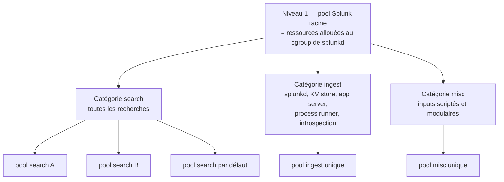
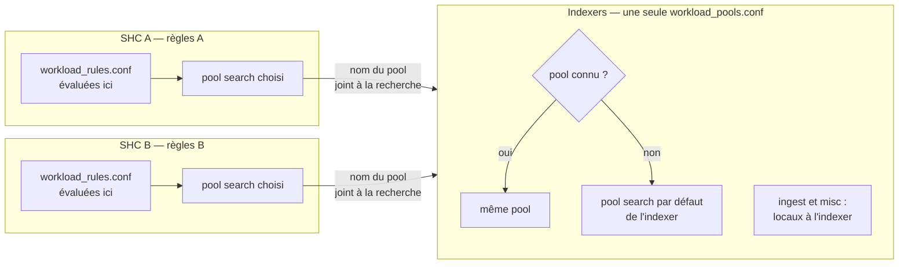
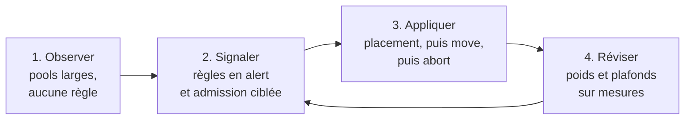

# Chapitre 9 — Workload Management : principes clés

> Fiche de référence **indépendante de la version et de l'archétype** :
> les invariants du Workload Management (WLM) Splunk Enterprise à
> connaître avant de concevoir des pools ou des règles. Elle est lisible
> seule et sert de socle aux guides opérationnels
> [search heads (ch. 6)](./06-guide-wlm-sh.md) et
> [indexers (ch. 7)](./07-guide-wlm-indexers.md).
>
> Vérifiée contre la documentation Splunk Enterprise **9.4 et 10.0**
> (novembre 2026). Chaque affirmation renvoie à sa source ; une version
> PDF de cette fiche est jointe au handbook :
> [`PDF/09-wlm-principes-cles.pdf`](./PDF/09-wlm-principes-cles.pdf).

## 1. Ce que WLM est — et n'est pas

WLM répartit des ressources **existantes** selon des priorités : il
n'en ajoute aucune. Sur une plateforme sous-dimensionnée, il décide
seulement qui souffre ([blog Splunk, partie 2][blog-p2]).

WLM ne choisit pas **où** une recherche s'exécute. Répartir la charge
entre sites d'un cluster multisite relève de la *search affinity*, pas
de WLM ([Splunk Community][comm-multisite]).

WLM s'appuie sur les **cgroups Linux** : il ne fonctionne que sous
Linux, et les cgroups doivent être en place avant toute configuration
([How WLM works 10.0][how-10]). En pratique, splunkd doit tourner comme
service systemd avec délégation des cgroups ([TekStream][tekstream]).

## 2. La hiérarchie à trois niveaux

- **Niveau 1.** La base de calcul n'est pas la RAM physique, mais ce
  qui est alloué au cgroup de Splunk ([How WLM works 9.3][how-93]). Si
  l'unité systemd porte une limite mémoire, c'est elle la base — et
  l'OOM du cgroup peut frapper bien avant que la machine soit pleine
  ([Splunk Community][comm-oom]).
- **Niveau 2.** Trois catégories, et seulement trois : `search`,
  `ingest`, `misc` ([workload_pools.conf 10.0][spec-pools]). Il n'existe
  pas de catégorie propre aux recherches distribuées côté indexer.
- **Niveau 3.** Plusieurs pools possibles dans `search` ; `ingest` et
  `misc` n'en contiennent qu'un, qui est leur pool par défaut
  ([workload_pools.conf 10.0][spec-pools]).

Chaque catégorie doit avoir un pool marqué `default_category_pool`
quand WLM est activé ([workload_pools.conf 10.0][spec-pools] ; voir
aussi [F-WLM-01](./04-findings-empiriques.md#f-wlm-01--chaque-catégorie-exige-un-pool-default)).

## 3. Ce que contient chaque catégorie

| Catégorie | Processus | Conséquence de conception |
| --- | --- | --- |
| `search` | Toutes les recherches : ad hoc, planifiées, accélérations de rapports et de data models, summary indexing | La seule catégorie où l'on crée des pools métier |
| `ingest` | Indexation **et cœur de Splunk** : splunkd, process runner, KV store, app server, introspection | Ne jamais l'affamer, **y compris sur un search head** : l'UI et le KV store y vivent |
| `misc` | Inputs scriptés et modulaires | Quasi vide sur un indexer pur ; à surveiller là où tournent des add-ons de collecte |

Source : [How WLM works 10.0][how-10].

Le piège classique : réduire `ingest` sur les search heads « parce
qu'ils n'indexent pas ». C'est oublier que splunkd, Splunk Web et le
KV store en dépendent, sous une limite mémoire dure (§5). Les retours
de la communauté vont dans le même sens : calibrer chaque catégorie sur
les médianes **et les pics** observés, avec une marge généreuse
([Splunk Community][comm-categories]).

## 4. CPU : un poids relatif, un plancher garanti, un plafond souple

- Les `cpu_weight` sont **relatifs** : un pool reçoit sa part en
  proportion de son poids sur la somme des poids
  ([How WLM works 10.0][how-10]).
- Cette part n'est **pas un plafond** : un pool qui la dépasse emprunte
  le CPU inutilisé des autres pools **de sa catégorie**
  ([How WLM works 10.0][how-10]).
- Elle joue comme un **minimum garanti en cas de contention**. Sans
  contention, des poids égaux sont quasiment transparents.
- Une catégorie à pool unique (`ingest`, `misc`) reçoit de fait tout le
  CPU de la catégorie, quel que soit le poids du pool.

Calcul de la part garantie : `poids du pool / somme des poids des pools
de la catégorie × poids de la catégorie`. Exemple : quatre pools
`search` à 25/50/100/25 dans une catégorie à 70 % donnent 35 % garantis
au pool de poids 100.

## 5. Mémoire : un plafond dur, sans garantie ni emprunt

- Le `mem_weight` d'un pool est un **pourcentage absolu de la mémoire
  de sa catégorie** ([How WLM works 10.0][how-10]) — ce n'est pas une
  part relative comme pour le CPU.
- C'est un **plafond dur** : un pool ne peut pas emprunter la mémoire
  inutilisée des autres ([How WLM works 9.3][how-93]).
- Au dépassement, le **noyau Linux tue un processus du pool** selon son
  score OOM ([How WLM works 10.0][how-10]) : la recherche échoue, les
  autres pools ne sont pas touchés.
- Ce n'est **pas une réservation**. Rien n'impose que la somme des
  `mem_weight` fasse 100 ([workload_pools.conf 10.0][spec-pools]) :
  quatre pools à 100 % chacun est une configuration valide, où chacun
  peut utiliser toute la mémoire de la catégorie.

Deux conséquences pratiques :

1. **Découper la mémoire en parts qui somment à 100 crée une partition
   stricte.** Un pool à 35 % se fait tuer des recherches alors que la
   catégorie a encore de la mémoire libre ailleurs. C'est la cause la
   plus probable de « recherches tuées sans saturation visible ».
2. **Pour garantir de la mémoire à un pool, il faut plafonner les
   autres.** Trois pools plafonnés à 70 % laissent au quatrième au moins
   30 %. C'est la même mécanique que l'exemple Splunk où les catégories
   `search` et `misc`, plafonnées à 70 % cumulés, protègent 30 % pour
   l'ingestion ([blog Splunk, partie 1][blog-p1]).

| | CPU | Mémoire |
| --- | --- | --- |
| Nature du poids | Relatif entre pools | Absolu, en % de la catégorie |
| Ce qu'il garantit | Une part en cas de contention | Rien |
| Ce qu'il plafonne | Rien (emprunt possible) | Tout dépassement |
| Pool saturé | Les recherches ralentissent | Une recherche est tuée (OOM) |

## 6. Mode distribué : qui décide, qui applique

- **Les règles sont évaluées sur le search head**
  ([How WLM works 10.0][how-10]). `workload_rules.conf` n'a pas à être
  poussé sur les indexers ([Distributed deployments 10.0][dist-10]).
- **Seul le pool `search` voyage.** Une recherche s'exécute dans le
  **même pool, par son nom**, sur le search head et sur chaque indexer ;
  si l'indexer ne connaît pas ce pool, elle tombe dans le pool `search`
  par défaut de l'indexer ([How WLM works 10.0][how-10]). Les catégories
  `ingest` et `misc` restent propres à chaque instance.
- **Les allocations peuvent différer** entre search heads et indexers
  ([Distributed deployments 10.0][dist-10]) : on peut réduire la part
  `search` sur les indexers sans toucher aux search heads.
- **Plusieurs SHC sur les mêmes indexers.** Chaque SHC applique ses
  règles indépendamment ([blog Splunk, bonnes pratiques][blog-bp]) et ne
  voit pas la charge des autres. Les indexers, eux, n'ont qu'une
  configuration de pools, commune à tous.

Patterns qui en découlent :

1. **Aligner les noms** des pools `search` entre chaque SHC et les
   indexers, avec un préfixe par SHC pour éviter les collisions.
2. **Créer un pool côté indexers avant de le référencer côté SHC.**
   L'inverse fait tomber les recherches dans le pool par défaut le temps
   du décalage.
3. **Un pool `search` par défaut dédié et nommé explicitement sur les
   indexers** (par exemple `idx_default_unmapped`) sert de témoin : tout
   ce qui y atterrit signale un pool inconnu. Il faut alors déclarer sur
   les indexers les pools par défaut de chaque SHC, sinon le témoin se
   remplit de recherches légitimes. Il n'existe pas de repli par SHC
   d'origine : un seul pool par défaut par catégorie et par indexer
   ([workload_pools.conf 10.0][spec-pools]).

## 7. Règles de workload : placement, puis surveillance

| Type | Moment | Prédicat `runtime` | Actions |
| --- | --- | --- | --- |
| Placement | Au lancement | Interdit | Placer dans un pool (clé `workload_pool`, sans `action`) |
| Surveillance | En cours d'exécution | **Obligatoire** | `abort`, `move`, `alert` |

Source : [Configure workload rules 10.0][rules-10] et
[workload_rules.conf 10.0][spec-rules].

- **Ordre.** Les règles s'évaluent dans l'ordre de
  `[workload_rules_order]` ; la première qui correspond déclenche son
  action. Elles sont évaluées au lancement puis **toutes les dix
  secondes** ([Configure workload rules 10.0][rules-10]).
- **Abort avant move.** Si une règle « move après 5 min » est placée
  au-dessus d'une règle « abort après 10 min », elle se redéclenche à
  chaque réévaluation et l'abort ne se produit jamais
  ([exemples WLM][examples]). Les règles les plus sévères vont en haut.
- **`alert` = « Display a Message ».** L'action s'écrit `alert` dans
  `workload_rules.conf` ; Splunk Web l'appelle *Display a Message*
  ([workload_rules.conf 10.0][spec-rules], [Configure workload rules 10.0][rules-10]).
  Le message n'est visible que des utilisateurs qui détiennent les
  quatre capabilities WLM (`list_workload_pools`, `edit_workload_pools`,
  `list_workload_rules`, `select_workload_rules`) : ce n'est **pas** un
  canal vers l'utilisateur final. Les déclenchements se comptent dans le
  tableau de bord *Workload Management Monitoring* de la Monitoring
  Console ([Monitor WLM 10.0][monitor-10]).
- **Recherches de base seulement.** Les règles ne s'appliquent pas aux
  sous-recherches ([Configure workload rules 10.0][rules-10]).
- **Pas de rechargement manuel nécessaire après modification des
  règles** : elles prennent effet sans redémarrage
  ([workload_rules.conf 10.0][spec-rules]).

## 8. Règles d'admission : filtrer avant le lancement

- Évaluées **avant** l'exécution, **toutes à la fois, sans ordre**. Si
  une recherche correspond à une règle `filter` et à une règle `queue`,
  elle est filtrée ([workload_rules.conf 10.0][spec-rules]).
- `queue` n'existe que pour les règles `adhoc_search_percentage`, qui
  exigent `search_type=adhoc` comme seul autre prédicat ; la valeur
  s'applique **par membre** de SHC ([Admission rules 10.2][admission]).
- Les recherches ad hoc sont évaluées à leur lancement ; les recherches
  planifiées le sont **de façon asynchrone toutes les 600 s** : une
  modification peut mettre dix minutes à s'appliquer
  ([Admission rules 10.2][admission]).
- L'activation globale vit dans `workload_policy.conf`, stanza
  `[search_admission_control]`, désactivée par défaut
  ([workload_policy.conf 10.0][spec-policy]). Par défaut le fichier est
  écrit dans l'app `search` ([Admission rules 10.2][admission]) : un
  déploiement par deployer doit l'emporter **aussi**, sinon les règles
  existent sans être actives. Un cas de la communauté — règles
  appliquées sur un seul nœud — est compatible avec ce scénario, sans
  que le fil l'ait tranché ([Splunk Community][comm-cm-only]).
- Le message à l'utilisateur s'affiche sous la barre de recherche pour
  l'ad hoc, mais seulement dans `scheduler.log` pour les recherches
  planifiées ([Admission rules 10.2][admission]).

## 9. Les pièges des prédicats

| Piège | Comportement réel | Parade |
| --- | --- | --- |
| `index=*` | Correspondance **littérale** avec la chaîne `index=*` (ou `index=_*`), pas un joker | Cibler explicitement, ou passer par `indexes_count` en admission |
| Recherches « all time » | Ne correspondent qu'aux règles `search_time_range=alltime`, jamais aux seuils numériques | Écrire une règle `alltime` dédiée |
| Clients REST | Sans plage explicite, une recherche REST est en « all time » | Exclure les apps et comptes techniques concernés |
| Héritage de rôles | Un `admin` hérite de `user` et `power` : il correspond à `role=user` | Utiliser `user=<nom>` pour viser un compte précis |
| Utilisateur `nobody` | Invalide dans un prédicat ; `splunk-system-user` est valide | Exclure par `app=` plutôt que par utilisateur |
| `srchTimeWin` | Ne s'applique ni aux règles de workload ni aux règles d'admission | Les deux mécanismes coexistent sans se parler |
| Fuseau des planifications | Fuseau du système, pas celui de l'utilisateur | Raisonner en heure serveur |
| Opérateur `=` sur une durée | Peut rater les plages « snap to » | Préférer `>` (ex. `search_time_range>24h`) |
| Seuil numérique de plage | Selon la version, exige `numeric_search_time_range = true` dans `[general]` de `workload_rules.conf` (avec un coût de performance) | Vérifier la spec de la version déployée |

Sources : [Configure workload rules 10.0][rules-10],
[Admission rules 10.2][admission], [workload_rules.conf 10.0][spec-rules].

Retour terrain : un client a appliqué l'exemple officiel « pas de
recherche all time » et bloqué des recherches internes (nettoyage de
modèles, télémétrie, regroupement d'événements ITSI), toutes exécutées
sous `nobody` — qu'il n'a pas pu exclure par l'utilisateur
([Splunk Community][comm-alltime]). Avant toute règle d'admission
`alltime` ou `index=*`, recenser les recherches planifiées des apps
techniques et des apps premium, et les exclure par `app=`. Le blog
Splunk recommande une règle à la fois, observée au moins 24 h
([blog Splunk, admission rules][blog-admission]).

## 10. Déployer sans se piéger

- **Prérequis vérifiables.** Les *preflight checks* (page Workload
  Management, endpoint REST de statut, ou `splunk check workload-config`
  selon [TekStream][tekstream]) valident l'OS, les cgroups et la
  délégation systemd — pas le dimensionnement. Sur 10.0, un statut
  global `general.preflight_check_status` est exposé par l'endpoint des
  preflight checks ; le texte de remédiation s'affiche toujours, quel
  que soit le résultat.
- **Search head cluster : un seul canal.** Réplication de configuration
  *ou* push du deployer, jamais les deux : les mélanger peut faire
  échouer WLM ([Distributed deployments 10.0][dist-10]). Le push du
  deployer déclenche un rechargement sur chaque membre
  ([Distributed deployments 9.2][dist-92]).
- **Cluster d'indexers.** `workload_pools.conf` passe par le bundle du
  cluster manager ; après distribution, les peers **rechargent**
  automatiquement le fichier ([Distributed deployments 10.0][dist-10]).
  Un rolling restart n'est attendu que si d'autres fichiers du bundle
  l'exigent ; le vérifier avec la validation du bundle avant de pousser.
- **Reload ou restart ?** La documentation décrit un rechargement ; la
  spec de `workload_pools.conf` prévient qu'un redémarrage peut être
  nécessaire ([workload_pools.conf 10.0][spec-pools]) ; le lab de ce
  guide a eu besoin d'un restart à la **première** activation
  ([F-WLM-08](./04-findings-empiriques.md#f-wlm-08--restart-splunkd-doit-être-en-root-direct)).
  Prévoir un restart à la première activation, un reload ensuite.
- **App dédiée.** Isoler `workload_pools.conf`, `workload_rules.conf` et
  `workload_policy.conf` dans une app sans autre contenu, pour que son
  déploiement ne déclenche pas de restart induit.
- **Points systemd remontés par le terrain** :
  - `systemctl stop Splunkd` qui ne rend pas la main (timeout de l'unité)
    sur RHEL 8 après passage aux cgroups v2
    ([Splunk Community][comm-stop-hang]) — chronométrer un arrêt en
    recette ;
  - `/proc` monté avec `hidepid` : splunkd ne peut plus lire
    `/proc/1/cgroup` et journalise des avertissements en boucle
    ([Splunk Community][comm-hidepid]) — à vérifier sur les serveurs
    durcis.

## 11. Démarche progressive

1. **Observer.** Activer WLM avec des plafonds mémoire larges (100 % par
   pool) et des poids CPU égaux : quasi transparent, mais la Monitoring
   Console mesure déjà la consommation par pool, par app, par rôle et
   par type de recherche ([Monitor WLM 10.0][monitor-10]). Avant même
   l'activation, les données d'introspection donnent la consommation par
   classe de processus.
2. **Signaler.** Règles de surveillance en `alert`, en gardant en tête
   que le message n'est visible que des administrateurs WLM (§7) : la
   mesure se lit dans la Monitoring Console.
3. **Appliquer.** Placement d'abord (bénin), puis `move`, puis `abort` ;
   les règles `abort` au-dessus des règles `move` (§7). Exclure
   explicitement les accélérations (`search_type=datamodel_acceleration`)
   et les recherches de détection des règles d'abort : un abort crée un
   trou de couverture silencieux.
4. **Réviser.** Ne séparer les plafonds mémoire qu'une fois les besoins
   réels connus — en regardant les pics, pas les moyennes.

## À retenir

- CPU : poids **relatif**, plancher garanti en contention, emprunt
  possible. Mémoire : plafond **absolu** par catégorie, ni garanti ni
  empruntable, sanction par OOM.
- Trois catégories seulement ; `ingest` porte le cœur de Splunk, y
  compris sur un search head.
- Les règles vivent sur les search heads ; seul le **nom** du pool
  `search` voyage vers les indexers, avec repli sur un pool par défaut
  unique.
- Ordre des règles : la plus sévère en haut. Admission : pas d'ordre,
  activation dans `workload_policy.conf`.
- `index=*`, « all time », héritage de rôles et `nobody` : les quatre
  pièges de prédicats qui font le plus de dégâts.

## Sources

### Documentation officielle Splunk

- [How workload management works — 10.0][how-10]
- [How workload management works — 9.3][how-93]
- [Configure workload pools — 10.0](https://help.splunk.com/en/splunk-enterprise/administer/manage-workloads/10.0/configure-workload-management)
- [Configure workload rules — 10.0][rules-10]
- [Configure admission rules to prefilter searches — 10.2][admission]
- [Configure workload management on distributed deployments — 10.0][dist-10]
- [Configure workload management on distributed deployments — 9.2][dist-92]
- [Monitor workload management using the monitoring console — 10.0][monitor-10]
- [Workload management examples][examples]
- [workload_pools.conf — 10.0.4][spec-pools]
- [workload_rules.conf — 10.0.0][spec-rules]
- [workload_policy.conf — 10.0.1][spec-policy]

### Blogs Splunk

- [Best Practices for Using Splunk Workload Management][blog-bp]
- [Get in Command of Splunk Resources with Workload Management — Part 1][blog-p1]
- [Get in Command of Splunk Resources with Workload Management — Part 2][blog-p2]
- [Admission Rules: Use Cases and Best Practices][blog-admission]

### Retours d'expérience

- [Splunk Community — Workload Management Rule: No AllTime searches][comm-alltime]
- [Splunk Community — Admission Rules only working on Cluster Master][comm-cm-only]
- [Splunk Community — Setting Workload Categories for Workload Management][comm-categories]
- [Splunk Community — Splunk service on indexer killed by OOM killer][comm-oom]
- [Splunk Community — systemctl stop Splunkd hangs][comm-stop-hang]
- [Splunk Community — Invalid file path /proc/1/cgroup][comm-hidepid]
- [Splunk Community — Workload Management Configuration (multisite)][comm-multisite]
- [TekStream — Taking Action with Workload Management in Splunk Cloud][tekstream]

[how-10]: https://help.splunk.com/en/splunk-enterprise/administer/manage-workloads/10.0/workload-management-overview/how-workload-management-works
[how-93]: https://help.splunk.com/en/splunk-enterprise/administer/manage-workloads/9.3/workload-management-overview/how-workload-management-works
[rules-10]: https://help.splunk.com/en/splunk-enterprise/administer/manage-workloads/10.0/configure-workload-management/configure-workload-rules
[admission]: https://help.splunk.com/en/splunk-enterprise/administer/manage-workloads/10.2/configure-workload-management/configure-admission-rules-to-prefilter-searches
[dist-10]: https://help.splunk.com/en/splunk-enterprise/administer/manage-workloads/10.0/configure-workload-management/configure-workload-management-on-distributed-deployments
[dist-92]: https://help.splunk.com/en/splunk-enterprise/administer/manage-workloads/9.2/configure-workload-management/configure-workload-management-on-distributed-deployments
[monitor-10]: https://help.splunk.com/en/splunk-enterprise/administer/manage-workloads/10.0/monitor-workload-management
[examples]: https://docs.splunk.com/Documentation/Splunk/latest/Workloads/Workloadmanagementexamples
[spec-pools]: https://help.splunk.com/en/splunk-enterprise/administer/admin-manual/10.0/configuration-file-reference/10.0.4-configuration-file-reference/workload_pools.conf
[spec-rules]: https://help.splunk.com/en/splunk-enterprise/administer/admin-manual/10.0/configuration-file-reference/10.0.0-configuration-file-reference/workload_rules.conf
[spec-policy]: https://help.splunk.com/en/splunk-enterprise/administer/admin-manual/10.0/configuration-file-reference/10.0.1-configuration-file-reference/workload_policy.conf
[blog-bp]: https://www.splunk.com/en_us/blog/platform/best-practices-for-using-splunk-workload-management.html
[blog-p1]: https://www.splunk.com/en_us/blog/platform/get-in-command-of-splunk-resources-with-workload-management-part-1.html
[blog-p2]: https://www.splunk.com/en_us/blog/platform/get-in-command-of-splunk-resources-with-workload-management-part-2.html
[blog-admission]: https://www.splunk.com/en_us/blog/tips-and-tricks/admission-rules-use-cases-and-best-practices1.html
[comm-alltime]: https://community.splunk.com/t5/Splunk-Cloud-Platform/Workload-Management-Rule-No-AllTime-searches/m-p/623661
[comm-cm-only]: https://community.splunk.com/t5/Splunk-Search/Workload-Management-Admission-Rules-only-working-on-Cluster/m-p/547102
[comm-categories]: https://community.splunk.com/t5/Reporting/Setting-Workload-Categories-for-Workload-Management/m-p/478902
[comm-oom]: https://community.splunk.com/t5/Splunk-Search/Splunk-service-on-indexer-server-gets-killed-by-OOM-killer-when/td-p/467207
[comm-stop-hang]: https://community.splunk.com/t5/Splunk-Enterprise/systemctl-stop-Splunkd-hangs/m-p/747134
[comm-hidepid]: https://community.splunk.com/t5/Deployment-Architecture/9-0-3-Invalid-file-path-proc-1-cgroup-while-checking-container/m-p/649542
[comm-multisite]: https://community.splunk.com/t5/Deployment-Architecture/Workload-Management-Configuration/m-p/475403
[tekstream]: https://www.tekstream.com/blog/splunk-workload-management-rules/
