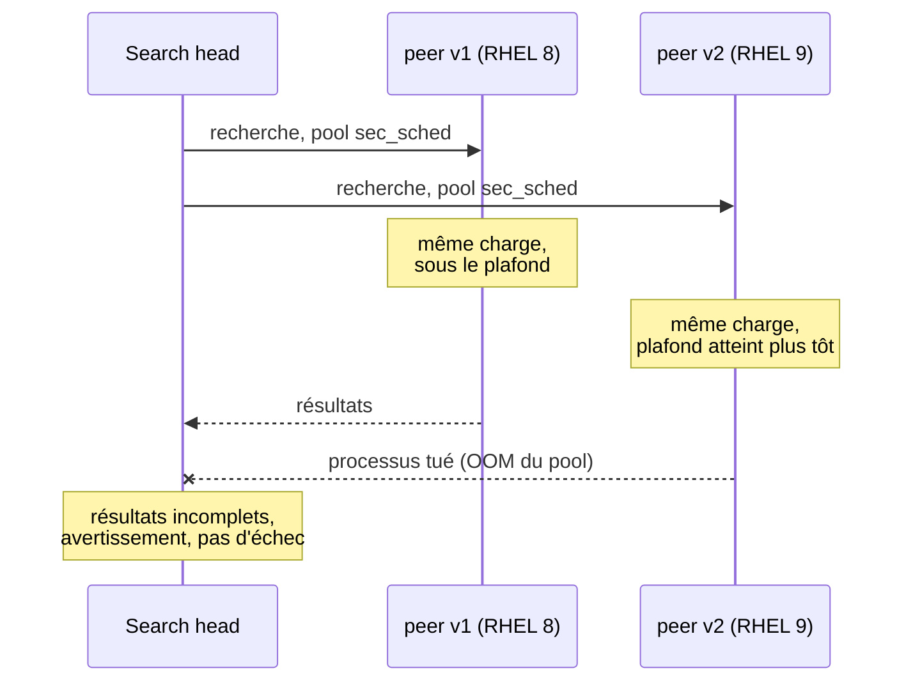
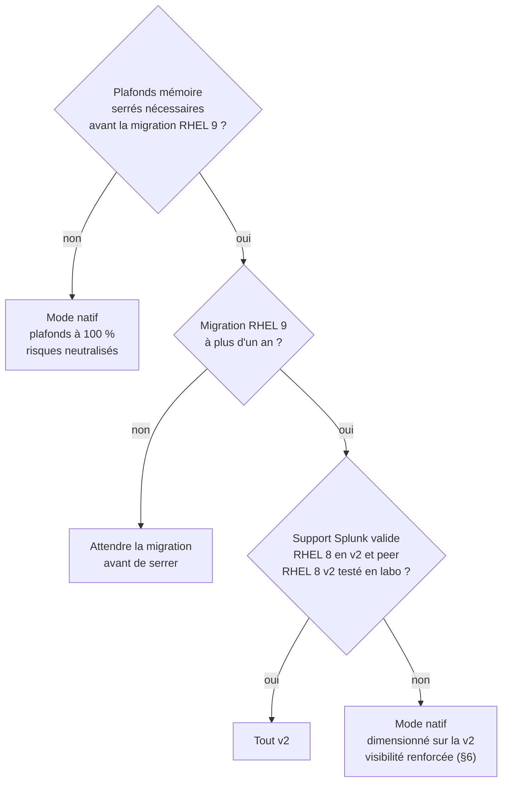

# Chapitre 10 — Workload Management : couche système et cohabitation cgroups v1/v2

> **Cadrage système historique ajouté le 19 novembre 2026**, notamment fondé sur la documentation Splunk 10.2 ; les déductions et points à tester ne sont pas des résultats de qualification.
> Gouvernance : [synthèse 2.0](./synthese/README.md) ; [correspondance sujet/version](./README.md#table-des-matières).
> Mise en place WLM : [chapitre configuration du handbook autonome](../splunk-wlm-configuration/02-configurer-wlm.md), dans son périmètre 10.4.5 ; exécution 10.2 non qualifiée. Ne pas combiner les anciennes étapes avec cette procédure.

> Ce chapitre traite ce qui se passe **sous** WLM : le choix de la version
> de cgroups, l'unité systemd de Splunk, les différences de traitement du
> noyau entre cgroups v1 et v2, et le cas d'un cluster d'indexers dont les
> peers ne sont pas tous dans le même mode. Il complète les
> [principes clés (chapitre 9)](./09-wlm-principes-cles.md) et le
> [guide indexers (chapitre 7)](./07-guide-wlm-indexers.md).
>
> Vérifié en novembre 2026 contre la documentation Splunk Enterprise 10.2,
> la documentation du noyau Linux, les pages de manuel systemd et la
> documentation Red Hat Enterprise Linux 8 et 9.

## Niveau de preuve

Chaque affirmation porte l'un de ces repères :

| Repère | Signification |
| --- | --- |
| **[D]** | Documenté par la source citée |
| **[I]** | Déduit de plusieurs faits documentés ; raisonnement explicité |
| **[T]** | Non documenté : à confirmer en labo avant d'en dépendre |

La documentation Splunk ne dit ni quels fichiers de cgroups WLM écrit, ni
avec quelles options, ni d'où viennent ses métriques par pool. Tout ce qui
en dépend est donc **[T]**.

## 1. Quelle version de cgroups Splunk utilise

### 1.1 Une détection automatique

À partir de la 9.4, Splunk détecte la version de cgroups du système et
l'utilise, sans action ni paramètre **[D]**
([Configure cgroups v2 — 10.2][spl-v2]). Aucun réglage de `server.conf` ou
de `workload_pools.conf` ne force une version. La version utilisée est
donc **celle que l'OS monte au démarrage**.

### 1.2 Combinaisons OS / mode

| OS | Mode | Statut Splunk | Statut OS | Source |
| --- | --- | --- | --- | --- |
| RHEL 8 | v1 | Nominal | Défaut de RHEL 8 | [D] [spl-req], [rh8-rm] |
| RHEL 8 | v2 | **Exception** : contacter le support Splunk, référence RHEL-63896 | Activable par paramètre noyau | [D] [spl-req] |
| RHEL 9 | v2 | Nominal (cité par Splunk avec AL2023 et Ubuntu 22) | Défaut de RHEL 9 | [D] [spl-req], [rh9-k] |
| RHEL 9 | v1 | Non décrit pour 9.4+ ; cité par Lantern comme contournement pour Splunk ≤ 9.2 | Déprécié en RHEL 9 ; bloque la montée en RHEL 10 | [D] [lantern], [leapp] |
| RHEL 10 | v2 | — | v1 retiré | [D] [leapp] |

Avant la 9.3, WLM ne fonctionne pas en v2 **[D]** ([Lantern][lantern]).

### 1.3 Deux pièges propres à RHEL 8 en v2

- **Contrôleur CPU inactivable.** En v2 sur RHEL 8, l'activation du
  contrôleur `cpu` échoue (`Invalid argument`) tant que des processus
  utilisateur tournent en ordonnancement temps réel : `rtkit-daemon`,
  logiciels de clustering, agents d'horodatage **[D]**
  ([Red Hat KB 6582021][rh-cpu]). WLM n'a alors aucun contrôle du CPU
  sur ce peer.
- **Dérive au reboot.** Sur RHEL 8, la v2 repose sur un paramètre noyau
  (`systemd.unified_cgroup_hierarchy=1`) **[D]** ([RHEL 8][rh8-rm]). Un
  noyau installé sans ce paramètre redémarre en v1, sans alerte **[I]**.

## 2. Déterminer le mode avant d'activer WLM

```bash
# Mode monté maintenant : cgroup2fs = v2 ; tmpfs = v1 ou hybride
stat -fc %T /sys/fs/cgroup

# Départager v1 et hybride
ls -d /sys/fs/cgroup/cpu /sys/fs/cgroup/memory   # présents : contrôleurs en v1
ls -d /sys/fs/cgroup/unified 2>/dev/null          # présent : mode hybride

# Mode au prochain démarrage (absent = défaut de la distribution)
grep -o 'systemd.unified_cgroup_hierarchy=[01]' /proc/cmdline
grubby --info=ALL | grep -E '^kernel|unified_cgroup'

# En v2 : contrôleurs disponibles et délégués à l'unité
cat /sys/fs/cgroup/cgroup.controllers
cat /sys/fs/cgroup/system.slice/Splunkd.service/cgroup.controllers

# En v2 sur RHEL 8 : processus temps réel qui bloquent le contrôleur cpu
ps axo pid,cls,cmd | awk '$2 ~ /(FF|RR)/' | grep -v '\['
```

Contrôles documentés : répertoires `/sys/fs/cgroup/cpu` et `memory` pour
la v1, `cgroup.controllers` pour la v2, `mount | grep cgroup` **[D]**
([Lantern][lantern]). En mode hybride, le CPU et la mémoire restent gérés
en v1 ; WLM tournera donc en v1 **[I]** (la documentation Splunk ne traite
pas ce mode).

Côté Splunk, le preflight check cgroups se lit avant l'activation. La
confirmation explicite arrive après : `splunk show
workload-management-status --verbose` affiche le préfixe « V2 » devant
les chemins *CPU Group* et *Memory Group* **[D]** ([Configure cgroups v2
— 10.2][spl-v2]).

## 3. L'unité systemd de Splunk

### 3.1 Directives et mode de cgroups

| Directive | Statut | Comportement |
| --- | --- | --- |
| `CPUShares=`, `MemoryLimit=` | Directives v1, **dépréciées** depuis systemd 252 | [D] [sd-rc] |
| `CPUWeight=` | v2 : `cpu.weight`, de 1 à 10 000, défaut 100 | [D] [sd-rc], [k-v2] |
| `MemoryMax=` | v2 : `memory.max` | [D] [sd-rc] |
| `MemoryHigh=`, `MemoryLow=`, `MemoryMin=`, `MemorySwapMax=` | Décrites uniquement pour la v2 | [D] [sd-rc] |
| Traduction des directives v2 vers la v1 (et l'inverse) | Non documentée par la page de manuel actuelle | [T] |
| Précédence quand `MemoryLimit=` et `MemoryMax=` coexistent | Non documentée | [T] |

Conséquences :

- **N'écrire qu'un jeu de directives**, celui du mode réel de l'hôte. Les
  échelles diffèrent (`CPUShares` 1024 par défaut, `CPUWeight` 100) : une
  valeur écrite dans la mauvaise échelle donne à Splunk dix fois trop ou
  dix fois trop peu de priorité face aux autres services de l'hôte **[I]**.
- **La source de vérité est le fichier de cgroup**, pas l'unité :
  `systemctl show` affiche ce qui est configuré, pas ce que le noyau
  applique.

```bash
systemctl --version | head -1
systemd-analyze verify /etc/systemd/system/Splunkd.service
systemctl show Splunkd -p CPUWeight -p CPUShares -p MemoryMax -p MemoryLimit -p MemoryHigh -p Delegate -p OOMPolicy
# v2
cat /sys/fs/cgroup/system.slice/Splunkd.service/memory.max
cat /sys/fs/cgroup/system.slice/Splunkd.service/cpu.weight
# v1
cat /sys/fs/cgroup/memory/system.slice/Splunkd.service/memory.limit_in_bytes
cat /sys/fs/cgroup/cpu,cpuacct/system.slice/Splunkd.service/cpu.shares
```

### 3.2 Délégation

`Delegate=` permet aux processus de l'unité de gérer leur propre
sous-arborescence de cgroups ; systemd cesse alors de gérer ce qui est
en dessous **[D]** ([systemd.resource-control][sd-rc]). Sur la
hiérarchie v1, la délégation **n'est pas accordée aux services non
privilégiés** **[D]** (même source). C'est ce qui explique les
`ExecStartPost` qui font un `chown` des cgroups v1 vers l'utilisateur
`splunk` dans les unités générées sur des hôtes v1 **[I]**.

Conséquence : une unité générée pour un mode ne doit pas être recopiée
sur un hôte de l'autre mode. Une unité v1 recopiée sur un hôte v2 peut
empêcher Splunk de démarrer (retour communautaire, [Splunk Community][comm-v2unit]). Une
unité v2 recopiée sur un hôte v1 prive Splunk des droits sur ses
sous-cgroups : les preflight checks échouent **[I]**.

Procédure documentée pour changer de mode : arrêter Splunk, `splunk
disable boot-start`, reconfigurer l'OS, `splunk enable boot-start
-systemd-managed 1`, démarrer, configurer WLM **[D]** ([Configure cgroups
v2 — 10.2][spl-v2]).

### 3.3 Limite mémoire sur l'unité

Une `MemoryMax=` (ou une ancienne `MemoryLimit=`) sur l'unité a deux
effets :

1. **Elle devient la base de calcul de WLM.** Le pool racine est
   dimensionné sur ce qui est alloué au cgroup de Splunk, pas sur la RAM
   **[D]** ([How WLM works 9.3][spl-how93]).
2. **C'est un second plafond dur, au-dessus des pools.** Au plafond d'un
   cgroup, le noyau récupère de la mémoire, puis l'OOM killer agit **dans
   ce cgroup** **[D]** ([cgroup v2][k-v2]). Au niveau de l'unité, le
   cgroup contient **tous** les processus Splunk : la victime peut être
   splunkd principal, pas seulement une recherche **[I]**. Le peer quitte
   alors le cluster.

Une valeur figée à la RAM de l'installation devient un plafond inférieur
à la RAM réelle après un agrandissement de la VM **[I]**. Poser une limite
d'unité de façon délibérée, au-dessus de la somme des catégories, ou ne
pas en poser.

### 3.4 `OOMPolicy`

| Valeur | Effet quand un processus de l'unité est tué par l'OOM |
| --- | --- |
| `continue` | Journalisé ; l'unité continue |
| `stop` | Les processus de l'unité sont arrêtés proprement ; état `oom-kill` |
| `kill` | `memory.oom.group = 1` : le noyau tue tous les processus restants |

Source : [systemd.service][sd-svc] **[D]**. Apparu dans systemd 243
(absent de RHEL 8, qui a systemd 239). La valeur par défaut est
`DefaultOOMPolicy=` ; **les unités avec `Delegate=` activé ont
`continue` par défaut** **[D]**. La page ne dit pas si un OOM survenu
dans un sous-cgroup délégué compte pour l'unité **[T]**. Or en v2,
`memory.events` d'un cgroup **inclut** les événements de ses descendants
**[D]** ([cgroup v2][k-v2]).

Recommandation : vérifier la valeur effective (`systemctl show Splunkd -p
OOMPolicy`), et la fixer explicitement à `continue` par une surcharge
(*drop-in*) de l'unité. Un OOM de pool ne doit jamais pouvoir arrêter
splunkd.

## 4. Ce que le noyau fait différemment en v1 et en v2

### 4.1 Mémoire comptée contre le plafond

| Élément | v1 | v2 |
| --- | --- | --- |
| Mémoire anonyme, page cache | Comptés | Comptés |
| Mémoire noyau (dentries, inodes, slab) | Imputée au compteur principal, activée par défaut sur les noyaux récents ; le comportement des noyaux anciens et l'option `cgroup.memory=nokmem` sont à vérifier | Comptée |
| Buffers des sockets TCP | Compteur séparé (`memory.kmem.tcp.*`, déprécié) ; inclusion dans le compteur principal non précisée | Comptés |
| Exactitude du compteur | `memory.usage_in_bytes` est une valeur approximative ; la doc recommande `memory.stat` | `memory.current` |

Sources : [cgroup v1 memory][k-v1], [cgroup v2][k-v2] **[D]**.

Sur un indexer, la partie distante d'une recherche ouvre de nombreux
fichiers et renvoie ses résultats par le réseau : ce sont précisément les
postes dont la comptabilité diffère. **À plafond égal, un peer v2 atteint
son plafond plus tôt qu'un peer v1** **[I]**. L'ampleur de l'écart dépend
de la charge et du noyau **[T]**.

### 4.2 Au plafond

| | v1 | v2 |
| --- | --- | --- |
| Avant l'OOM | Récupération de mémoire | Récupération de mémoire ; `memory.high` peut ralentir et récupérer sans tuer |
| Victime de l'OOM | Le processus le plus gros du cgroup | Un processus du cgroup, ou **tous** si `memory.oom.group = 1` |
| Suspension au lieu de tuer | `oom_kill_disable` : les tâches peuvent s'arrêter (`under_oom`) | N'existe pas |
| Swap | Limite mémoire + swap via `memsw` si `CONFIG_SWAP` | `memory.swap.max`, illimité par défaut |
| Protection | `soft_limit_in_bytes` sans effet sur les noyaux récents | `memory.low`, `memory.min` |

Sources : [cgroup v1 memory][k-v1], [cgroup v2][k-v2] **[D]**. Quelles
options WLM règle réellement (`memory.high`, `memory.oom.group`, swap) :
**[T]**.

Le page cache d'une page partagée est imputé au premier cgroup qui la lit,
dans les deux modes **[D]**. Avec des plafonds serrés, l'éviction du cache
d'un pool sous pression ralentit aussi les autres pools qui lisaient les
mêmes buckets **[I]**.

### 4.3 CPU

Partage proportionnel dans les deux modes : `cpu.shares` en v1,
`cpu.weight` en v2, de 1 à 10 000, défaut 100 **[D]** ([cgroup v2][k-v2]).
Splunk convertit les poids ; écart attendu limité à l'arrondi **[I]**. En
v2, un cgroup non racine qui délègue un contrôleur à ses enfants ne peut
pas contenir de processus lui-même (*no internal process*) **[D]**.

## 5. Cohabitation v1 / v2 en cible avec des pools limitants

Ce cas est celui d'un parc RHEL 8 (v1) et RHEL 9 (v2) conservé
durablement, avec des plafonds mémoire serrés sur certains pools.

### 5.1 Contrainte structurante : un seul bundle

Le cluster manager distribue la même configuration à tous les peers.
Les plafonds sont donc identiques sur les peers v1 et v2, sans
compensation par mode **[I]**. Une surcharge locale par peer sortirait de
la gouvernance du bundle, et sa précédence face à `peer-apps` est à
vérifier **[T]**.

Règle de dimensionnement : **mesurer les pics sur les peers v2** et poser
les plafonds à partir d'eux. Les peers v1 gardent une marge cachée, au
prix d'une capacité inutilisée **[I]**.

### 5.2 Effet sur une recherche distribuée



- L'utilisateur reçoit des **résultats incomplets** avec un
  avertissement, sans échec de la recherche **[I]**.
- Le symptôme dépend des peers qui portent les buckets : il paraît
  aléatoire **[I]**.
- **Recherches planifiées de détection** : une corrélation qui reçoit des
  résultats incomplets peut ne pas lever son alerte. Le trou de
  couverture n'apparaît que dans les journaux de recherche **[I]**.

### 5.3 Comparaison des options

| Option | Support | Opération en prod | Homogénéité du comportement | Avenir |
| --- | --- | --- | --- | --- |
| **Mode natif** (RH8 v1, RH9 v2) | Deux cas nominaux | Aucune | Non | Résolu par la migration RHEL 9 |
| **Tout v2** (RH8 v2, RH9 v2) | RH8 v2 en exception | Reboot et unité régénérée sur chaque RH8 | Proche (noyaux 4.18 et 5.14) | Compatible |
| **Tout v1** (RH9 repassé en v1) | RH9 v1 non décrit pour 9.4+ | Reboot et unité régénérée sur chaque RH9 | Oui | Impasse : bloque RHEL 10 |

Dans les trois cas, le cluster mélange RHEL 8 et RHEL 9. Or tous les
nœuds d'un cluster d'indexers, y compris un SHC rattaché et son deployer,
doivent tourner sous le même OS, **version comprise** **[D]**
([Indexer cluster requirements — 10.2][spl-idxreq]). Le correctif de fond
est la migration RHEL 8 → RHEL 9, qui règle en même temps l'homogénéité
des cgroups.



## 6. Visibilité en parc mixte

### 6.1 Métriques non comparables

En v1, `memory.usage_in_bytes` est approximatif ; en v2, `memory.current`
a un périmètre plus large **[D]** ([cgroup v1 memory][k-v1],
[cgroup v2][k-v2]). La source exacte des métriques par pool affichées par
Splunk n'est pas documentée **[T]**. Si elles viennent de ces compteurs,
le même pool à la même charge affiche des valeurs différentes selon le
mode **[I]**. Conséquences :

- une moyenne sur tout le déploiement mélange deux unités de mesure ;
- un « 70 % du plafond » ne représente pas la même distance à l'OOM sur
  un peer v1 et sur un peer v2 ;
- un dimensionnement sur les pics observés est faussé par les peers v1.

### 6.2 Signaux disponibles

| Signal | v1 | v2 |
| --- | --- | --- |
| Plafond touché | `memory.failcnt` : nombre de fois où la limite a été dépassée | `memory.events` : `max`, `high` |
| OOM survenu | `memory.oom_control` : `oom_kill` | `memory.events` : `oom`, `oom_kill`, `oom_group_kill` ; hiérarchique (`memory.events.local` pour le cgroup seul) |
| Pression avant l'OOM | Pas de PSI par cgroup | `memory.pressure` (PSI) par cgroup |

Sources : [cgroup v1 memory][k-v1], [cgroup v2][k-v2] **[D]**.

Conséquence : une alerte de pré-saturation ne couvre que les peers v2.
Sur les peers v1, rien ne signale l'approche du plafond avant l'OOM
**[I]**.

### 6.3 Ce qu'il faut ajouter à la Monitoring Console

La documentation des tableaux de bord WLM de la Monitoring Console ne
mentionne pas les OOM de pool ([Monitor WLM 10.0][spl-mon]) **[T]**. À
mettre en place :

1. **Étiquette de mode par peer** : OS, mode de cgroups, `memory.max` de
   l'unité, `OOMPolicy`, contrôleurs délégués. Source possible : un input
   scripté, ou le statut WLM qui affiche le préfixe « V2 ».
2. **Journal du noyau collecté dans Splunk**, avec une extraction qui
   accepte les formats des différents noyaux. C'est la source de vérité
   pour les OOM **[I]**.
3. **Tableaux de bord séparés par mode**, sans moyenne mixte.
4. **Pré-alerte** sur `memory.events` et `memory.pressure` pour la v2, sur
   `memory.failcnt` pour la v1.
5. **Résultats incomplets** : suivi des avertissements de résultats
   incomplets sur les recherches planifiées, en priorité celles de
   détection.

## 7. Checklist avant activation

- [ ] Mode de cgroups relevé sur chaque instance : maintenant **et** au
  prochain démarrage (§2).
- [ ] En v2 : contrôleurs `cpu` et `memory` disponibles et délégués à
  l'unité.
- [ ] RHEL 8 en v2 : validation écrite du support Splunk (RHEL-63896),
  aucun processus temps réel bloquant.
- [ ] Unité régénérée sur chaque hôte (`splunk enable boot-start
  -systemd-managed 1`), un seul jeu de directives, sans `MemoryLimit=`
  sur un hôte v2.
- [ ] Limite mémoire d'unité absente ou délibérée, au-dessus de la somme
  des catégories.
- [ ] `OOMPolicy=continue` vérifiée ou fixée par surcharge.
- [ ] Swap : présence et réglages identiques sur tout le parc.
- [ ] Parc mixte : plafonds à 100 % tant que l'étiquette de mode, la
  collecte du journal noyau et les tableaux de bord par mode (§6.3) ne
  sont pas en place.

## 8. Tests labo à prévoir

Pour lever les points **[T]**, avec un peer v1 et un peer v2, le même pool
et la même charge :

1. Seuil d'OOM réel d'un pool plafonné, sur chaque mode.
2. Fichiers de cgroups écrits par WLM : `memory.max`, `memory.high`,
   `memory.oom.group`, swap, poids CPU.
3. Victime de l'OOM : un processus ou tout le pool.
4. État de l'unité systemd après un OOM de pool (`OOMPolicy`).
5. Comportement avec et sans swap.
6. Source et valeur des métriques par pool dans la Monitoring Console,
   comparées aux fichiers de cgroups.
7. Message du noyau à l'OOM sur chaque version de noyau.

## À retenir

- Splunk utilise la version de cgroups que l'OS monte au démarrage : on
  la connaît avant l'activation en lisant `/sys/fs/cgroup` et la ligne de
  commande du noyau, **actuelle et suivante**.
- RHEL 8 en v1 et RHEL 9 en v2 sont les deux cas nominaux ; RHEL 8 en v2
  est une exception côté Splunk, RHEL 9 en v1 une impasse.
- L'unité systemd se régénère sur chaque hôte : un seul jeu de
  directives, pas de limite mémoire figée, `OOMPolicy=continue`.
- La v2 compte plus de mémoire contre le plafond : à plafond égal, les
  peers v2 lâchent en premier. En parc mixte, dimensionner sur la v2.
- Plafonds à 100 % : la cohabitation est sans conséquence. Plafonds
  serrés : risque de résultats incomplets, y compris sur la détection,
  et visibilité à construire mode par mode.

## Sources

### Splunk

- [Configure cgroups v2 in Splunk Enterprise — 10.2][spl-v2]
- [System requirements (workload management) — 10.2][spl-req]
- [How workload management works — 9.3][spl-how93]
- [Monitor workload management using the monitoring console — 10.0][spl-mon]
- [System requirements and other deployment considerations for indexer clusters — 10.2][spl-idxreq]
- [Lantern — Safeguarding Workload Management operation during the transition to cgroups v2][lantern]
- [Splunk Community — profil de contributeur, unités systemd et cgroups v2][comm-v2unit]

### Noyau Linux et systemd

- [Control Group v2 — documentation du noyau][k-v2]
- [Memory Resource Controller (cgroup v1) — documentation du noyau][k-v1]
- [systemd.resource-control(5)][sd-rc]
- [systemd.service(5) — `OOMPolicy=`][sd-svc]

### Red Hat et dérivés

- [RHEL 8 — Configuring resource management by using cgroups-v2 and systemd][rh8-rm]
- [RHEL 9 — Considerations in adopting RHEL 9, chapitre Kernel][rh9-k]
- [Red Hat KB 6582021 — The cpu controller in cgroup v2 can not be used in RHEL 8][rh-cpu]
- [AlmaLinux leapp-repository — inhibition de la montée 9 → 10 avec cgroups v1][leapp]

[spl-v2]: https://help.splunk.com/en/splunk-enterprise/administer/manage-workloads/10.2/set-up-linux-for-workload-management/configure-cgroups-v2-in-splunk-enterprise
[spl-req]: https://help.splunk.com/en/splunk-enterprise/administer/manage-workloads/10.2/set-up-linux-for-workload-management
[spl-how93]: https://help.splunk.com/en/splunk-enterprise/administer/manage-workloads/9.3/workload-management-overview/how-workload-management-works
[spl-mon]: https://help.splunk.com/en/splunk-enterprise/administer/manage-workloads/10.0/monitor-workload-management
[spl-idxreq]: https://help.splunk.com/en/splunk-enterprise/administer/manage-indexers-and-indexer-clusters/10.2/deploy-the-indexer-cluster/system-requirements-and-other-deployment-considerations-for-indexer-clusters
[lantern]: https://lantern.splunk.com/Splunk_Platform/Product_Tips/Searching_and_Reporting/Safeguarding_Workload_Management_operation_during_the_transition_to_cgroups_v2
[comm-v2unit]: https://community.splunk.com/t5/user/viewprofilepage/user-id/242107
[k-v2]: https://docs.kernel.org/admin-guide/cgroup-v2.html
[k-v1]: https://docs.kernel.org/admin-guide/cgroup-v1/memory.html
[sd-rc]: https://www.freedesktop.org/software/systemd/man/latest/systemd.resource-control.html
[sd-svc]: https://www.freedesktop.org/software/systemd/man/latest/systemd.service.html
[rh8-rm]: https://docs.redhat.com/en/documentation/red_hat_enterprise_linux/8/html/managing_monitoring_and_updating_the_kernel/assembly_configuring-resource-management-using-systemd_managing-monitoring-and-updating-the-kernel
[rh9-k]: https://docs.redhat.com/en/documentation/red_hat_enterprise_linux/9/html/considerations_in_adopting_rhel_9/assembly_kernel_considerations-in-adopting-rhel-9
[rh-cpu]: https://access.redhat.com/node/6582021
[leapp]: https://git.almalinux.org/rpms/leapp-repository/src/branch/c8/SOURCES/0066-Inhibit-upgrade-on-systems-with-cgroupsv1-on-9to10-1.patch
