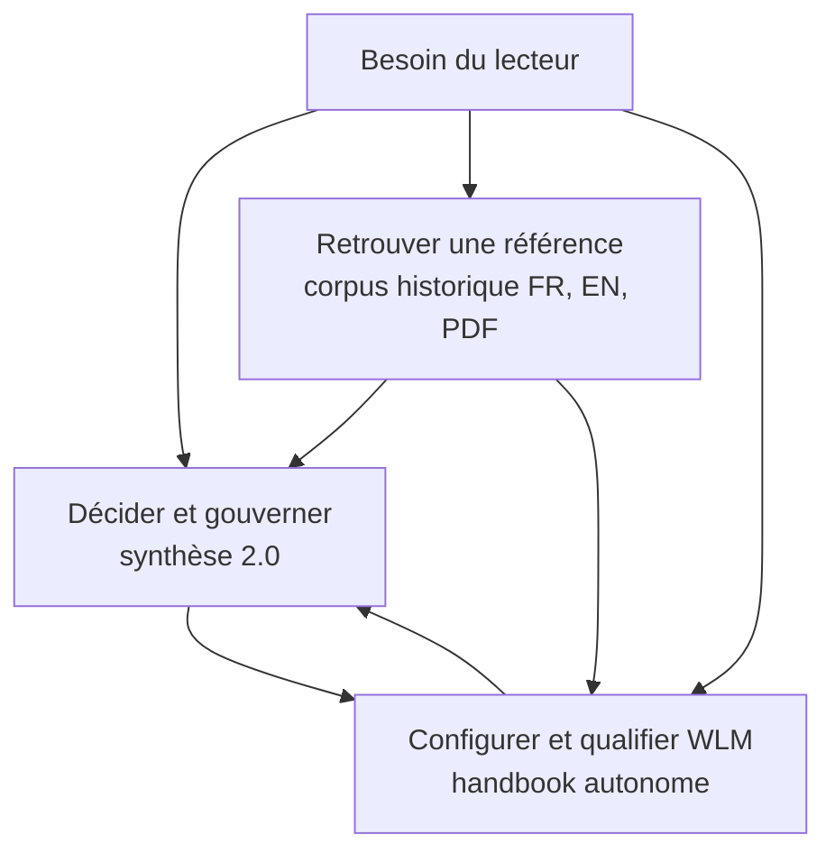

# Gouvernance des usages Splunk — guide d'approche

**Parcours de référence : [Gouverner les usages Splunk, synthèse 2.0](./synthese/README.md).** Cette édition organise décisions, responsabilités, RBAC, parcours utilisateurs, méthode, garde-fous et suivi. Elle ne remplace pas les anciens documents par une réécriture de leur contenu.

**Pour mettre en place WLM : [02. Configurer WLM pas à pas](../splunk-wlm-configuration/02-configurer-wlm.md)** dans le [handbook WLM autonome](../splunk-wlm-configuration/README.md). Les anciens chapitres WLM ci-dessous sont historiques, pas une procédure actuelle à combiner avec ce handbook.

> Langues : français canonique. La synthèse 2.0 est uniquement française.
> Le [corpus anglais conservé](./EN/README.md) traduit l'ancien guide 9.4.6,
> sans les corrections WLM françaises de novembre 2026 ; il ne traduit pas la synthèse.

## À qui ce guide s'adresse

Responsables de service, architectes, responsables des usages, administrateurs seniors et référents sécurité/IAM d'une plateforme Splunk Enterprise autogérée, notamment avec SHC et indexeurs partagés. Le lecteur connaît rôles, applications, knowledge objects et recherches planifiées.

## Ce que ce guide couvre

La [synthèse](./synthese/README.md#sommaire) constitue un ensemble cohérent en six chapitres :

| Chapitre | Objet |
| --- | --- |
| [00. Décisions et responsabilités](./synthese/00-decisions-et-responsabilites.md) | Politique, arbitrage, redevables et registre de décisions |
| [01. Habilitations et RBAC](./synthese/01-habilitations-rbac.md) | Catalogue de profils, droits effectifs, cumuls et cycle de vie |
| [02. Parcours et responsabilisation](./synthese/02-parcours-et-responsabilisation.md) | Accompagnement, contenu partagé et exceptions |
| [03. Méthode de transformation](./synthese/03-methode-de-transformation.md) | Baseline, qualification, pilote, vagues et réception |
| [04. Garde-fous et arbitrage WLM](./synthese/04-garde-fous-et-arbitrage-wlm.md) | Politique de ressources et remise à l'équipe de configuration |
| [05. Suivi et revue](./synthese/05-suivi-et-revue.md) | Indicateurs, couverture, limites de preuve et décisions correctives |

Les anciens chapitres restent des références historiques ciblées. La [table de correspondance](#table-des-matières) indique leur version et le point de lecture approprié aujourd'hui.

## Ce que ce guide ne couvre pas

- La configuration WLM, systemd/cgroups et les étapes de distribution : voir le [chapitre configuration du handbook WLM](../splunk-wlm-configuration/02-configurer-wlm.md).
- L'installation de Splunk ou d'un SHC, les intégrations IdP propres à une organisation et les procédures Cloud.
- L'écriture quotidienne de SPL : voir le [handbook utilisateur](../splunk-user-handbook/README.md).
- Le catalogue complet des activités RUN : voir le [handbook d'exploitation](../splunk-exploitation-handbook/README.md).
- Une nouvelle qualification de binaire ou un dimensionnement universel.

## Comment l'utiliser

1. Pour décider et organiser les usages, commencer par la [synthèse 2.0](./synthese/README.md).
2. Pour retrouver un constat ou un ancien lien, utiliser la table historique ci-dessous. Les chemins, titres de chapitres et ancres des documents conservés ne changent pas.
3. Pour configurer WLM, lire le [périmètre et les limites du handbook autonome](../splunk-wlm-configuration/README.md), puis son [chapitre 02](../splunk-wlm-configuration/02-configurer-wlm.md). Ne pas assembler des étapes de versions différentes.

## Versionnage et hypothèses

| Ensemble | Version et portée | Statut de preuve |
| --- | --- | --- |
| Synthèse de gouvernance | Édition **2.0, 25 novembre 2026** | Recomposition éditoriale du corpus public, sans nouveau test Splunk ni nouvelle vérification Web |
| Ancien guide, chapitres 1 à 8 | Référence **Splunk Enterprise 9.4.6** ; révision WLM française du **18 novembre 2026** sur 3, 4, 6, 7 et 8 | Observations historiques 9.4.6 et corrections documentaires identifiées, pas qualification des builds ultérieurs |
| Ancienne fiche 9 et PDF | Fiche du **18 novembre 2026**, confrontée notamment aux docs **9.4/10.0**, avec références complémentaires **9.2/9.3/10.2** | La formulation ancienne « indépendante de la version » ne vaut pas validation de toute version |
| Ancien chapitre 10 | Ajout du **19 novembre 2026** ; cadrage documentaire notamment **Splunk 10.2**, Linux, systemd et RHEL 8/9 | Distingue documenté, déduit et à tester ; pas une qualification exécutée 10.2 |
| Corpus EN | Traduction historique des chapitres 1 à 8 sur **9.4.6**, antérieure à la révision WLM FR du 18 novembre 2026 | Ne traduit ni les chapitres FR 9/10 ni la synthèse 2.0 ; ne pas utiliser ses anciens exemples WLM comme procédure |
| Handbook WLM autonome | Édition **1.0, 24 novembre 2026**, publiée séparément | Qualification décrite sur **10.4.5** ; **aucun résultat d'exécution 10.2**, voir [transposition](../splunk-wlm-configuration/07-transposition-102.md) |

L'archétype de l'ancien guide était un SHC d'environ mille utilisateurs. Ses seuils IAM, quotas, répartitions de profils et pourcentages WLM ne sont pas reconduits comme prescriptions universelles par la synthèse.

## Conventions

Français par défaut, un H1 par page, liens Markdown relatifs et sources en fin de chapitre. La nouvelle synthèse et les anciens documents ont des statuts éditoriaux distincts ; un renvoi n'efface pas les limites de preuve du document visé.

### Placeholders

Les exemples historiques utilisent notamment `idx_<perim>`, `data_<perim>`, `feature_<cap>`, `app_<prod>` et `metier_<profil>_<perim>`. Ce sont des formes génériques, pas des identifiants d'une plateforme réelle. Les noms de pools de l'ancien guide ne constituent pas une nomenclature actuelle imposée.

### Notation des recherches SPL

Blocs `spl` pour SPL, `bash` pour les commandes et `ini` ou `conf` pour les configurations. La synthèse n'ajoute pas de recette WLM ni de commande d'administration ; elle renvoie à leur source spécialisée.

### Citation des sources

Les sources des nouveaux chapitres sont les documents publics du dépôt lus pour cette synthèse. Les références éditeur des anciens documents restent attachées à leurs versions et à leurs avertissements. Leur présence n'atteste pas un nouvel accès Web ni un nouvel essai technique.

## Table des matières

### Correspondance par sujet et version

**Corpus historique conservé**, sans déplacement ni suppression. Les encadrés de tête distinguent le document ancien du parcours de référence ; le corps et les ancres restent conservés. Les dates et portées ci-dessous qualifient des documents, pas l'état courant d'une plateforme.

| Sujet | Document FR conservé | Correspondance EN historique | Version ou révision | Lecture de référence |
| --- | --- | --- | --- | --- |
| Enjeux de gouvernance | [1. Pourquoi gouverner](./01-pourquoi-gouverner.md) | [1. Why governance](./EN/01-why-governance.md) | Guide 9.4.6 | [Décisions et responsabilités](./synthese/00-decisions-et-responsabilites.md) |
| Méthode | [2. Méthode de projet](./02-methode-projet.md) | [2. Project method](./EN/02-project-method.md) | Guide 9.4.6 | [Méthode de transformation](./synthese/03-methode-de-transformation.md) |
| Axes et sensibilisation | [3. Quatre axes](./03-quatre-axes.md) | [3. Four axes](./EN/03-four-axes.md) | 9.4.6 ; WLM FR révisé le 18 novembre 2026, non reporté en EN | [Parcours](./synthese/02-parcours-et-responsabilisation.md) et [garde-fous](./synthese/04-garde-fous-et-arbitrage-wlm.md) |
| Comportements empiriques | [4. Findings](./04-findings-empiriques.md) | [4. Empirical findings](./EN/04-empirical-findings.md) | Observations 9.4.6 ; corrections documentaires WLM FR du 18 novembre 2026 | [RBAC et tests à prévoir](./synthese/01-habilitations-rbac.md#ne-pas-transformer-un-finding-en-loi-universelle) ; conserver la version de chaque finding |
| RBAC et cycle de vie | [5. Guide RBAC](./05-guide-rbac.md) | [5. RBAC guide](./EN/05-rbac-guide.md) | Guide 9.4.6 | [Habilitations et RBAC](./synthese/01-habilitations-rbac.md) ; ancien guide comme détail historique |
| WLM search heads | [6. Ancien guide WLM SH](./06-guide-wlm-sh.md) | [6. Historical WLM SH guide](./EN/06-wlm-search-head-guide.md) | 9.4.6 ; révision documentaire FR 9.4/10.0 du 18 novembre 2026, non reportée en EN | [Configurer WLM, chapitre 02](../splunk-wlm-configuration/02-configurer-wlm.md) et son périmètre 10.4.5 |
| WLM indexeurs et distribution | [7. Ancien guide WLM indexeurs](./07-guide-wlm-indexers.md) | [7. Historical WLM indexers guide](./EN/07-wlm-indexers-guide.md) | 9.4.6 ; révision documentaire FR 9.4/10.0 du 18 novembre 2026, non reportée en EN | [Configuration distribuée WLM](../splunk-wlm-configuration/02-configurer-wlm.md) ; ne pas reprendre l'ancien ordre « indexeurs d'abord » |
| Chiffres, registre et glossaire | [8. Recommandations historiques](./08-recommandations-chiffrees.md) | [8. Historical recommendations](./EN/08-recommendations.md) | Archétype 9.4.6 ; WLM FR révisé le 18 novembre 2026, EN non aligné | [Suivi et revue](./synthese/05-suivi-et-revue.md) ; [dimensionnement WLM](../splunk-wlm-configuration/06-dimensionnement-et-retour.md) |
| Principes WLM | [9. Ancienne fiche](./09-wlm-principes-cles.md) et [PDF inchangé](./PDF/09-wlm-principes-cles.pdf) | Pas de traduction EN | Fiche du 18 novembre 2026, références 9.4/10.0 et complémentaires | [Modèle WLM autonome](../splunk-wlm-configuration/01-modele-wlm.md), puis [configuration](../splunk-wlm-configuration/02-configurer-wlm.md) |
| Système et cgroups mixtes | [10. Ancien cadrage système](./10-wlm-systeme-cohabitation-cgroups.md) | Pas de traduction EN | Ajout du 19 novembre 2026, documentation 10.2 et sources système ; déductions et tests ouverts | [Cgroups mixtes, observations 10.4.5](../splunk-wlm-configuration/04-cgroups-mixtes.md) ; [transposition 10.2 non qualifiée](../splunk-wlm-configuration/07-transposition-102.md) |

### Limites des anciens guides WLM

Les chapitres historiques 2, 3, 6 et 7 emploient des notions d'« observation » ou de « monitor-only » qui peuvent laisser croire à une activation sans effet ; certains proposent les indexeurs avant les search heads. **Activer des pools active des plafonds, même sans règle bloquante.** Pour le profil qualifié du handbook autonome, suivre sa [séquence SHC puis pairs](../splunk-wlm-configuration/02-configurer-wlm.md#8-activez-les-shc-avant-les-pairs), pas une combinaison des deux approches.

Le PDF reste une pièce historique du 18 novembre 2026, non régénérée pour la synthèse. Ses liens directs restent valides ; il ne contient pas les présents avertissements. Son statut est porté ici et dans la [fiche Markdown qui l'accompagne](./09-wlm-principes-cles.md).

## Sources globales

- [Sources de la synthèse 2.0](./synthese/README.md#sources-globales).
- [Findings historiques 9.4.6 et leurs sources](./04-findings-empiriques.md#sources).
- [Guide RBAC historique et ses sources](./05-guide-rbac.md#sources).
- [Ancienne fiche WLM et références versionnées](./09-wlm-principes-cles.md#sources).
- [Ancien cadrage cgroups et niveaux de preuve](./10-wlm-systeme-cohabitation-cgroups.md#niveau-de-preuve).
- [Handbook WLM autonome, sources et version de l'édition](../splunk-wlm-configuration/README.md#sources-globales).
