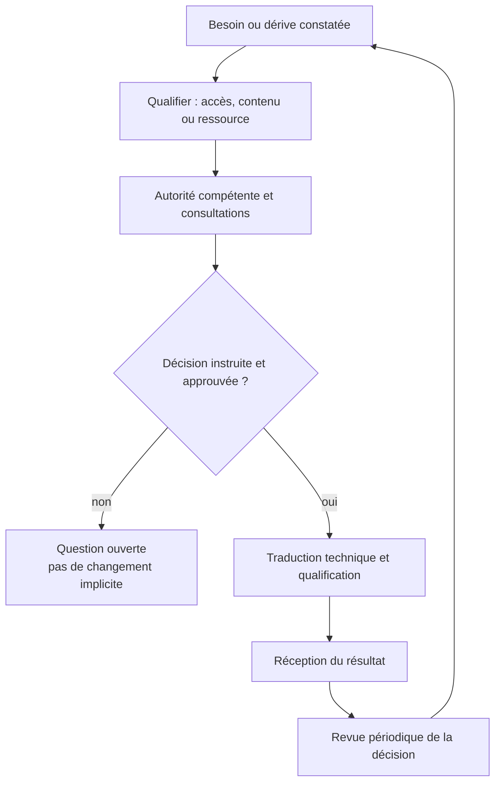

# 00. Décisions et responsabilités

## Le résultat recherché

Une gouvernance utile permet de répondre à quatre questions sans reconstruire l'histoire de la plateforme : pourquoi cet accès existe-t-il, qui répond de ce contenu, quel usage doit être protégé en cas de contention, et qui peut accepter une exception ?

**Proposition de méthode.** Partir de décisions vérifiables plutôt que d'un inventaire de réglages. L'ancien corpus distinguait droits par défaut, modèle d'habilitation, sensibilisation et WLM ; la synthèse conserve ces [quatre axes historiques](../03-quatre-axes.md#1-vue-densemble), mais sépare la politique de son implémentation technique.

## Des fonctions, pas des comptes Splunk

Le [RACI d'exploitation](../../splunk-exploitation-handbook/02-raci-exploitation.md#1-rappel-des-six-rôles-et-de-la-notation) définit les fonctions utilisées ici. PLT désigne l'exploitation plateforme ; DAT, les données et usages ; SEC, la sécurité/IAM et la conformité ; HEB, le socle d'hébergement ; PO, le responsable de service ; USR, les utilisateurs.

Un rôle organisationnel ne donne aucun droit dans Splunk. Être propriétaire d'une application ne justifie pas `admin` ; être administrateur technique ne donne pas le mandat de décider seul des accès aux données.

| Décision ou acte | Redevable | Réalisation et consultations | Trace attendue |
| --- | --- | --- | --- |
| Politique d'habilitation et règles d'authentification | SEC | PLT réalise ; DAT précise le besoin ; PO est consulté | Matrice approuvée et critères de revue |
| Qualité et cycle de vie du contenu partagé | DAT | USR produit ; PLT et SEC sont consultés selon l'impact | Propriétaire, utilité et critères de retrait |
| Arbitrage entre besoins incompatibles du service | PO | DAT, PLT et SEC instruisent les options | Priorité retenue, risque résiduel et échéance |
| Mise en œuvre WLM et capacité partagée | PLT | DAT et PO sont consultés sur la priorité des usages | Politique traduite, qualification et réception |
| Bundle, redémarrage et retour technique | PLT | DAT consulté ; USR informé ; HEB associé si le socle change | Fenêtre, sauvegarde, arrêt et retour vérifiables |
| Régime d'approbation du changement | PO | PLT, DAT et SEC consultés | Autorité, critères d'acceptation et décision |

Cette table est une lecture orientée gouvernance du RACI, pas un second catalogue d'exploitation. Pour les activités détaillées et les cas non listés, le [RACI d'exploitation fait référence](../../splunk-exploitation-handbook/02-raci-exploitation.md#7-comment-se-servir-de-ce-raci). Chaque décision doit garder un seul redevable ; une politique et son déploiement sont deux décisions distinctes.

## Tenir un registre de décisions

Une fiche de décision contient au minimum :

| Champ | Contenu à renseigner |
| --- | --- |
| Besoin et périmètre | Usage rendu possible, données, population et composants concernés |
| Options | Maintien de l'existant, changement proposé, solution moins contraignante |
| Décision | Choix explicite et conditions d'application |
| Responsabilités | Redevable, réalisateur et personnes consultées |
| Preuve | Source versionnée, observation datée et critères de réception |
| Limites | Conditions non testées, risque accepté et exclusions |
| Réversibilité | Sauvegarde, déclencheur d'arrêt et responsable du retour |
| Durée | Date d'effet, échéance éventuelle et prochaine revue |

Conserver les inventaires nominatifs, approbations et preuves d'exploitation dans l'outil interne prévu par l'organisation. La KB publique ne reçoit que les principes et les exemples anonymisés.

## Savoir où trancher

Une priorité métier ne s'exprime pas d'abord par un pourcentage CPU. Il faut nommer l'usage, ce qui doit rester possible et ce qui peut être différé. PLT transforme ensuite cette politique en contraintes qualifiées, selon le [contrat WLM](./04-garde-fous-et-arbitrage-wlm.md).

## Critères de sortie du cadrage

- Chaque famille de décision a un redevable identifié et disponible.
- Les besoins d'accès et de contenu partagé ont un propriétaire de validation.
- Les arbitrages de priorité et les exceptions ont une durée et une autorité.
- Les limites de preuve sont écrites ; aucune observation ancienne n'est présentée comme un contrôle actuel.
- Le périmètre public et le périmètre des preuves internes sont séparés.

## Sources

- [Axes structurants du corpus historique](../03-quatre-axes.md).
- [RACI d'exploitation : zone grise et activités transverses](../../splunk-exploitation-handbook/02-raci-exploitation.md#4-domaine-c--zone-grise-activités-g--la-section-décisive).
- [RACI : politique d'accès, exécution et arbitrage](../../splunk-exploitation-handbook/02-raci-exploitation.md#5-domaine-d--transverse-activités-t).
- [Ancienne méthode de projet](../02-methode-projet.md), reprise comme matière de méthode et non comme procédure actuelle.
