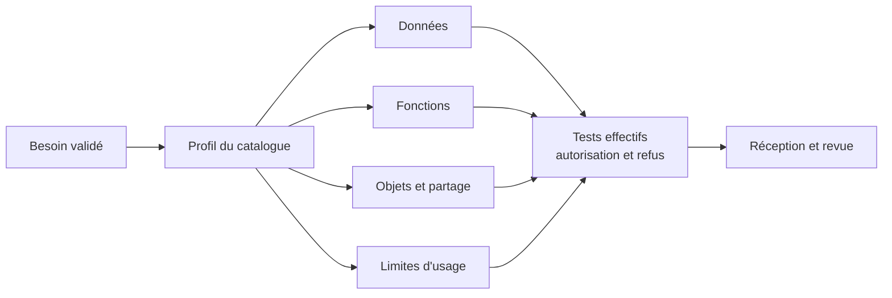

# 01. Habilitations et RBAC

## Décrire un besoin avant un rôle

**Proposition de méthode.** Une habilitation décrit une finalité, un périmètre de données, les fonctions nécessaires, le contenu accessible et les limites d'usage. Le nom d'un rôle existant ne remplace pas cette description.

Séparer ces dimensions rend la revue compréhensible. Le [guide RBAC historique](../05-guide-rbac.md#3-pattern-de-conception-cible) propose des rôles atomiques et des composites métier. Cette séparation reste un modèle de conception ; les valeurs et configurations de ce guide ne sont pas une recette reçue sur le build du lecteur.

| Dimension | Exemple de gabarit | Décision de gouvernance |
| --- | --- | --- |
| Données | `data_<perim>` | Données nécessaires, exclusions et validation par le responsable compétent |
| Fonctions | `feature_<cap>` | Recherche, planification ou accélération justifiée par le besoin |
| Contenu applicatif | `app_<prod>` | Lecture, modification et partage des knowledge objects |
| Profil attribué | `metier_<profil>_<perim>` | Assemblage approuvé et combinaisons autorisées |
| Limites | Palier nommé dans le catalogue | Valeurs justifiées par l'usage mesuré, pas par le prestige du profil |

Le profil « propriétaire » est une responsabilité de contenu, pas un synonyme de privilège administratif. Les ACL d'objets doivent être examinées avec les rôles, pas déduites du seul accès aux index ([guide historique, modèle mental](../05-guide-rbac.md#1-cadrage-rapide--modèle-mental)).

## Ne pas transformer un finding en loi universelle

Le chapitre historique [Findings empiriques 9.4.6](../04-findings-empiriques.md) rapporte notamment les comportements suivants. Leur portée est **9.4.6**, pas toute version Enterprise. La synthèse demande de les intégrer au plan de qualification, elle ne les mesure pas de nouveau.

| Observation historique | Risque à éviter | Vérification demandée sur la cible |
| --- | --- | --- |
| F-RBAC-01 : capability héritée non retirée au niveau enfant | Croire qu'un composite restreint un parent trop puissant | Tester le droit réellement exercé après composition |
| F-RBAC-02 : quotas hérités et cumul multi-rôles trompeurs | Confondre affichage REST, valeur déclarée et enforcement | Tester quotas du rôle final et combinaisons réellement attribuées |
| F-RBAC-03 à 06 : index, exclusions et filtres | Déduire la visibilité d'une chaîne de configuration isolée | Tester données attendues et interdites, y compris les index internes pertinents |
| F-RBAC-07 et F-ACL-01 : visibilité et héritage des ACL | Confondre modification autorisée et contenu effectivement visible | Tester lecture, modification et partage avec chaque profil |
| F-SAML-01 à 03 : fallback et mapping | Donner un droit élevé par défaut ou par homonymie | Tester aucun groupe, groupe normal, groupe sensible et cumul |

**Ne pas recopier les correctifs historiques sans preuve.** Par exemple, modifier un filtre, ajouter un rôle restrictif ou superposer un ancien et un nouveau rôle ne démontre pas une réduction d'accès. Il faut une preuve négative sur les données ou fonctions qui doivent être refusées, en plus du scénario autorisé.

## Un catalogue de profils attribuables

Pour chaque profil, documenter :

1. La population et la finalité d'accès.
2. Les dimensions données, fonctions, applications et quotas.
3. Le valideur du besoin, l'approbateur d'accès et le canal de réalisation.
4. Les autres profils compatibles ou interdits en cumul.
5. Les tests de réception et les preuves de retrait.
6. La date de revue et le traitement des exceptions.

La règle organisationnelle recherchée est une attribution lisible, pas un nombre magique de rôles. Une combinaison nécessaire peut être autorisée si ses effets sont compris et testés. Un rôle supplémentaire ne doit jamais servir de « deny » supposé sans qualification.

## Cycle de vie et droits sensibles

- Prévoir arrivée, évolution du besoin, absence, départ et reprise des objets partagés.
- Traiter séparément accès humain, automatisation et accès de secours, chacun avec propriétaire et revue.
- Éviter les attributions sensibles par correspondance de nom non maîtrisée ; faire approuver leur mécanisme de mapping.
- Ne pas assimiler un rôle minimal à une désactivation effective de compte. Faire vérifier la connexion et les droits résiduels par le mécanisme d'identité concerné.
- Définir les délais d'inactivité et de conservation dans la politique locale. Les valeurs **90/180 jours du corpus historique sont des propositions anciennes**, pas une obligation IAM établie par cette édition.
- Avant tout retrait ou suppression, inventorier les dépendances et traiter les objets partagés. Une demande de revue n'autorise pas une suppression de compte ou de rôle.

## Réception minimale

La matrice de tests couvre au moins un profil normal, un propriétaire, un profil sensible, une combinaison de rôles autorisée et un cas sans mapping attendu. Pour chaque cas : identité de test autorisée, build, droits attendus, droits refusés, résultat et limite de preuve. Les essais se préparent dans le dispositif du lecteur ; aucun n'est exécuté par cette publication.

## Sources

- [Guide RBAC historique, modèle hybride et déploiement](../05-guide-rbac.md).
- [Famille RBAC des findings 9.4.6](../04-findings-empiriques.md#famille-rbac).
- [Famille SAML des findings 9.4.6](../04-findings-empiriques.md#famille-saml).
- [RACI d'exploitation, activités transverses](../../splunk-exploitation-handbook/02-raci-exploitation.md#5-domaine-d--transverse-activités-t).
