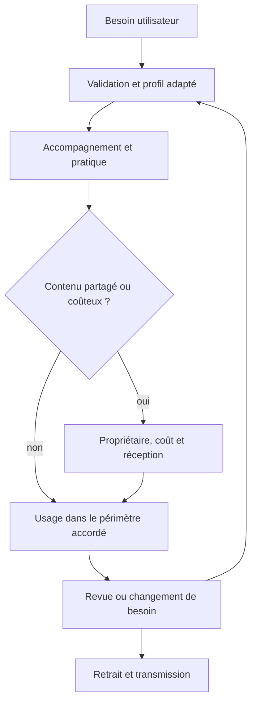

# 02. Parcours et responsabilisation

## Rendre le contrat d'usage visible

Un utilisateur doit connaître ce qui lui est permis, ce qui consomme une ressource partagée et où obtenir de l'aide. **Proposition de méthode.** L'accès, l'accompagnement et la responsabilité du contenu avancent ensemble ; une formation suivie n'accorde pas automatiquement une capability.

Le [handbook utilisateur](../../splunk-user-handbook/README.md) porte les pratiques SPL et de production de contenu. Ce chapitre organise leur acquisition et leur revue, sans les recopier.

## Un parcours par besoin

| Étape | Ce que le demandeur apporte | Décision et réception |
| --- | --- | --- |
| Arrivée ou nouveau besoin | Finalité, données, application et responsable de validation | Profil du catalogue approuvé ; accès autorisés et refusés vérifiés |
| Recherche interactive | Besoin borné et connaissance des limites d'usage | Accompagnement sur temps, périmètre et lecture des avertissements |
| Planification ou alerte | Propriétaire, utilité, fréquence, destinataire et impact d'un échec | Revue DAT ; consultation PLT sur la charge et SEC si la finalité l'exige |
| Accélération ou traitement coûteux | Gain attendu, coût, durée de vie et alternative | DAT conçoit ; PLT décide de la faisabilité capacitaire selon le RACI |
| Publication partagée | Public visé, ACL, maintenance et suppléance | DAT reçoit le contenu partagé ; le producteur en assure l'entretien convenu |
| Changement de mission ou départ | Inventaire des droits et des contenus à transmettre | Retrait approuvé, reprise du partagé et vérification de l'état effectif |

Ces étapes sont des exigences de décision, pas une promotion automatique vers des droits plus larges. Un analyste peut garder un accès restreint tout en produisant un contenu de qualité.

## Le contrat d'un contenu partagé

Une recherche planifiée, une alerte, un dashboard ou un modèle accéléré doit avoir une fiche proportionnée à son impact :

- Finalité et utilisateurs servis.
- Propriétaire de maintenance et solution en cas d'absence.
- Données et autorisations nécessaires, sans supposer que l'owner technique suffit.
- Planification, coût attendu et dépendances.
- Résultat métier attendu, traitement des erreurs et des résultats incomplets.
- Date de revue et critère de retrait ou de remplacement.

Le [RACI données et usages](../../splunk-exploitation-handbook/02-raci-exploitation.md#3-domaine-b--données--usages-activités-d) distingue la production par USR de la responsabilité DAT sur l'espace partagé. La gouvernance ne transfère pas silencieusement la maintenance de tout contenu à l'équipe plateforme.

## Une boucle pédagogique distincte de l'incident

L'[axe historique de sensibilisation](../03-quatre-axes.md#4-axe-3--sensibilisation-et-surveillance-pédagogique) fournit le principe : observation, explication et alternative. La proposition retenue ici ajoute une condition de qualité : faire confirmer le signal et le besoin avant de conclure à un mauvais usage.

1. Qualifier l'observation et son périmètre de preuve.
2. Vérifier si le comportement est légitime, mal compris ou réellement risqué.
3. Envoyer un retour concret : ce qui a été observé, son effet, une alternative et un contact.
4. Dédupliquer les messages et respecter la politique locale de confidentialité et de conservation.
5. Vérifier la correction ou enregistrer l'exception approuvée.

Une suspicion d'accès indu, de destruction ou de fuite suit le canal de sécurité prévu ; ce n'est pas une simple notification pédagogique. À l'inverse, un pic de durée ne prouve ni faute ni intention malveillante.

**Ne pas présumer le canal.** Un message technique WLM n'est pas une preuve que l'utilisateur final a été prévenu. La [révision française historique](../06-guide-wlm-sh.md#24-la-workload-rule) signalait déjà cette limite. Faire qualifier séparément le canal, le destinataire et la réception avant de mesurer l'efficacité pédagogique.

## Des exceptions bornées

Une exception indique le besoin non couvert, la population ou le contenu concerné, l'approbateur compétent, la limite accordée, les mesures compensatoires et l'échéance. Elle prévoit une sortie : normalisation du besoin, correction du contenu ou retrait approuvé.

La proximité d'une échéance ne justifie pas `admin` par défaut, un compte partagé ni une exemption générale. Si l'exception touche à la fois accès et capacité, faire instruire les deux décisions ; un seul accord ne remplace pas l'autre.

## Sources

- [Axe historique de sensibilisation](../03-quatre-axes.md#4-axe-3--sensibilisation-et-surveillance-pédagogique).
- [Registre historique et indicateurs pédagogiques](../08-recommandations-chiffrees.md#6-registre-des-comportements-dangereux), sans reconduire ses seuils comme normes.
- [RACI d'exploitation : contenu partagé, planification et accélération](../../splunk-exploitation-handbook/02-raci-exploitation.md).
- [Handbook utilisateur Splunk](../../splunk-user-handbook/README.md).
