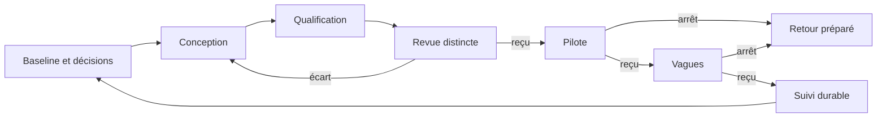

# 03. Méthode de transformation

## Une méthode commune, des procédures spécialisées

Le [cycle historique cadrage, maquette, audit et handbooks](../02-methode-projet.md#1-vue-densemble-du-cycle) reste la matière de départ. La proposition de méthode de cette édition le transforme en jalons de décision proportionnés au risque : décrire, qualifier, recevoir, puis réviser.

La gouvernance fixe les objectifs et les preuves attendues. Elle ne remplace ni le processus de changement de l'organisation ni les procédures techniques, notamment [la configuration WLM](../../splunk-wlm-configuration/02-configurer-wlm.md).

## Les jalons et leurs critères de passage

| Jalon | Travail attendu | Condition de passage |
| --- | --- | --- |
| 0. Mandat et cadrage | Périmètre, redevables, besoins, exclusions, approbations et retour | Décisions assumées ; questions non résolues explicitement bloquantes ou acceptées |
| 1. Baseline | Inventaire des accès et contenus ; usages et charge sur une période représentative | Sources datées, couverture connue, limites et périodes atypiques signalées |
| 2. Conception | Catalogue de profils, parcours, priorités et exceptions | Règles d'attribution et d'arbitrage relues par les autorités compétentes |
| 3. Qualification | Tests positifs et négatifs, cumuls de droits, contraintes et retour | Résultats rattachés au build et au scénario ; écarts corrigés ou acceptés |
| 4. Revue distincte | Lecture critique des décisions et des preuves par un autre intervenant | Verdict, limites et réserves conservés ; pas d'approbation inventée |
| 5. Pilote | Cohorte volontaire et représentative, support et critères d'arrêt | Usages attendus reçus ; dérives et faux positifs traités |
| 6. Vagues | Extension progressive dans les fenêtres approuvées | Réception de chaque vague avant la suivante |
| 7. Revue durable | Mesures, exceptions, retrait des anciens usages et mise à jour du catalogue | Chaque dérive déclenche une décision, pas une modification hors processus |

Une durée standard ne remplace pas la représentativité. Inclure les traitements hebdomadaires, mensuels ou saisonniers concernés. Les fenêtres chiffrées du corpus ancien sont des points de départ historiques, pas des minima universels.

## Qualifier sans élargir le mandat

Une fiche de test distingue hypothèse documentaire, procédure prévue, résultat attendu, résultat reçu et verdict. Elle conserve le build, les conditions, la date et les preuves utiles. Une preuve absente donne « non vérifié », pas « conforme ».

L'auteur prépare les scénarios ; un autre intervenant critique les hypothèses et les preuves. Si cette revue distincte n'est pas disponible, le livrable le dit. Une auto-vérification ne devient pas une validation indépendante en changeant le titre du rapport.

Les essais potentiellement destructifs se préparent sur des ressources dédiées et autorisées. Les exemples anciens de suppression de rôle, de compte ou de redémarrage ne sont jamais exécutés pour vérifier seulement un document. **Cette synthèse est une refonte éditoriale, pas l'exécution de ce cycle sur une plateforme.**

## Un pilote doit pouvoir échouer proprement

Avant le pilote, fixer :

- Les besoins et contenus qui doivent continuer à fonctionner.
- Les personnes qui réalisent, reçoivent, assistent et décident de l'arrêt.
- Les symptômes d'arrêt : accès indu, perte d'accès nécessaire, résultat incomplet, contrainte non expliquée ou preuve devenue aveugle.
- Le retour autorisé et ses dépendances : sources sauvegardées, reprise des attributions ou configurations, réception après restauration.
- Le traitement des utilisateurs et contenus non migrés.

Une double attribution ancien/nouveau peut préserver le service mais ne prouve pas un durcissement effectif. Si elle est nécessaire, la borner et recevoir la restriction **après** retrait approuvé de l'ancien accès. Le [plan de tests RBAC](./01-habilitations-rbac.md) doit inclure ce cas.

## Observer ne veut pas toujours dire ne rien changer

Distinguer explicitement :

1. **Baseline en lecture seule** : collecte de l'état et des usages sans modifier droits ou contraintes.
2. **Objets préparés mais non attribués** : changement de configuration, même sans utilisateur migré.
3. **WLM activé, règles seulement observatrices** : les plafonds Linux restent actifs ; ce n'est pas une baseline sans effet.
4. **Contrainte appliquée** : retrait d'accès, filtrage, déplacement ou arrêt, après qualification et approbation.

La configuration et l'ordre d'activation WLM appartiennent au [handbook autonome, chapitre 02](../../splunk-wlm-configuration/02-configurer-wlm.md). Ne pas déduire un ordre technique de la succession des axes de gouvernance.

## Recevoir et clôturer une vague

Comparer l'état obtenu à l'état attendu, pas seulement au succès du déploiement. Conserver les écarts, le support nécessaire et la décision de poursuivre, corriger ou revenir. Les anciennes configurations restent disponibles dans le dispositif de sauvegarde prévu tant que le retour en dépend ; leur suppression exige son propre traitement.

## Sources

- [Méthode historique de projet](../02-methode-projet.md).
- [Déploiement RBAC historique](../05-guide-rbac.md#5-déploiement-progressif--sept-phases), pour les points de vigilance de migration.
- [WLM : préparation, activation et réception](../../splunk-wlm-configuration/02-configurer-wlm.md).
- [WLM : niveaux de preuve et limites de qualification](../../splunk-wlm-configuration/README.md#niveaux-de-preuve).
