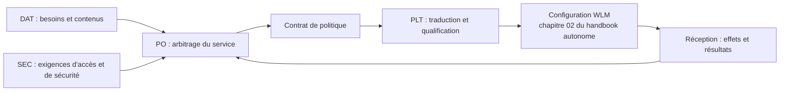

# 04. Garde-fous et arbitrage WLM

## La gouvernance décide, WLM met en œuvre une partie des contraintes

**Proposition de méthode.** Traiter séparément l'autorisation d'accès, les limites de concurrence, la priorité d'un usage et la maîtrise des ressources. Un mécanisme de ressources ne doit pas devenir un moyen de réparer implicitement une habilitation incorrecte.

Le [modèle technique WLM](../../splunk-wlm-configuration/01-modele-wlm.md) explique CPU, mémoire, pools et règles. Ce chapitre ne le recopie pas. Il définit les décisions nécessaires avant de demander une configuration à PLT.

| Question de politique | Décision attendue | Ce qu'elle ne prouve pas |
| --- | --- | --- |
| Qui peut accéder aux données et fonctions ? | Habilitation approuvée et testée | Un placement dans un pool ne crée pas une autorisation |
| Quelle concurrence est acceptable ? | Limites du profil et cumuls qualifiés | Un quota déclaré n'établit pas son application effective |
| Quel usage doit rester possible en contention ? | Priorités, usages différables et exclusions | Un poids CPU n'est ni une capacité ajoutée ni un délai garanti |
| Quel effet contraignant est acceptable ? | Signalement, attente, déplacement, refus ou arrêt justifié | Une règle chargée n'est pas une règle reçue sur toutes les recherches visées |
| Quelle complétude est indispensable ? | Résultats attendus et contributions contrôlées | Un job terminé n'est pas à lui seul une preuve de résultat complet |

Les limites des dernières lignes sont illustrées, dans le périmètre **10.4.5 du handbook WLM**, par les [résultats de qualification](../../splunk-wlm-configuration/03-resultats-qualification.md) et les [contrôles d'audit](../../splunk-wlm-configuration/05-exploitation-et-audit.md). Elles ne constituent pas de nouveaux essais réalisés pour la gouvernance.

## Le contrat remis à l'équipe plateforme

Pour chaque classe d'usage, la politique précise :

- Finalité et propriétaire métier ou applicatif.
- Population, applications et types de traitements concernés.
- Criticité, périodes utiles et dépendances entre contenus.
- Priorité relative en contention et usages que l'on peut différer.
- Effet autorisé sur l'utilisateur et les traitements automatisés.
- Exclusions motivées, notamment détection, traitements techniques ou accélérations à qualifier.
- Critères de réception, seuils d'arrêt, retour et information des personnes concernées.
- Build cible et conditions non qualifiées.

Ne pas reprendre les pourcentages, nombres de pools ou durées de l'ancien guide comme une politique approuvée. La [calibration WLM](../../splunk-wlm-configuration/06-dimensionnement-et-retour.md) reste un travail technique à partir des charges et des marges réellement mesurées.

Ce flux ne transfère pas les responsabilités du [RACI](../../splunk-exploitation-handbook/02-raci-exploitation.md). SEC reste redevable de la politique d'accès ; PLT, de la mise en œuvre WLM. Un arbitrage de service n'autorise pas à contourner ces validations.

## Garde-fous avant toute contrainte

1. Le besoin légitime et les scénarios affectés ont été recensés.
2. Le signal qui motive la règle est observable et sa couverture connue.
3. Les faux positifs et les exceptions sont instruits avec DAT et les propriétaires concernés.
4. La contrainte et son effet sont approuvés, avec un retour possible.
5. Les utilisateurs et exploitants ont un canal d'explication et de support reçu.
6. L'effet réel est testé, y compris sur les traitements planifiés et les résultats incomplets.

L'absence de règles bloquantes ne rend pas WLM inoffensif : les plafonds de pools, catégories et service existent dès l'activation. Ne pas appeler cette activation « observation sans effet ». Le [chapitre de configuration](../../splunk-wlm-configuration/02-configurer-wlm.md#8-activez-les-shc-avant-les-pairs) explicite cette différence et la séquence retenue pour son profil qualifié.

## Une seule procédure de configuration

Pour mettre en place WLM, utiliser **[02. Configurer WLM pas à pas](../../splunk-wlm-configuration/02-configurer-wlm.md)**, avec ses prérequis et ses renvois vers l'audit et le retour. Ce handbook est autonome : il fournit sa procédure sans dépendre des anciens guides WLM de gouvernance.

- Sa qualification d'exécution porte sur **Splunk Enterprise 10.4.5**, dans les conditions déclarées par son [périmètre](../../splunk-wlm-configuration/00-perimetre-et-preuves.md).
- **10.2 n'y est pas qualifié par exécution.** Utiliser le [chapitre de transposition](../../splunk-wlm-configuration/07-transposition-102.md) pour identifier ce qui reste à vérifier.
- Les anciens guides [search heads](../06-guide-wlm-sh.md), [indexeurs](../07-guide-wlm-indexers.md), [principes/PDF](../09-wlm-principes-cles.md) et [cgroups](../10-wlm-systeme-cohabitation-cgroups.md) restent des documents historiques versionnés. Ils ne sont pas des étapes alternatives à combiner avec cette procédure.

L'activation initiale et l'ajout ultérieur d'un pool sont deux changements distincts. En particulier, ne pas transformer une recommandation historique d'alignement des noms en ordre général d'activation des tiers.

## Sources

- [WLM : modèle technique](../../splunk-wlm-configuration/01-modele-wlm.md).
- [WLM : configuration, autorité procédurale du corpus pour le profil qualifié](../../splunk-wlm-configuration/02-configurer-wlm.md).
- [WLM : exploitation et audit](../../splunk-wlm-configuration/05-exploitation-et-audit.md).
- [WLM : dimensionnement et retour](../../splunk-wlm-configuration/06-dimensionnement-et-retour.md).
- [RACI d'exploitation, activité G6 et politique d'accès](../../splunk-exploitation-handbook/02-raci-exploitation.md).
