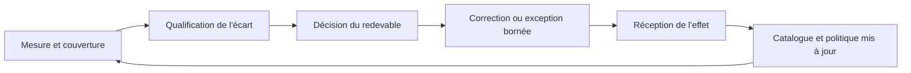

# 05. Suivi et revue

## Mesurer pour décider

**Proposition de méthode.** Un indicateur n'est utile que s'il permet à un responsable de décider : corriger un droit, accompagner un utilisateur, reprendre un contenu, revoir une contrainte ou demander de la capacité. Choisir un nombre limité d'indicateurs dans la supervision et les rituels existants ; ce livre ne déploie ni alerte ni nouveau système de monitoring.

Le suivi relie les [décisions](./00-decisions-et-responsabilites.md), les [parcours](./02-parcours-et-responsabilisation.md) et les [garde-fous](./04-garde-fous-et-arbitrage-wlm.md). Il ne remplace pas les contrôles techniques du [handbook WLM](../../splunk-wlm-configuration/05-exploitation-et-audit.md).

## Définir chaque indicateur avant de le compter

Chaque fiche précise population attendue, source, fenêtre, unité, fraîcheur, méthode de calcul, exclusions, responsable et décision déclenchée. Pour un taux, écrire le numérateur et le dénominateur ; pour un délai, les deux événements qui le bornent. Une valeur sans couverture ne donne pas un état sain.

| Axe | Indicateur proposé | Définition et limites à expliciter | Décision possible |
| --- | --- | --- | --- |
| Habilitations | Couverture des revues | Profils ou attributions revus / population à revoir ; distinguer humains, services et secours | Traiter la population manquante ou une attribution sans justification |
| Contenu partagé | Couverture de propriété | Objets avec propriétaire actif et revue à jour / objets partagés attendus | Réassigner, corriger ou retirer après approbation |
| Exceptions | Exceptions échues non traitées | Exceptions hors échéance / exceptions enregistrées ; absence de registre = inconnu | Renouvellement motivé, normalisation ou retrait |
| Pédagogie | Récidive après retour reçu | Usages répétés parmi les utilisateurs effectivement notifiés et observables sur la fenêtre | Revoir l'alternative, le canal ou l'accompagnement |
| Ressources | Effets des contraintes | Recherches distinctes affectées, par usage et type d'effet, avec couverture déclarée | Recalibrer ou corriger une règle après décision |
| Service | Régression fonctionnelle | Besoins témoins reçus / besoins témoins attendus ; suivre erreurs et complétude séparément | Arrêter une vague, revenir ou instruire un incident |

Aucune cible universelle n'est fixée ici. Les seuils historiques de population, de récidive ou de latence ne deviennent pas des engagements de service par leur présence dans une table.

## Ne pas confondre événement, recherche et utilisateur

Le [chapitre d'audit WLM](../../splunk-wlm-configuration/05-exploitation-et-audit.md#2-lisez-wlm_monitor) observe, sur son build 10.4.5, plusieurs événements d'alerte pour une même recherche. Compter les lignes comme autant de recherches surestime l'impact. La fiche d'indicateur doit annoncer l'unité réellement comptée et la clé de rapprochement qualifiée sur le build cible.

De même, ne pas recopier les anciens noms d'actions `_audit` WLM comme un contrat actuel. Les [contrôles de corrélation](../../splunk-wlm-configuration/05-exploitation-et-audit.md#3-corrélez-_audit-sans-perdre-la-valeur-brute) distinguent les sources et la valeur brute. Le présent livre renvoie à ces contrôles plutôt que de dupliquer leurs SPL.

## Quatre états plutôt qu'un vert par défaut

| État de preuve | Lecture de gouvernance |
| --- | --- |
| Reçu et conforme au critère | Le critère défini est satisfait dans le périmètre mesuré |
| Reçu et divergent | Un écart existe ; il faut un responsable et une décision |
| Partiel | Certaines populations, instances ou fenêtres manquent |
| Inconnu | Source absente, erreur, collecte périmée ou contrôle non exécuté |

Un résultat vide n'est sain que si le contrôle s'est exécuté correctement, sur une population complète et une période pertinente. Pour WLM, la couverture des membres, les actions de règles, les résultats de recherche et les événements noyau répondent à des questions différentes ; le [chapitre d'audit](../../splunk-wlm-configuration/05-exploitation-et-audit.md#contrôlez-quatre-plans-distincts) en fixe la lecture technique.

## Organiser la revue

Adapter la cadence aux usages et au risque. Une courte revue opérationnelle traite les écarts actifs ; une revue de politique réexamine périodiquement profils, propriétaires, exceptions et priorités. Ces rendez-vous peuvent utiliser les rituels existants du service.

La revue conserve :

1. L'observation datée et ses limites.
2. Le besoin ou la décision affectée.
3. Le redevable, l'action décidée et l'échéance.
4. Le critère de clôture et la preuve de résultat.
5. Les réserves et les conditions de réouverture.

Si l'écart exige un changement d'accès, une suppression ou une interruption, la revue déclenche le processus d'approbation adapté. Elle ne l'autorise pas implicitement.

## Ce qui déclenche une révision du handbook local

Revoir la politique après changement de build, d'IdP, de populations, de criticité, de périmètre de données ou de capacité partagée. Vérifier aussi qu'une nouvelle source technique ne contredit pas une ancienne recommandation. Conserver la version précédente et indiquer ce qui a changé, sans effacer les limites de l'ancienne preuve.

## Sources

- [Registre et KPI historiques](../08-recommandations-chiffrees.md), matière initiale sans reconduction de ses cibles chiffrées.
- [WLM : état distribué, sources d'audit et complétude des recherches](../../splunk-wlm-configuration/05-exploitation-et-audit.md).
- [RACI d'exploitation](../../splunk-exploitation-handbook/02-raci-exploitation.md).
- [Décisions et responsabilités de cette synthèse](./00-decisions-et-responsabilites.md).
