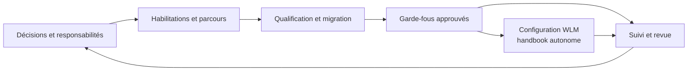

# Gouverner les usages Splunk

## Objet et limites

Cette synthèse organise les décisions qui rendent les usages Splunk explicables, attribuables et révisables : qui peut faire quoi, pour quel besoin, avec quelles limites, et qui répond du résultat. Elle propose une méthode de gouvernance, pas une configuration à déployer.

Elle constitue le parcours de référence de l'**édition de gouvernance 2.0**. Les [documents historiques et leur correspondance](../README.md#table-des-matières) restent distincts et accessibles à leurs chemins d'origine. Ils documentent les approches et constats antérieurs ; leur conservation ne reconduit pas toutes leurs prescriptions.

## Lecteur et prérequis

Responsable de service, architecte, responsable des usages, administrateur senior ou référent sécurité/IAM d'une plateforme Splunk mutualisée. Le lecteur connaît les rôles, les applications, les knowledge objects, les recherches planifiées et le partage des ressources entre search heads et indexeurs.

## Périmètre

- Gouvernance de Splunk Enterprise autogéré, notamment avec SHC et indexeurs partagés.
- Décisions, responsabilités, habilitations/RBAC, parcours utilisateurs, méthode de transformation, garde-fous et revue des résultats.
- **Aucune nouvelle qualification technique.** Les findings RBAC cités restent des observations historiques **9.4.6** à confronter au build cible.
- Configuration WLM, systemd, cgroups, bundles, calibration et retour technique : [handbook WLM autonome](../../splunk-wlm-configuration/README.md), en particulier [02. Configurer WLM](../../splunk-wlm-configuration/02-configurer-wlm.md).

Hors périmètre : installation Splunk, procédures Cloud, configuration d'un IdP particulier, dimensionnement universel, déploiement de supervision et politique d'une organisation réelle.

## Comment lire ce livre

Lire 00 à 03 pour construire le dispositif. Utiliser 04 pour remettre à l'équipe plateforme une politique de ressources approuvée, puis 05 pour préparer la revue. Chaque chapitre indique ce qu'il faut décider et la preuve à demander, sans transformer une intention en résultat acquis.

## Sommaire

| Chapitre | Question traitée | Livrable attendu |
| --- | --- | --- |
| [00. Décisions et responsabilités](./00-decisions-et-responsabilites.md) | Qui arbitre, approuve et réalise ? | Registre de décisions et responsabilités nommées |
| [01. Habilitations et RBAC](./01-habilitations-rbac.md) | Quels droits effectifs pour quel besoin ? | Catalogue de profils, matrice d'accès et tests de cumul |
| [02. Parcours et responsabilisation](./02-parcours-et-responsabilisation.md) | Comment acquérir, exercer et rendre un droit ? | Parcours utilisateur, propriétaire de contenu et exceptions bornées |
| [03. Méthode de transformation](./03-methode-de-transformation.md) | Comment passer de l'existant à une cible reçue ? | Baseline, qualification, pilote et jalons de décision |
| [04. Garde-fous et arbitrage WLM](./04-garde-fous-et-arbitrage-wlm.md) | Quelles contraintes peut-on appliquer, et à qui ? | Contrat de politique remis à la configuration WLM |
| [05. Suivi et revue](./05-suivi-et-revue.md) | Comment savoir si la politique reste adaptée ? | Indicateurs définis, revue et décisions de correction |

## Conventions

- Français canonique. **Cette synthèse n'a pas de traduction anglaise.** Le dossier [EN historique](../EN/README.md) ne la traduit pas et n'intègre pas la révision WLM française de novembre 2026.
- Un H1 par page, des liens relatifs Markdown, une section Sources finale par chapitre. Les diagrammes décrivent une méthode, pas une infrastructure réelle.
- Les noms `data_<perim>`, `feature_<cap>`, `app_<prod>` et `metier_<profil>_<perim>` sont des gabarits anonymisés, jamais des objets à créer tels quels.
- **Proposition de méthode** désigne une règle d'organisation à faire approuver. **Observation historique** désigne un résultat attribué à une version dans le corpus. **À vérifier** désigne une condition sans preuve sur la cible du lecteur.
- Aucun palier chiffré historique, délai IAM ou poids de pool n'est une norme universelle. Une recommandation n'autorise ni un changement d'accès ni une suppression.

## Sources globales

Cette édition est une synthèse éditoriale du corpus public du dépôt, pas un nouvel audit des sources éditeur :

- [Ancien guide d'approche et table de correspondance](../README.md).
- [Findings historiques 9.4.6](../04-findings-empiriques.md), en distinguant observations et corrections documentaires ultérieures.
- [RACI d'exploitation Splunk](../../splunk-exploitation-handbook/02-raci-exploitation.md), référence des fonctions PLT, DAT, SEC, HEB, PO et USR.
- [Handbook utilisateur](../../splunk-user-handbook/README.md), pour les pratiques de recherche et de production de contenu.
- [Handbook WLM, édition 1.0](../../splunk-wlm-configuration/README.md), pour le modèle technique, la configuration et la qualification bornée à 10.4.5.

## Version de cette édition

**Édition de gouvernance 2.0, 25 novembre 2026.** Le numéro désigne cette organisation éditoriale, pas une version de Splunk. Aucun accès à une plateforme, essai de laboratoire, test de SPL ou contrôle Web des références externes n'est réalisé pour cette synthèse. Les conditions et limites techniques des sources liées restent applicables.
