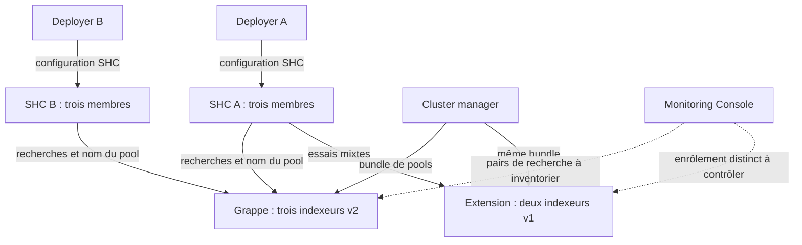

# 00. Périmètre et méthode de qualification

## Environnement couvert

**Observé en 10.4.5.** La première topologie comprend trois indexeurs, deux SHC de trois membres, deux deployers, un cluster manager (CM) et une Monitoring Console (MC). La grappe n'est pas multisite. Les facteurs de réplication et de recherche sont configurés à 2/2.

L'extension mixte ajoute deux indexeurs en cgroups v1 aux trois indexeurs en cgroups v2. Les essais mixtes utilisent un seul SHC actif. L'autre SHC et son deployer sont arrêtés pour respecter la capacité du banc. **Le mélange de cinq pairs sous charge de deux SHC simultanés n'est donc pas qualifié.**

| Élément | Profil effectivement couvert | Limite |
| --- | --- | --- |
| Splunk | Enterprise 10.4.5, WLM Advanced | Aucun autre build exécuté pour cette qualification |
| Socle v2 | RHEL 10.0, cgroups v2, systemd 257 | Ne pas déduire le mode du seul nom de distribution |
| Extension v1 | AlmaLinux 8.10, noyau 4.18, systemd 239, cgroups v1 | OS, noyau et systemd changent ensemble ; la cause d'un écart n'est pas isolée au seul mode cgroups |
| Gabarit récent | 2 vCPU et 2 Gio nominaux par invité | Petit banc de mécanismes, pas recommandation de capacité Splunk |
| Profil historique | 1 Gio fixe pour certains essais de routage, d'admission et de cycles | Ne pas présenter tous les essais comme exécutés avec 2 Gio |
| Licence | Laboratoire annoncé Developer/Enterprise ; pool natif enterprise, quota effectif de 10 737 418 240 octets | L'étiquette ne démontre ni l'éligibilité ni la capacité d'une licence de production |

## Trois grandeurs mémoire distinctes

La RAM nominale d'une VM, `MemTotal` Linux et `MemoryMax` du service ne sont pas interchangeables.

| Mesure reçue | RHEL, profil récent | AlmaLinux, extension |
| --- | ---: | ---: |
| RAM nominale | 2 Gio | 2 Gio |
| `MemTotal` Linux | 1 679 236 Kio | 1 751 632 Kio |
| `MemoryMax` retenu | 1 719 537 664 octets | 1 793 671 168 octets |

Le protocole fixe `MemoryMax = MemTotal × 1024`. C'est un **choix du banc**, pas une obligation universelle de Splunk. Il limite le service à la mémoire visible par Linux. Il ne réserve pas de marge supplémentaire pour l'OS. Un déploiement réel exige une décision de capacité distincte.

**Observé en 10.4.5, T11.** Les plafonds WLM suivent le plafond du service au démarrage. Une modification de `MemoryMax` à chaud ne les recalcule pas. La démonstration discriminante et ses valeurs figurent au [chapitre 03](./03-resultats-qualification.md).

## Lire les verdicts

Les identifiants T01 à T18 désignent les essais du socle v2. Les identifiants M1 à M6 désignent l'extension mixte. Ils servent uniquement de repères de lecture.

Une passe par variante est la règle. Les passes successives corrigent parfois un protocole ; elles ne constituent pas des répétitions indépendantes. Les résultats de trois pairs d'une même recherche ne sont pas trois campagnes.

Exceptions à conserver :

- T17 utilise trois recherches concurrentes par mode, ad hoc et planifié.
- T18 comprend dix cycles par classe, sur cinq représentants distincts.
- T12 et T13 exercent les trois membres d'un SHC.
- T14 comprend une comparaison admin, puis un complément non-admin. Seule la passe non-admin sans erreur distante porte son verdict favorable.

Une intégrité de fichier vérifiée ne prouve ni la complétude du corpus ni la causalité d'un résultat. Une restauration réussie ne transforme pas une passe négative en succès.

## Protocole minimal à conserver

1. Identifiez la version exacte et les participants.
2. Vérifiez la santé de la grappe et des SHC.
3. Vérifiez l'absence de charge ou de mutation concurrente.
4. Sauvegardez les sources et les réglages qui changeront.
5. Fixez une hypothèse et une seule variable par variante.
6. Fixez une durée maximale et des conditions d'arrêt.
7. Distribuez la variante par l'autorité native.
8. Relisez son effet sur chaque membre.
9. Associez la recherche, son processus et son cgroup.
10. Conservez les mesures brutes et les messages d'erreur.
11. Restaurez la référence par la même autorité.
12. Vérifiez les fichiers actifs, les plafonds et la santé.

Pour le CPU, utilisez les deltas des compteurs et une horloge monotone. Pour la mémoire, relevez le pool, ses descendants, sa catégorie et l'instance. Pour l'ingestion, rapprochez les séquences distinctes offertes et reçues. Un compteur de copies répliquées n'est pas un volume unique ingéré.

## Ce que les essais ne garantissent pas

- Aucun partage CPU instantané à chaque intervalle.
- Aucune survie universelle de `splunkd` face à un OOM.
- Aucune complétude déduite du seul état DONE.
- Aucun débit maximal ni protection à toute pression mémoire.
- Aucune répétabilité statistique.
- Aucune conformité du mélange d'OS à une matrice de support éditeur.
- Aucune qualification multisite, perte de site, production ou Splunk 10.2.

## Sources

- Spécifications et valeurs effectives de Splunk Enterprise 10.4.5 : `workload_pools.conf.spec`, `workload_rules.conf.spec`, `workload_policy.conf.spec`.
- [Tableaux de qualification de cette édition](./03-resultats-qualification.md), avec les conditions propres à chaque essai.
- [Sources globales et niveaux de preuve](./README.md).
