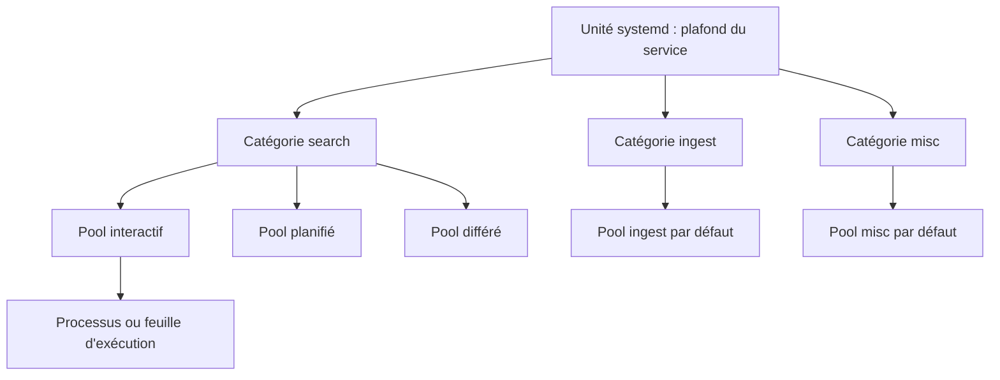

# 01. Modèle WLM : des règles Splunk aux contrôles Linux

## Catégories et pools

**Documenté, spécification 10.4.5.** WLM organise les ressources en trois catégories : `search`, `ingest` et `misc`. Chaque pool appartient à une seule catégorie.

| Catégorie | Contenu et conséquence |
| --- | --- |
| `search` | Processus de recherche répartis dans les pools métier |
| `ingest` | Démon principal et auxiliaires : process runner, KV store, serveur Web et introspection selon le modèle documenté ; son nom ne signifie pas « seuls événements entrants » |
| `misc` | Activités auxiliaires, notamment inputs scriptés et modulaires |

Le rôle du nœud ne supprime pas le besoin des catégories système. Un search head possède aussi un démon principal et des auxiliaires. Ne réduisez pas `ingest` à une valeur symbolique parce que le nœud n'indexe pas de données métier.



`default_category_pool = 1` désigne le défaut **dans la stanza du pool**. Les recherches non placées, ou les pools inconnus sur un pair, doivent disposer d'un défaut recevable. Définissez explicitement un défaut par catégorie.

## CPU : poids relatif, pas plafond dur

**Documenté.** `cpu_weight` détermine une proportion relative entre consommateurs concurrents d'un même niveau. La part d'un pool dépend des autres pools demandeurs. La part de sa catégorie dépend aussi des autres catégories demandeuses.

Une lecture de contention s'écrit :

```text
part du pool dans sa catégorie = poids du pool / somme des poids concurrents
part théorique dans l'instance = part de catégorie × part du pool
```

Cette relation n'est pas une promesse de débit ni une échéance de scheduler. Un pool peut emprunter le CPU inutilisé des autres pools. Une catégorie peut emprunter le CPU libre des autres catégories.

**Observé en 10.4.5.** T01 et T03 démontrent ces deux emprunts. T02 démontre un partage intégré voisin de 1:1 pour deux pools de même poids. Deux intervalles-pair de cinq secondes sortent cependant de la tolérance relative retenue. M2 retrouve le partage intégré sur v1 et v2, avec davantage d'excursions courtes sur le pair v1 de cette passe.

**Non vérifié.** Poids inégaux, garantie instantanée et toutes les combinaisons de saturation.

## Mémoire : plafond par niveau, pas réservation

**Documenté et observé en 10.4.5.** `mem_weight` d'un pool exprime un pourcentage du plafond de sa catégorie. La catégorie possède elle-même un plafond relatif à la base du service. Ce n'est pas une priorité mémoire relative aux seuls consommateurs actifs.

Un pool à 20 ne peut pas obtenir plus de RAM en invoquant l'inactivité du pool voisin. Plusieurs pools à 100 peuvent chacun atteindre le plafond de la catégorie, sous réserve de la limite commune de leurs ancêtres. Ils ne disposent pas chacun d'une réservation indépendante.

Le profil large des essais utilise `search` mémoire à 70, `ingest` à 100 et `misc` à 10. Cette somme supérieure à 100 décrit des plafonds qui se recouvrent. Elle ne crée pas de mémoire supplémentaire. Le plafond de l'instance reste applicable.

Une partition dont les poids mémoire des pools somment à 100 peut provoquer un OOM de pool alors que la catégorie garde de la marge. T05 l'observe après dimensionnement de son témoin. Le protocole impose aussi CPU=mémoire pour cette variante ; cette égalité n'est pas une exigence générale de WLM.

### Le swap change le résultat

**Observé en 10.4.5.** Avec swap actif, les profils mémoire atteignent leur plafond RAM puis paginent sans OOM. Sur le profil v2 reçu, `memory.swap.max` reste à `max`. Le plafond RAM n'est donc pas un plafond RAM plus swap.

Sans swap sur le pair chargé, T04 et M3 produisent un OOM local au pool. T08 montre une conséquence plus grave : un OOM de catégorie `ingest` peut tuer le démon principal pendant `swapoff`.

**Non vérifié.** Épuisement du swap, autres réglages de swap et toute protection universelle contre l'OOM. Ne désactivez pas le swap pour activer WLM.

### La base est fixée au démarrage

**Observé en 10.4.5, complément T11.** À `MemTotal` constant, le démarrage sous un `MemoryMax` différent change les plafonds des catégories et des pools. Une modification à chaud du seul `MemoryMax` change l'instance, mais pas ces plafonds dans la fenêtre observée. Le retour à la valeur initiale exige aussi un redémarrage pour le recalcul reçu.

Le calcul est compatible avec un arrondi inférieur à la page à chaque niveau. L'essai ne départage pas l'emploi interne du nombre systemd brut et celui du plafond noyau déjà arrondi lorsque les deux calculs donnent le même résultat.

## Règles de charge

**Documenté, `workload_rules.conf.spec` 10.4.5.**

| Effet | Syntaxe | Point de contrôle |
| --- | --- | --- |
| Placement, nommé `place` dans les traces | `workload_pool = nom`, sans clé `action` | Pool et processus effectifs |
| Notification | `action = alert` avec prédicat `runtime` | Message Web et journal `wlm_monitor` |
| Arrêt | `action = abort` avec prédicat `runtime` | Message, marqueur `wlm_terminated` et fin des processus |
| Déplacement | `action = move`, `workload_pool = cible`, prédicat `runtime` | Nouveau cgroup du même processus |

N'écrivez pas `action = place`. N'écrivez pas `action = display_message`. `runtime` appartient au prédicat ; ce n'est pas une clé séparée.

`[workload_rules_order]` donne la priorité de gauche à droite. Les noms qui y figurent désignent des stanzas `[workload_rule:*]`. Une admission rule ne fait pas partie de cette liste.

**Observé en 10.4.5, T10.** À prédicat identique, mettre `move` à gauche provoque le déplacement ; mettre `abort` à gauche provoque l'arrêt. L'essai après déplacement dure moins d'une minute supplémentaire. Il ne démontre pas l'impossibilité absolue d'un abort ultérieur. `runtime` décrit une durée dans un pool, pas une durée murale universelle depuis le clic utilisateur.

Ne traduisez pas une cadence d'évaluation annoncée en borne de délai. Pour un seuil d'une minute, T17 observe environ 62 à 68 secondes de durée native à la détection de l'action, selon le mode testé.

## Admission et policy

Une stanza `[search_filter_rule:*]` filtre avant l'exécution. `action = filter` refuse la recherche. `action = queue` appartient au contrat des règles de saturation ad hoc ; cette fonction n'a pas de qualification fonctionnelle dédiée dans les essais présentés.

La présence d'une règle ne suffit pas. `workload_policy.conf` porte le commutateur global :

```ini
[search_admission_control]
admission_rules_enabled = 0
```

**Observé en 10.4.5, T12.** Le même filtre accepte les soumissions correspondantes en OFF et les refuse en ON. Les témoins hors prédicat continuent de réussir. L'essai compare 0 à 1 ; il ne compare pas une clé absente à une clé présente.

## Pièges de prédicats

- **`index=*` est littéral dans les cas testés.** Une règle portant ce prédicat ne signifie pas « toute recherche visant n'importe quel index ». T14 le confirme avec admin puis non-admin. Comparez la chaîne littérale à une recherche nommant un index explicite.
- **`role=` inclut l'héritage dans les chaînes testées.** T15 retrouve le rôle parent pour un utilisateur ne portant directement que son enfant. Cela ne qualifie pas toutes les profondeurs ni les conflits de rôles.
- **`search_time_range=alltime` est un cas explicite.** Un seuil numérique exige le réglage global documenté `numeric_search_time_range` ; ne l'écrivez pas dans le prédicat.
- **`user=nobody` est invalide selon la spécification.** Cette restriction est documentaire, pas un essai de compte. Utilisez un périmètre d'app correctement inventorié pour les exclusions nécessaires.
- **Un champ REST de pool absent pour un non-admin n'établit pas un défaut de placement.** T14 et T15 utilisent une preuve PID, dispatch et cgroup.

## Du search head au pair

Le search head évalue le placement. La contribution distribuée utilise sur le pair le pool **de même nom**. Les poids peuvent différer selon le rôle du nœud. Si le pool n'existe pas sur le pair, T07 observe le repli vers son défaut, avec un résultat métier inchangé dans cette passe.

Les pools des deux SHC qui partagent les indexeurs doivent donc être connus des pairs. Un même nom commun aux deux SHC fusionne leurs contributions dans le même pool local. Pour distinguer leurs enveloppes, employez des noms génériques distincts et distribuez leur union aux pairs.

WLM s'appuie sur les contrôles du noyau local. Les modes cgroups v1 et v2 ne s'échangent pas une hiérarchie entre serveurs. Une unité systemd correcte est nécessaire sur chaque nœud ; le bundle de pools ne la remplace pas.

## Sources

- Splunk Enterprise 10.4.5 : `etc/system/README/workload_pools.conf.spec`, `workload_rules.conf.spec` et `workload_policy.conf.spec`.
- [Résultats T01 à T18 et M1 à M6](./03-resultats-qualification.md).
- [Grappe mixte et correspondance des contrôles Linux](./04-cgroups-mixtes.md).
- [Pointeurs documentaires complémentaires et limites de version](./README.md).
