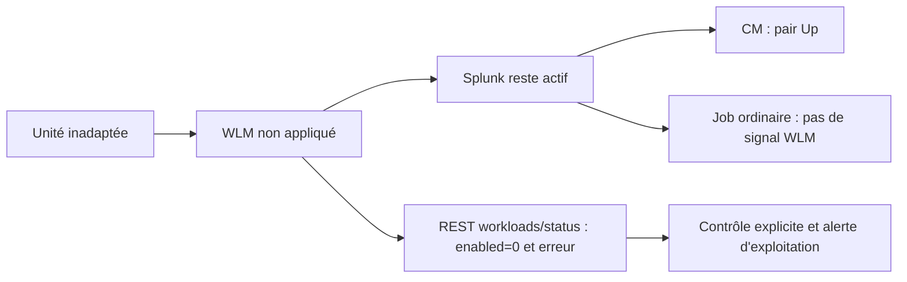

# 04. Exploiter une grappe mixte cgroups v1/v2

## Résultat acquis et limite de support

**Observé en Splunk Enterprise 10.4.5.** WLM Advanced fonctionne sur les pairs AlmaLinux 8.10 en cgroups v1 après génération de leur unité native. Placement, abort, emprunt CPU, partage intégré, OOM local, arrêt propre et retour ont été reçus dans leurs conditions d'essai.

Le fonctionnement observé n'est pas une certification de support du mélange RHEL 10 et AlmaLinux 8.10. Vérifiez séparément la matrice OS et les exigences de grappe du build cible. Aucun résultat de cette extension ne qualifie 10.2.

## Ne déduisez pas le mode de l'OS

1. Relevez le type de montage de `/sys/fs/cgroup`.
2. Relevez les montages des contrôleurs.
3. Relevez la version de systemd et le noyau.
4. Relevez le `ControlGroup` de l'unité active.
5. Vérifiez les contrôleurs réellement utilisés par le processus.

```bash
# Lecture seule : distinguer hiérarchie unifiée et contrôleurs séparés.
stat -fc %T /sys/fs/cgroup
findmnt -t cgroup,cgroup2
systemctl --version
uname -r
```

`cgroup2fs` indique la hiérarchie v2 au point contrôlé. `tmpfs` seul ne suffit pas à départager v1 et hybride. Confrontez les montages. Dans l'extension reçue, les contrôleurs CPU et mémoire sont effectivement en v1.

## Générez l'unité localement

L'unité v2 copiée vise `/sys/fs/cgroup/system.slice/%n`. Ce post-hook n'est pas adapté aux contrôleurs séparés du profil v1 reçu. Son échec peut laisser Splunk actif mais WLM désactivé.

La génération native 10.4.5 produit sur v1 les post-hooks des chemins CPU et mémoire séparés. Le [chapitre de configuration](./02-configurer-wlm.md) donne la commande et la réception. Conservez le plafond, les drop-ins utiles et le choix de démarrage au boot. Ne copiez pas un GUID ni une identité d'instance depuis un pair témoin.

**Observé en 10.4.5.** La correction de l'unité a suffi ; le bundle de pools n'a pas changé. Ce défaut n'était donc pas une preuve d'incompatibilité de WLM avec v1.

## Utilisez les bons fichiers

Les chemins complets dépendent du montage et du `ControlGroup` effectifs. Les noms ci-dessous sont des repères de lecture, pas des chemins à fabriquer.

| Objet | cgroups v2 | cgroups v1 |
| --- | --- | --- |
| CPU cumulé | `cpu.stat`, champ `usage_usec` | `cpuacct.usage`, nanosecondes |
| Poids CPU | `cpu.weight` | `cpu.shares` |
| Limite RAM | `memory.max` | `memory.limit_in_bytes` |
| RAM courante | `memory.current` | `memory.usage_in_bytes` |
| Événements mémoire | `memory.events` et `memory.events.local` | `memory.failcnt` et `memory.oom_control` |
| Swap | `memory.swap.current`, `memory.swap.max` si présents | Compteurs `memory.memsw.*` si activés et exposés |
| Attachement du worker reçu | Pool et éventuelle feuille `_leaf` | Contrôleurs CPU et mémoire du pool, sans feuille v2 exigée |

Convertissez les compteurs CPU en secondes avant comparaison. Utilisez des intervalles monotones. Ne comparez pas directement les échelles `cpu.weight` et `cpu.shares` : la passe reçue lit 11 en v2 et 113 en v1 pour des pools configurés de même poids.

Un compteur absent est indisponible, pas nul. Un usage mémoire échantillonné après un kill peut être faible. Il ne réfute pas l'OOM trop rapide pour la sonde.

## Ce que la comparaison démontre

- M1 place le même job sur les pools attendus des deux modes, puis reçoit son abort.
- M2 observe presque deux vCPU en solo, puis un partage intégré proche de 1:1.
- M3 atteint les plafonds RAM avec pagination sur les deux modes lorsque le swap est actif.
- M3 reçoit un kill local de worker sur le seul pair v1 sans swap, démon principal intact.
- M4 reçoit l'arrêt et le retour avec WLM Advanced actif sur le pair v1.
- M6 retrouve les plafonds par niveau sur les cinq pairs.

Les [tableaux M1 à M6](./03-resultats-qualification.md) donnent les valeurs et les restrictions. Ils ne démontrent pas une égalité de seuil d'OOM à charge identique sur toutes les variantes. Les OS, noyaux, tailles de mémoire visible et versions de systemd diffèrent. Pendant la sous-phase sans swap v1, le témoin v2 garde le swap.

Les profils de charge ont aussi leurs limites. Une expansion mémoire a invalidé une passe CPU par OOM. `mvexpand` a tronqué les résultats de la passe mémoire. Ces faits n'effacent pas les observations de contrôle de ressources, mais interdisent une conclusion de performance ou de complétude métier.

## M5 : un pair sans WLM peut rester Up

**Défaut volontaire reçu en 10.4.5.** Après remise d'une unité v2 sur un pair v1 :

- `general.enabled=0` ;
- `general.isSupported=1` et mode Advanced ;
- message d'échec de création des catégories ;
- CM à cinq pairs Up, RF/SF satisfaits ;
- recherche ordinaire terminée sans message WLM de panne ;
- aucune entrée propre à cette panne dans `wlm_monitor` pendant la fenêtre.

L'unité v1 a ensuite été restaurée. WLM enabled=1 a été reçu de nouveau. Il ne faut pas reproduire ce défaut en exploitation pour tester une alerte.



**Recommandation.** Interrogez `workloads/status` sur chaque membre attendu. Alertez sur disabled, erreur ou membre manquant. Le statut de support et le libellé Advanced ne remplacent pas `enabled=1`.

## La MC n'invente pas les pairs manquants

Dans cette extension, la MC ne possède pas les deux nouveaux indexeurs dans son catalogue de pairs de recherche. Ses recherches REST et d'introspection ne les montrent donc pas. La même interrogation depuis un SH couvrant les cinq pairs expose le défaut.

1. Comparez les pairs de recherche de la MC aux pairs du CM.
2. Traitez chaque membre manquant avant d'interpréter un tableau global.
3. Vérifiez des données fraîches de chaque membre après enrôlement.
4. Séparez couverture, disponibilité, état WLM et activité mesurée.

L'absence de ligne d'un pair non enrôlé n'est pas une preuve d'incompatibilité cgroups. Une MC incomplète ne peut pas certifier WLM sain partout.

## Sources

- [Résultats mixtes M1 à M6 de cette édition](./03-resultats-qualification.md).
- Générateur natif et états WLM de Splunk Enterprise 10.4.5 sur les deux environnements qualifiés.
- [Contrôles REST, audit et noyau](./05-exploitation-et-audit.md).
- [Cgroups v2, documentation noyau](https://docs.kernel.org/admin-guide/cgroup-v2.html) et [contrôleur mémoire v1](https://docs.kernel.org/admin-guide/cgroup-v1/memory.html), pointeurs complémentaires non revérifiés par accès Web pour cette édition.
