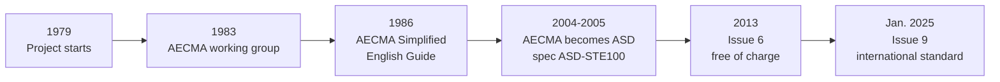
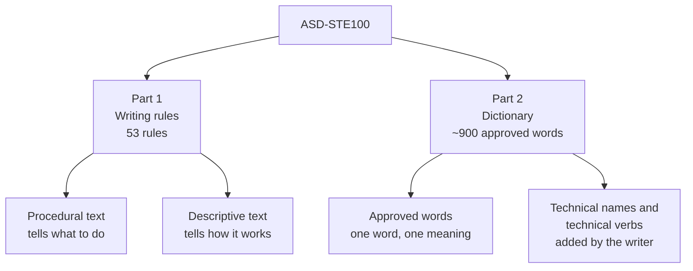

# ASD-STE100 — Simplified Technical English (STE)

> This page applies the STE writing rules at approximately 80 %. It obeys the
> rules for sentence length, paragraph length, noun clusters, active voice and
> one instruction for each sentence. It does not check each word against the
> STE dictionary.

ASD-STE100 is a standard for technical writing. It defines a controlled form of
English: Simplified Technical English (STE). STE limits the vocabulary and the
grammar. The result is a text that is clear, has only one interpretation and is
easy to translate. The first use was aircraft maintenance documentation. Since
2013, the standard is free.

## History and ownership

- **1979**: the project starts. All aircraft manufacturers write their
  maintenance manuals in English and follow the same specification (ATA 100).
  But their writing styles are very different.
- **1983**: AECMA (the European aerospace industry association) sets up a
  working group to write a controlled English.
- **1986**: the first version is released: the *AECMA Simplified English
  Guide*. The same year, the ATA 100 specification makes STE a requirement.
- **2004–2005**: AECMA merges with two other associations to form ASD. The
  guide becomes the specification ASD-STE100.
- **2013**: Issue 6 makes the standard free of charge.
- **January 2025**: Issue 9 makes STE an international standard. Its subtitle
  is *Standard for Technical Documentation*.

The STE Maintenance Group (STEMG) maintains the standard. ASD owns the
copyright and the trademark. A new issue comes out approximately every three
years.

## Why "100"?

No official source explains the number. The STEMG site, its FAQ and ASD do not
give a reason.

- The number is **not a count**. The standard has 53 rules and approximately
  900 approved words.
- It is a **document identifier**: publisher prefix (ASD), acronym (STE),
  number.
- A probable cause is the link with **ATA 100**, the airline specification that
  STE was made to support. This is a hypothesis, not a documented fact. To get a
  confirmed answer, write to the STEMG.

## Structure of the standard

The standard has two parts:

1. **Writing rules**: 53 rules for grammar and style.
2. **Dictionary**: approximately 900 approved words.

The rules make a difference between two types of text. A **procedural** text
tells the reader what to do. A **descriptive** text tells the reader how a thing
works.

## Main writing rules

| Rule | Limit | How to apply it |
|---|---|---|
| Sentence length (procedure) | 20 words maximum | One action in each sentence |
| Sentence length (description) | 25 words maximum | Cut long subordinate clauses |
| Paragraph length | 6 sentences maximum | One topic in each paragraph |
| Noun clusters | 3 words maximum | "disk threshold value", not "cluster disk alert threshold value" |
| Voice | Active | Passive only in descriptive text, when the agent is unknown |
| Instructions | One in each sentence | Start with the action verb |
| Complex text | Vertical list | Numbered steps, conditions as bullets |
| Vocabulary | Approved words only | One word = one meaning = one part of speech |

Example from the standard: *Before you install the cushion, install the seat.*
The order of the words follows the order of the actions.

## The dictionary

Each approved word has one meaning and one part of speech. For example, a word
that is approved as a noun is not used as a verb. For each word that is not
approved, the dictionary gives an approved alternative.

The writer can add two categories of words that are specific to the domain:

- **technical names** (components, tools, materials);
- **technical verbs** (operations that are specific to the job).

Use these added words in the same way in all the documentation.

## Who uses STE

- **Aerospace and defence**: the origin of the standard. ATA specifications
  require it since 1986 (ATA 100, now ATA iSpec 2200, and ATA 104 for
  training). S1000D also refers to it.
- **Other industries**: at the end of 2024, 64 % of the users were outside
  aerospace and defence. Examples: automotive, renewable energy, medical
  devices, pharmaceuticals, translation services and universities.

## Tools

Different checkers are available: BSEC (Boeing), HyperSTE (Etteplan), Congree,
TechScribe. The STEMG and ASD do not endorse or certify these tools. A checker
alone does not make a text compliant.

## Limits

- **Scope**: outside aerospace, most organisations prefer *plain language*.
- **Not a full style guide**: the standard itself says so ("Can STE be used
  alone? No.").
- **Difficulty**: studies show that STE is difficult to apply correctly.
- **Translation**: machine translation improves. The benefit of STE for
  localisation becomes smaller.
- **Language**: STE is defined for English only. There is no official version
  for other languages. The structure rules (length, voice, lists) transfer well.
  The dictionary does not.

## Use outside aerospace

STE is useful for any text that a person must follow without error:
runbooks, operation procedures, on-call instructions, prompts for LLM agents.

Before:

> It is recommended that a verification of the cluster status be performed
> prior to any restart of a node.

After:

> Before you restart a node, make sure that the cluster status is healthy.

Procedure, before:

> The service should be stopped, and once the configuration file has been
> backed up and edited, it can be started again.

Procedure, after:

1. Stop the service.
2. Make a backup copy of the configuration file.
3. Edit the configuration file.
4. Start the service.

## Key points

- ASD-STE100 is a **controlled English** for technical documentation, owned by
  ASD and maintained by the STEMG.
- **Two parts**: 53 writing rules and a dictionary of approximately 900 words.
- **Main limits**: 20 words for each procedural sentence, 25 for each
  descriptive sentence, 6 sentences for each paragraph, 3 words for each noun
  cluster.
- **One word, one meaning**; active voice; one instruction for each sentence.
- The **structure rules transfer** to other domains and languages. The
  dictionary is the part that is specific to English and to the industry.
- The "100" has **no official explanation**; the ATA 100 link is a hypothesis.

## Sources

- [ASD-STE100 — official site (STEMG)](https://www.asd-ste100.org/)
- [About ASD-STE100](https://asd-ste100.org/about_STE.html)
- [ASD-STE100 — Frequently Asked Questions](https://www.asd-ste100.org/STE_faq.html)
- [ASD-STE100 Issue 9 (PDF)](https://www.asd-ste100.org/assets/files/ASD-STE100_ISSUE9.pdf)
- [ASD — Simplified Technical English](https://asd-europe.org/standards-specifications/simplified-technical-english)
- [Simplified Technical English — Wikipedia](https://en.wikipedia.org/wiki/Simplified_Technical_English)
