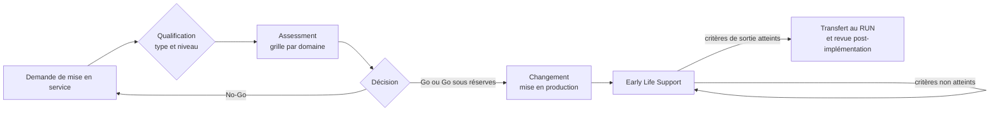

# Assessment d'entrée en service d'une solution Splunk

Grille d'évaluation à dérouler **avant** qu'une solution Splunk soit prise en charge
en production par l'équipe d'exploitation (RUN) : infrastructure de collecte, add-on
de données, app de contenu, app développée avec du code, intégration avec un système
tiers. Elle transpose les **critères d'acceptation de service** d'ITIL aux bonnes
pratiques Splunk et produit une décision tracée : **Go**, **Go sous réserves** ou
**No-Go**.

La grille ne remplace pas le changement (la mise en production reste un changement
au sens de [Change Enablement](./itil-gouvernance-changement.md)) : elle le
**précède** et décide si la solution est exploitable. Les rôles (PLT, DAT, SEC, PO)
et les identifiants d'activités (`G1`, `I1`…) sont ceux du
[handbook d'exploitation Splunk](../handbooks/splunk-exploitation-handbook/README.md).

## Ancrage ITIL

| Notion ITIL | Rôle dans l'assessment |
| --- | --- |
| **Service Acceptance Criteria** (SAC, ITIL v3 *Service Transition*) | La grille elle-même : conditions qu'un service remplit avant d'être accepté en exploitation |
| **Service Validation and Testing** (ITIL 4) | Les preuves : tests en pré-production, mesures, jeux d'événements |
| **Release / Deployment Management** (ITIL 4) | Le domaine DEP : artefact versionné, cible de déploiement, retour arrière |
| **Change Enablement** (ITIL 4) | La mise en production qui suit un Go ; le niveau d'assessment suit le type de changement |
| **Service Level Management** (ITIL 4) | Le niveau de service attendu (GOV-3) : sans lui, rien ne permet de dire si le RUN tient |
| **Knowledge Management**, **Problem Management** | Le dossier d'exploitation, le runbook, les erreurs connues (domaine SUP) |
| **Early Life Support** (ELS, ITIL v3 *Service Transition*) | La période d'hypercare après mise en production, avec des critères de sortie |

Principe directeur : **l'équipe RUN n'accepte que ce qu'elle sait superviser,
diagnostiquer, redéployer et restaurer sans le porteur.** Chaque critère de la grille
découle de cette phrase.



## Rôles

Le **porteur** est l'équipe qui livre la solution (projet, développeur, équipe
données, intégrateur). Les autres rôles sont ceux du handbook d'exploitation.

| Activité | Porteur | PLT | DAT | SEC | PO |
| --- | :-: | :-: | :-: | :-: | :-: |
| Constituer le dossier et les preuves | R | C | C | C | I |
| Évaluer CAP, DEP, CONT | C | R/A | C | I | I |
| Évaluer DON, PERF, PKG, OBS, SUP | C | C | R/A | I | I |
| Évaluer SEC | C | C | C | R/A | I |
| Décider Go / Go sous réserves / No-Go | I | C | C | C | A |
| Accorder une dérogation | I | C | C | C | A |
| Lever les réserves | R | C | C | C | A |
| Conduire l'Early Life Support | R | R | R | I | A |

Le porteur ne s'évalue pas lui-même, sauf au niveau **Léger** où il remplit la grille
et DAT la relit.

## Qualifier la solution

### Type

Une solution combine souvent plusieurs types (un add-on livré avec son serveur de
collecte, une app de contenu qui embarque une commande custom) : on applique
l'**union** des critères.

| Code | Type | Exemples | Risque dominant |
| --- | --- | --- | --- |
| **COL** | Infrastructure de collecte | Forwarders, heavy forwarder, serveur syslog, collecteur HEC, classes de serveurs du deployment server | Perte ou doublon de données, saturation, transport non sécurisé |
| **TA** | Add-on de données | Inputs, `props.conf`/`transforms.conf`, mise en conformité CIM | Parsing index-time irréversible, coût de présence des objets exportés |
| **APP** | App de contenu | Tableaux de bord, recherches planifiées, alertes, macros, lookups | Charge du scheduler, prolifération, coût des recherches |
| **DEV** | App avec code | Modular input, commande custom, handler REST, alert action, JavaScript custom | Sécurité du code, stabilité de splunkd, secrets |
| **INT** | Intégration | Export vers un outil de ticketing ou de SOAR, collecte par API tierce, API Splunk consommée par un tiers | Comptes de service, dépendance externe, flux réseau |

### Niveau d'assessment

Le niveau dose l'effort, comme le type de changement dose la cérémonie.

| Niveau | Quand | Change associé | Exigence |
| --- | --- | --- | --- |
| **Léger** | Contenu sans code (APP) ajouté à une app déjà en service, sans nouvelle donnée ni nouveau rôle | Standard | Critères bloquants de GOV, PERF, DEP ; auto-évaluation du porteur relue par DAT |
| **Standard** | Nouvelle source (COL, TA) ou nouvelle app sans code | Normal | Tous les domaines applicables, bloquants et réserves ; revue PLT et DAT |
| **Complet** | Code exécuté par splunkd (DEV), intégration (INT), données sensibles, criticité haute ou nouveau composant d'infrastructure | Normal, passage en CAB | Tout le niveau Standard, plus : preuves mesurées en pré-production, revue de code, retour arrière testé, ELS formel ; revue PLT, DAT et SEC |

## La grille

Chaque critère porte un identifiant, les types auxquels il s'applique, sa gravité
et la preuve attendue :

- **B**, bloquant : non satisfait, la décision est No-Go (sauf dérogation, voir plus
  bas).
- **R**, réserve : non satisfait, la décision peut être Go sous réserves, avec un
  propriétaire et une échéance.

Une preuve est un artefact vérifiable (fichier versionné, résultat de recherche,
compte rendu de test), pas une déclaration.

### GOV : gouvernance et propriété

| ID | Critère | S'applique à | Gravité | Preuve |
| --- | --- | --- | :-: | --- |
| GOV-1 | Un propriétaire de service nommé (un seul redevable) et un responsable technique | Tous | B | Fiche de service |
| GOV-2 | Besoin décrit : question métier ou sécurité traitée, consommateurs de la donnée ou du contenu | Tous | R | Dossier de la demande |
| GOV-3 | Niveau de service exprimé : criticité, plages de support, latence de donnée acceptable, délai de rétablissement | Tous (Standard et plus) | B | SLA ou OLA |
| GOV-4 | Solution enregistrée comme CI, avec ses relations (`dépend de`, `hébergé sur`, `utilise`) | Tous | R | Entrée CMDB, cf. [modèle de documentation](./itil-modele-documentation.md) |
| GOV-5 | Origine et support identifiés pour tout composant tiers : éditeur, niveau de support Splunkbase, version | TA, DEV, INT | R | Référence et version |
| GOV-6 | Fin de vie prévue : condition de retrait, et liste de ce qu'il faudra décommissionner (index, inputs, objets, comptes) | Tous | R | Dossier |

### CAP : capacité et architecture

| ID | Critère | S'applique à | Gravité | Preuve |
| --- | --- | --- | :-: | --- |
| CAP-1 | Volume par jour et pic estimés par source, rapportés au quota de licence | COL, TA | B | [Contrat I1](../handbooks/splunk-exploitation-handbook/04-interfaces-et-rituels.md#contrat-i1--demande-de-source-usages--socle), mesure en pré-production |
| CAP-2 | Index cible dédié au périmètre, jamais `main` ; rétention validée contre les exigences de conformité | COL, TA | B | Demande `G1`/`G2` |
| CAP-3 | Stockage dimensionné : volume × rétention × compression × facteurs de réplication. Ordre de grandeur documenté : rawdata à environ 15 % du brut (× RF), fichiers d'index à environ 35 % (× SF) | COL, TA | B | Calcul |
| CAP-4 | Chaîne de collecte alignée sur une architecture de référence (SVA) ; tout point unique de défaillance est nommé et accepté | COL | R | Schéma |
| CAP-5 | Charge de recherche estimée : nombre de recherches planifiées, fréquence, concurrence, accélérations demandées et leur budget (`G5`) | APP, TA, DEV | B | Inventaire |
| CAP-6 | Collecteurs dimensionnés pour le parsing qu'ils portent (CPU, pipelines, files) | COL | R | Mesure ou abaque |

### DON : données et qualité

| ID | Critère | S'applique à | Gravité | Preuve |
| --- | --- | --- | :-: | --- |
| DON-1 | Sourcetype explicite, nommé `<éditeur>:<produit>:<format>`, jamais attribué automatiquement | COL, TA | B | `inputs.conf` |
| DON-2 | Les huit réglages index-time (*Great Eight*) posés pour chaque sourcetype : `SHOULD_LINEMERGE`, `LINE_BREAKER`, `TRUNCATE`, `TIME_PREFIX`, `MAX_TIMESTAMP_LOOKAHEAD`, `TIME_FORMAT`, `EVENT_BREAKER_ENABLE`, `EVENT_BREAKER` | TA | B | `props.conf`, vue `btool` |
| DON-3 | Horodatage juste : fuseau explicite, écart `_indextime - _time` mesuré, aucun événement dans le futur | COL, TA | B | Recherche P2 ci-dessous |
| DON-4 | Aucun avertissement de parsing (date, découpage, troncature) sur l'échantillon de pré-production | TA | B | Recherche P3 |
| DON-5 | Conformité CIM des champs, tags et eventtypes quand un data model est consommé (Enterprise Security, corrélations) | TA | B si consommé, R sinon | Recherche sur le data model |
| DON-6 | Métadonnée `host` égale à l'émetteur réel, pas au collecteur intermédiaire | COL | R | Échantillon |
| DON-7 | Échantillon d'événements anonymisé, versionné avec l'add-on, rejouable en test | TA | R (B en Complet) | Dépôt |
| DON-8 | Ni doublon ni troncature : relecture de fichiers, accusés de réception rejoués, `TRUNCATE` atteint | COL, TA | B | Recherches P1 et P3 |

Le timestamp, le découpage et le masquage se figent à l'indexation : une erreur DON-2,
DON-3 ou SEC-5 découverte en production coûte une purge et une réindexation, pas un
correctif. C'est pourquoi ces critères sont bloquants. Voir
[`_time` et `_indextime`](../cheat-sheets/spl/time-vs-indextime.md),
[le temps dans les logs](../concepts/temps-dans-les-logs.md) et
[les pièges de parsing](../concepts/formats-logs-et-pieges-parsing.md).

### PKG : packaging et code

| ID | Critère | S'applique à | Gravité | Preuve |
| --- | --- | --- | :-: | --- |
| PKG-1 | AppInspect sans échec ni erreur ; chaque avertissement analysé | TA, APP, DEV | B (DEV), R (TA, APP) | Rapport AppInspect |
| PKG-2 | Paquet propre : ni `local/`, ni `metadata/local.meta`, ni lookup de production, ni `.git`, ni fichier temporaire | TA, APP, DEV | B | Contenu de l'archive |
| PKG-3 | `app.conf` renseigné : identifiant, version, libellé ; la version correspond au tag Git | TA, APP, DEV | B | `app.conf` |
| PKG-4 | Aucun secret en clair dans la configuration ou le code ; secrets stockés par `storage/passwords` | COL, DEV, INT | B | Revue, recherche de motifs |
| PKG-5 | Dépendances embarquées dans l'app, sans installation sur le système ni écriture dans une autre app | DEV | B | Arborescence |
| PKG-6 | Versions de Splunk et de Python cibles déclarées et testées | DEV | B | Compte rendu de test |
| PKG-7 | Objets préfixés au nom de l'app (macros, recherches, lookups), pour éviter les collisions | TA, APP, DEV | R | Inventaire |
| PKG-8 | Partage `default.meta` minimal : export `system` réservé à ce qui doit l'être | TA, APP | R | `default.meta`, cf. [coût de présence des add-ons](../concepts/splunk-cout-presence-addons-parsing.md) |
| PKG-9 | Aucun effet global : pas de stanza `[default]` ou `[source::...]` large dans `props.conf`, pas de surcharge de `limits.conf` ou `server.conf` dans une app | Tous | B | Vue `btool` |
| PKG-10 | Revue de code par un pair extérieur au porteur : erreurs gérées, délais réseau bornés, pas d'appel shell construit sur une entrée, journalisation par logger | DEV, INT | B | Compte rendu de revue |

### PERF : performance et sobriété

| ID | Critère | S'applique à | Gravité | Preuve |
| --- | --- | --- | :-: | --- |
| PERF-1 | Aucune recherche planifiée ni tableau de bord en temps réel par défaut | APP | B | `savedsearches.conf`, tableaux de bord |
| PERF-2 | Recherches planifiées bornées (`dispatch.earliest_time`, `dispatch.latest_time`), horaires cron étalés, `schedule_window` pour les recherches non critiques | APP | B | `savedsearches.conf` |
| PERF-3 | Recherches ciblées : index et sourcetype explicites, ni `index=*` ni période « All time » | APP | B | Revue SPL |
| PERF-4 | `tstats` et data models accélérés sur les gros volumes, dans le budget d'accélération validé par PLT | APP | R | Inventaire |
| PERF-5 | Tableaux de bord sobres : recherche de base et post-traitement plutôt que N recherches proches, rafraîchissement automatique justifié | APP | R | Code des tableaux de bord |
| PERF-6 | Lookups et collections KV store dimensionnés : taille, croissance, poids dans le knowledge bundle | APP, TA | R | Taille mesurée, cf. [handbook knowledge bundle](../handbooks/splunk-shc-knowledge-bundle/README.md) |
| PERF-7 | Mesures en pré-production : durée de chaque recherche planifiée, aucune recherche sautée attribuable | APP, DEV | B (Complet) | Recherche P4 |

Méthode de mesure d'une recherche :
[Search Performance Handbook](../handbooks/splunk-search-performance-handbook/README.md).

### SEC : sécurité et conformité

| ID | Critère | S'applique à | Gravité | Preuve |
| --- | --- | --- | :-: | --- |
| SEC-1 | Rôles dédiés au moindre privilège, accès aux index par rôle, aucune capability d'administration pour un usage | Tous | B | `authorize.conf`, cf. [RBAC](../cheat-sheets/splunk-rbac.md) |
| SEC-2 | Recherches planifiées possédées par un compte de service, pas par un compte nominatif | APP, DEV, INT | B | Propriétaires, cf. [comptes de service](../concepts/splunk-comptes-de-service-par-fichiers.md) |
| SEC-3 | Transport chiffré : TLS entre forwarders et indexeurs, HEC en HTTPS, certificats vérifiés | COL, INT | B | `outputs.conf`, `inputs.conf` |
| SEC-4 | Tokens HEC restreints à leurs index, un token par émetteur, rotation prévue | COL | B | `inputs.conf` |
| SEC-5 | Données sensibles classées ; masquage index-time validé **avant** la première indexation | COL, TA | B | Test de masquage |
| SEC-6 | Code tiers (Splunkbase, dépôt public) revu avant installation ; provenance et version figées | TA, DEV | B | Compte rendu, cf. [revue de code tiers](../skills/revue-code-malveillant.md) |
| SEC-7 | Flux réseau déclarés (ports, sens, protocole) et ouverts par l'équipe réseau | COL, INT | B | Demande d'ouverture |
| SEC-8 | Conformité : rétention légale, données personnelles, droit d'accès | Tous | R | Avis SEC |

### DEP : déploiement et changement

| ID | Critère | S'applique à | Gravité | Preuve |
| --- | --- | --- | :-: | --- |
| DEP-1 | Source versionnée dans Git ; chaque livraison est un tag | Tous | B | Dépôt |
| DEP-2 | Cible de déploiement conforme au tier : deployment server pour les forwarders, deployer pour le SHC, cluster manager pour les indexeurs ; jamais d'édition directe sur une instance | Tous | B | Pipeline, cf. [Deployment Server](../concepts/splunk-deployment-server.md) |
| DEP-3 | Validation statique automatisée en pipeline (`btool check`, AppInspect) | Tous | R | Journal du pipeline, cf. [patrons CI/CD](../concepts/cicd-deployment-patterns.md) |
| DEP-4 | Besoin de redémarrage connu et déclaré (rolling restart ou rechargement) ; `[triggers]` posés quand c'est possible | TA, APP, DEV | B | `app.conf`, cf. [déclencheurs de rolling restart](../concepts/splunk-rolling-restart-triggers.md) |
| DEP-5 | Déploiement éprouvé en pré-production représentative : même version de Splunk, même topologie | Tous (Standard et plus) | B | Compte rendu |
| DEP-6 | Retour arrière écrit, et testé au niveau Complet ; effets irréversibles listés (données indexées, KV store modifié, index-time) | Tous | B | Plan de retour arrière |
| DEP-7 | Notes de version : contenu, impacts, prérequis | Tous | R | Fichier versionné |
| DEP-8 | Fenêtre de déploiement compatible avec le calendrier des changements et les gels | Tous | B | Change record |

### OBS : supervision

| ID | Critère | S'applique à | Gravité | Preuve |
| --- | --- | --- | :-: | --- |
| OBS-1 | Complétude de chaque source supervisée : dernière réception, volume comparé à l'attendu | COL, TA | B | Entité de supervision, cf. [TrackMe](../cheat-sheets/splunk-trackme.md) |
| OBS-2 | Latence d'indexation supervisée par source | COL | R | Alerte |
| OBS-3 | Erreurs du code journalisées dans `_internal` ou un index dédié, avec un niveau, exploitables en SPL | DEV, INT | B | Recherche P5 |
| OBS-4 | Chaque alerte de santé a un destinataire et une procédure ; une alerte sans runbook n'est pas acceptée | Tous | B | Runbook |
| OBS-5 | Collecteurs supervisés au niveau hôte : disque, files, service | COL | B | Supervision système |
| OBS-6 | Tableau de bord de santé du service | Tous (Standard et plus) | R | Tableau de bord |

### SUP : exploitabilité et support

| ID | Critère | S'applique à | Gravité | Preuve |
| --- | --- | --- | :-: | --- |
| SUP-1 | Dossier d'exploitation : schéma d'architecture, flux, composants, dépendances, configuration de référence | Tous | B | Document versionné |
| SUP-2 | Runbook : contrôles de santé, arrêt et relance, erreurs connues avec contournement | Tous (Standard et plus) | B | Document versionné |
| SUP-3 | Chemin d'escalade : niveau 1, RUN, porteur ou éditeur ; plages horaires ; contacts par fonction | Tous | B | Fiche de service |
| SUP-4 | Transfert de connaissance fait, et runbook relu par l'équipe RUN | Tous (Standard et plus) | B | Compte rendu |
| SUP-5 | Demandes courantes (nouvel utilisateur, nouvelle source sur le même add-on) décrites comme changements standards | Tous | R | Catalogue |
| SUP-6 | Documentation d'usage et canal de support publiés pour les utilisateurs | APP | R | Lien |

### CONT : continuité

| ID | Critère | S'applique à | Gravité | Preuve |
| --- | --- | --- | :-: | --- |
| CONT-1 | Comportement connu si les indexeurs sont indisponibles : `useACK`, files persistantes sur les inputs réseau, durée de tamponnage couverte | COL | B | Configuration et test |
| CONT-2 | Répartition et bascule : `autoLB` sur plusieurs indexeurs, collecteurs syslog ou HEC redondés | COL | R (B si criticité haute) | `outputs.conf`, schéma |
| CONT-3 | Configuration reconstructible depuis Git ; état non versionné sauvegardé (KV store, lookups écrits par l'app, checkpoints) | APP, DEV, INT | B | Procédure de sauvegarde |
| CONT-4 | Reprise après interruption sans perte ni doublon (checkpoint du modular input) | COL, DEV, INT | B | Test d'interruption |
| CONT-5 | Indisponibilité d'une API tierce gérée : quotas, nouvelles tentatives bornées, alerte | INT | R | Test |

## Preuves mesurables

Formes de recherches pour produire les preuves en pré-production, puis pendant
l'Early Life Support. Valeurs entre chevrons à remplacer.

**P1, volume réel par jour et par sourcetype** (CAP-1, DON-8) :

```spl
index=_internal source=*license_usage.log* type=Usage idx=<index>
| eval GB=b/1024/1024/1024
| timechart span=1d sum(GB) AS GB by st
```

**P2, écart d'indexation** (DON-3, OBS-2). Un écart négatif signale un fuseau faux :

```spl
index=<index> sourcetype=<sourcetype> earliest=-24h
| eval lag=_indextime-_time
| stats count perc50(lag) AS p50 perc95(lag) AS p95 min(lag) AS min max(lag) AS max by host
```

**P3, avertissements de parsing** (DON-4, DON-8) :

```spl
index=_internal sourcetype=splunkd log_level=WARN
    component IN (DateParserVerbose, LineBreakingProcessor, AggregatorMiningProcessor)
| stats count by component, data_sourcetype
```

**P4, coût et recherches sautées de l'app** (PERF-7) :

```spl
index=_internal sourcetype=scheduler app=<app>
| stats count(eval(status="success")) AS ok
        count(eval(status="skipped")) AS skipped
        avg(run_time) AS avg_run_time max(run_time) AS max_run_time
        by savedsearch_name
```

**P5, erreurs du code** (OBS-3) :

```spl
index=_internal sourcetype=splunkd component=ExecProcessor log_level IN (WARN, ERROR) "<app>"
| stats count by log_level, message
```

Validation statique, à placer dans le pipeline (DEP-3, PKG-1) :

```bash
splunk btool check --debug
splunk-appinspect inspect <app>.tgz --mode precert
```

## Décider

| Décision | Condition | Suite |
| --- | --- | --- |
| **Go** | Tous les critères bloquants applicables satisfaits, aucune réserve ouverte | Change de mise en production |
| **Go sous réserves** | Tous les bloquants satisfaits ; chaque réserve a un propriétaire et une échéance antérieure à la fin de l'ELS | Change, puis suivi des réserves |
| **No-Go** | Au moins un bloquant non satisfait | Retour au porteur avec la liste des critères et des preuves manquantes |

**Dérogation.** Un critère bloquant peut être levé par le PO (A), après avis de PLT et
DAT, et avis conforme de SEC pour un critère du domaine SEC. Elle est écrite (risque
accepté, mesure compensatoire, date d'expiration) et revue à son échéance. Trois
critères ne se dérogent pas, parce que leur défaut est irréversible ou expose la
plateforme : **SEC-5** (données sensibles indexées en clair), **PKG-4** (secret en
clair) et **DEP-6** (pas de retour arrière).

## Early Life Support

Après la mise en production, le porteur reste au troisième niveau de support le temps
de l'ELS ; le RUN opère en premier niveau et apprend.

| Niveau | Durée indicative |
| --- | --- |
| Léger | Aucune |
| Standard | Deux semaines |
| Complet | Un cycle métier complet (au moins un mois, ou une clôture, un batch mensuel…) |

Critères de sortie, tous requis :

- aucun incident P1 ou P2 attribuable à la solution sur la période ;
- volume réel dans la marge annoncée au CAP-1 (P1) ;
- écart d'indexation conforme au niveau de service (P2) ;
- aucune recherche sautée attribuable à l'app (P4) ;
- réserves levées ;
- runbook complété des incidents rencontrés pendant l'ELS.

La sortie d'ELS vaut transfert au RUN et déclenche la revue post-implémentation
([PIR](./itil-gouvernance-changement.md#après-le-changement--pir)).

## Modèle de compte rendu

```markdown
# Assessment : <solution> <version>

- Types : <COL | TA | APP | DEV | INT>
- Niveau : <Léger | Standard | Complet>
- Porteur : <équipe> | Propriétaire de service : <rôle>
- Évaluateurs : PLT <nom> | DAT <nom> | SEC <nom>
- Date : <AAAA-MM-JJ>

## Résultat par domaine

| Domaine | Bloquants KO | Réserves ouvertes | Commentaire |
| --- | --- | --- | --- |
| GOV | | | |
| CAP | | | |
| DON | | | |
| PKG | | | |
| PERF | | | |
| SEC | | | |
| DEP | | | |
| OBS | | | |
| SUP | | | |
| CONT | | | |

## Réserves

| ID | Critère | Propriétaire | Échéance |
| --- | --- | --- | --- |

## Dérogations

| ID | Risque accepté | Mesure compensatoire | Expiration | Avis SEC |
| --- | --- | --- | --- | --- |

## Décision

<Go | Go sous réserves | No-Go> - décidé par <PO>, le <date>.
ELS : <durée>, sortie prévue le <date>.
```

## Pièges

| Piège | Effet | Parade |
| --- | --- | --- |
| Grille remplie après la mise en production | L'assessment devient une formalité, les défauts index-time sont déjà figés | Pas de change de mise en production sans compte rendu d'assessment joint |
| Go sous réserves sans échéance | Réserves perpétuelles, dette d'exploitation | Échéance antérieure à la fin de l'ELS ; réserve échue = incident de gouvernance |
| Assessment purement technique | Personne n'est propriétaire du service, personne ne tranche | GOV-1 et GOV-3 bloquants |
| Porteur juge et partie | Biais de confirmation | Évaluation par PLT, DAT, SEC dès le niveau Standard |
| Même niveau pour tout | Bureaucratie sur le contenu, laxisme sur le code | Qualifier le niveau avant d'ouvrir la grille |
| Pré-production non représentative | Le Go repose sur des preuves qui ne disent rien de la production | DEP-5 : même version, même topologie |

## À retenir

- L'équipe RUN n'accepte que ce qu'elle sait **superviser, diagnostiquer, redéployer
  et restaurer** sans le porteur.
- Qualifier d'abord (**type**, **niveau**), évaluer ensuite : l'effort suit le risque.
- Les critères index-time (horodatage, découpage, masquage) sont bloquants parce
  qu'ils sont **irréversibles**.
- Une preuve est un artefact vérifiable, pas une déclaration.
- La décision a un **seul** redevable (PO), les dérogations sont écrites et datées,
  et l'**Early Life Support** a des critères de sortie mesurés.

## Sources

- [ITIL 4 (AXELOS)](https://www.axelos.com/certifications/itil-service-management) : pratiques Service Validation and Testing, Release Management, Deployment Management, Change Enablement, Service Level Management ; SAC et ELS hérités d'ITIL v3 *Service Transition*
- [Splunk Lantern, Following data onboarding best practices (Splunk Success Framework)](https://lantern.splunk.com/Splunk_Success_Framework/Increase_Efficiencies/Enhancing_data_management_and_governance/Following_data_onboarding_best_practices)
- [Splunk Lantern, Configuring new source types (Great Eight)](https://lantern.splunk.com/Platform_Data_Management/Optimize_Data/Configuring_new_source_types)
- [Splunk Dev, AppInspect](https://dev.splunk.com/enterprise/reference/appinspect) et [AppInspect CLI](https://dev.splunk.com/enterprise/docs/developapps/testvalidate/appinspect/useappinspectclitool)
- [Splunk Dev, vetting des apps pour Splunk Cloud Platform](https://dev.splunk.com/enterprise/docs/releaseapps/cloudvetting) : exigences reprises comme référence de qualité même en Enterprise
- [Splunk Docs, Capacity Planning Manual 9.x](https://help.splunk.com/en/splunk-enterprise/administer/capacity-planning) (CAP-3)
- [Splunk Docs, Getting Data In 9.x](https://help.splunk.com/en/splunk-enterprise/administer/get-data-in) (DON, CONT-1)
- [Splunk Docs, Securing Splunk Enterprise 9.x](https://help.splunk.com/en/splunk-enterprise/administer/secure-splunk-enterprise) (SEC)
- [Splunk Validated Architectures](https://www.splunk.com/en_us/pdfs/tech-brief/splunk-validated-architectures.pdf) (CAP-4)
- Références internes : [handbook d'exploitation Splunk](../handbooks/splunk-exploitation-handbook/README.md), [gouvernance du changement ITIL](./itil-gouvernance-changement.md), [modèle de documentation ITIL](./itil-modele-documentation.md)
